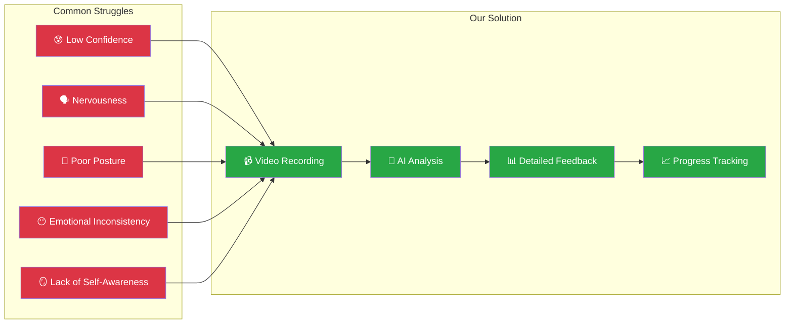
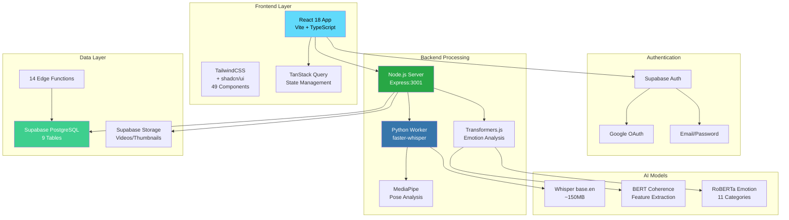
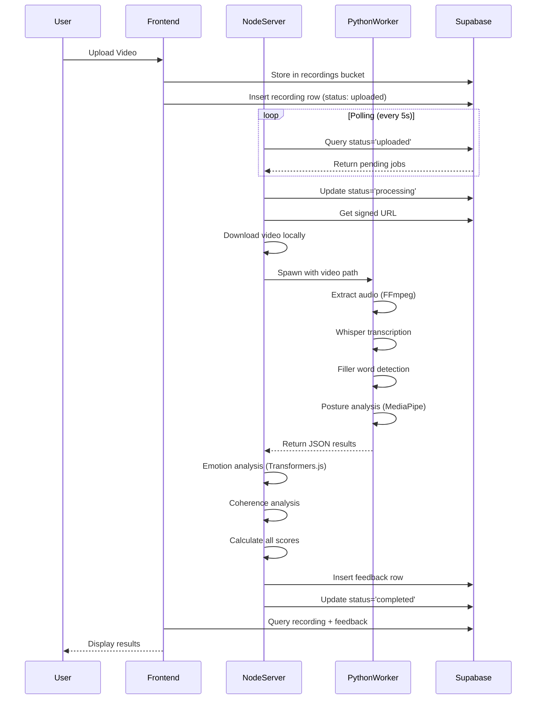
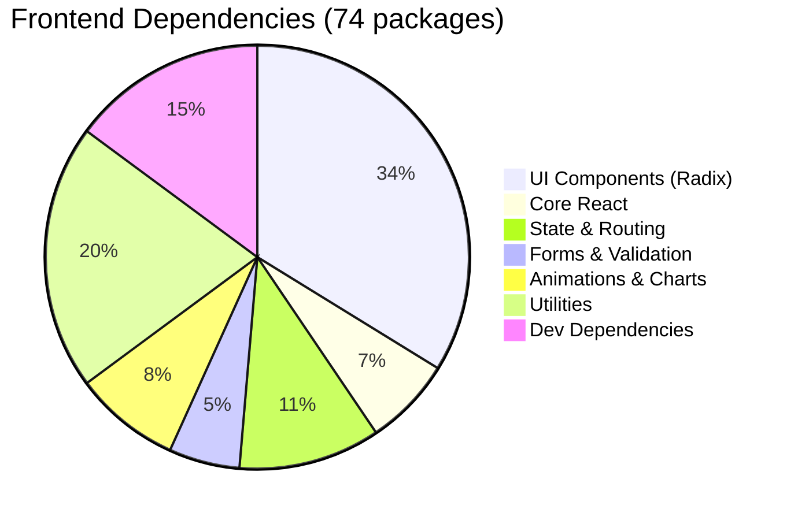
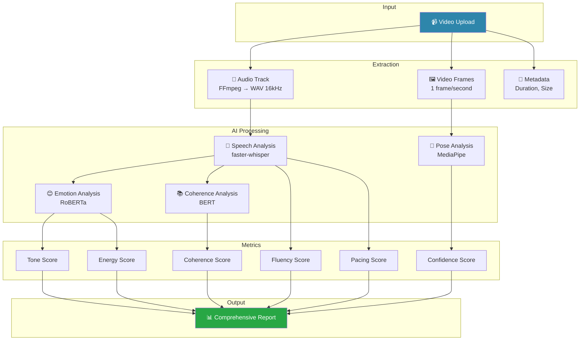
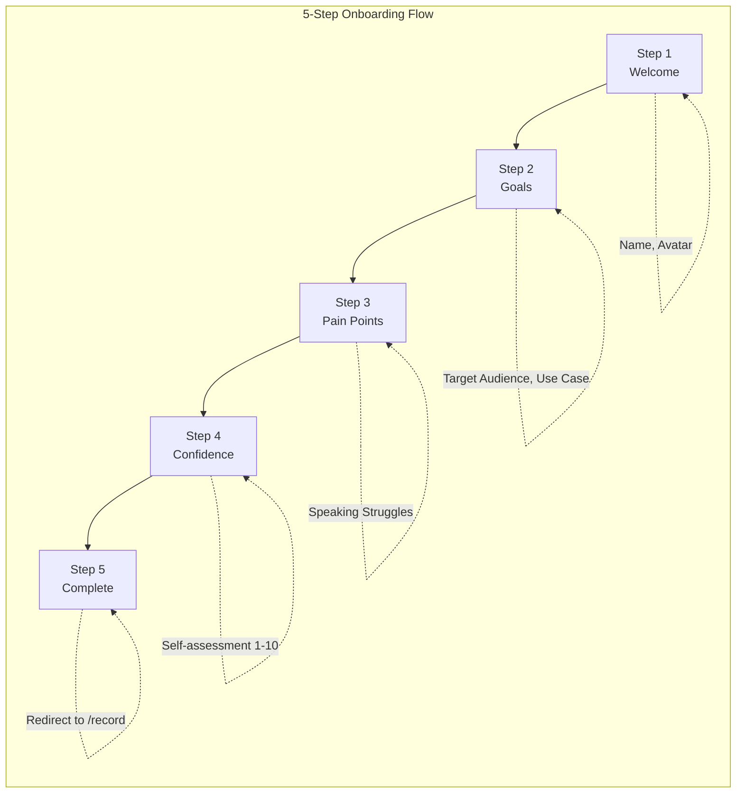
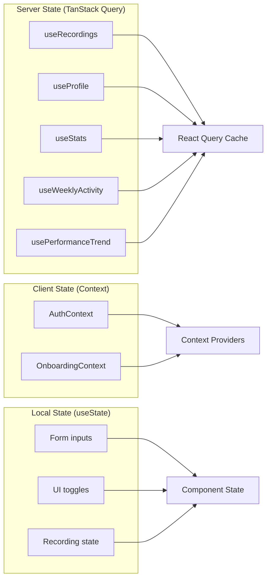
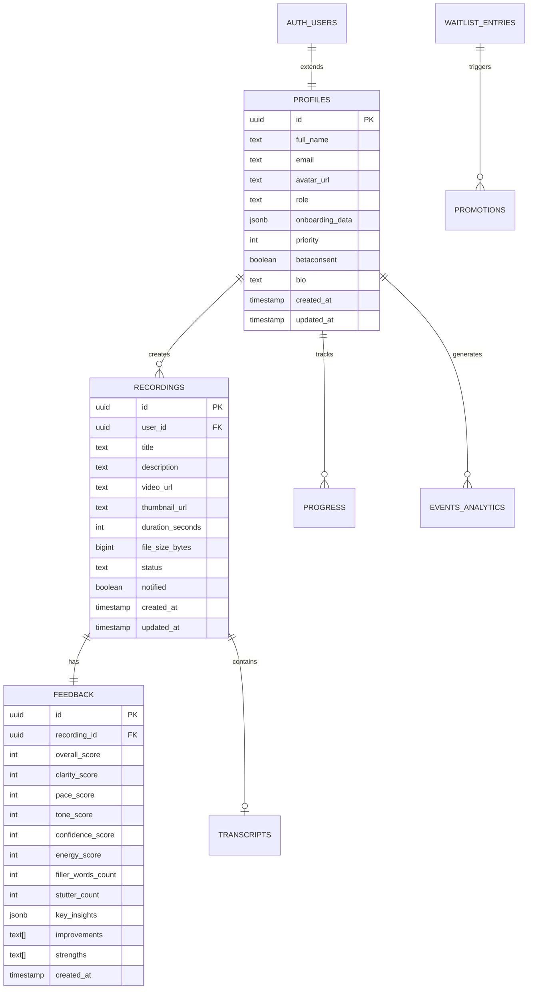
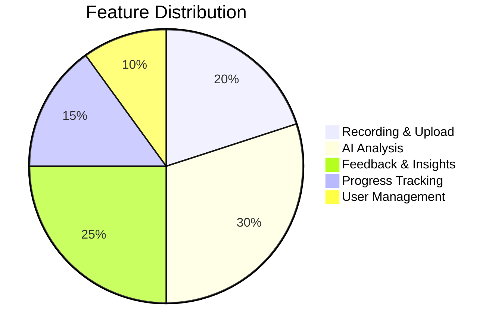
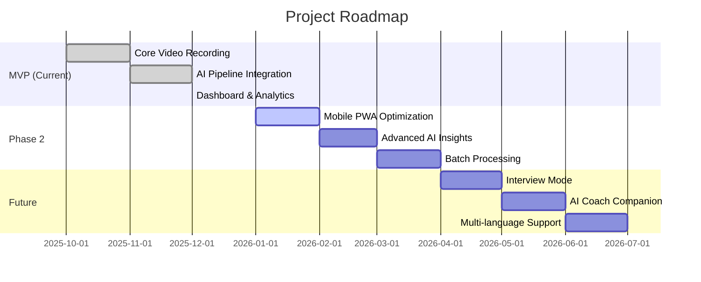

# 🚀 The Future You — Reflections MVP

## AI-Powered Communication & Self-Growth Platform

**Project Classification**: Zero-Cost Local AI Communication Coaching System\
**Version**: MVP 0.1.0\
**Last Updated**: December 15, 2025\
**Author**: Yash Magar

---

## Executive Summary

**The Future You** is a daily video-reflection and communication coaching
platform designed to help users build confidence, improve speaking skills, and
understand their emotional presence — all using **fully offline, zero-cost AI
models**.

### Project Health Scorecard

```
┌─────────────────────────────────────────────────────────────────────┐
│                      PROJECT SCORECARD                              │
├─────────────────────────────────────────────────────────────────────┤
│  Overall Technical Health:           ████████░░░░  75/100          │
│  Code Quality:                       ███████░░░░░  70/100          │
│  Security Posture:                   ██████░░░░░░  65/100          │
│  Performance:                        ████████░░░░  72/100          │
│  Frontend Design:                    █████████░░░  85/100          │
│  Documentation:                      ████████░░░░  78/100          │
│  AI Pipeline:                        █████████░░░  88/100          │
└─────────────────────────────────────────────────────────────────────┘
```

| Category           | Status              | Description                       |
| ------------------ | ------------------- | --------------------------------- |
| **Frontend**       | ✅ Production-Ready | React 18 + Vite + TypeScript      |
| **Backend**        | ✅ MVP Functional   | Node.js + Python hybrid processor |
| **Database**       | ✅ Well-Configured  | Supabase PostgreSQL with RLS      |
| **AI Engine**      | ✅ Innovative       | faster-whisper + Transformers.js  |
| **Authentication** | ✅ Secure           | Supabase Auth (Email + Google)    |
| **Deployment**     | ✅ Hybrid           | Vercel + Local Processor          |

> [!NOTE]
> **Zero-Cost AI**: This platform processes all video analysis locally using
> open-source models, resulting in **₹0 monthly AI costs** while maintaining
> full privacy.

---

## Table of Contents

1. [Introduction & Mission](#1-introduction--mission)
2. [System Architecture](#2-system-architecture)
3. [Tech Stack Deep Dive](#3-tech-stack-deep-dive)
4. [AI Analysis Pipeline](#4-ai-analysis-pipeline)
5. [Frontend Implementation](#5-frontend-implementation)
6. [Backend Implementation](#6-backend-implementation)
7. [Database Architecture](#7-database-architecture)
8. [Features Overview](#8-features-overview)
9. [Quick Start Guide](#9-quick-start-guide)
10. [Project Structure](#10-project-structure)
11. [Performance Metrics](#11-performance-metrics)
12. [Cost Analysis](#12-cost-analysis)
13. [Documentation](#13-documentation)
14. [Roadmap](#14-roadmap)

---

## 1. Introduction & Mission

### 1.1 The Problem

Modern communication tools teach you **what** to speak. **The Future You**
teaches you **how** you speak.



### 1.2 Core Mission

> **Help people communicate better — with confidence, clarity, and emotional
> awareness.**

### 1.3 The Growth Loop

```
┌──────────────────────────────────────────────────────────────────────────┐
│                        PERSONAL GROWTH LOOP                              │
├──────────────────────────────────────────────────────────────────────────┤
│                                                                          │
│    ┌─────────────┐      ┌──────────────┐      ┌────────────────┐        │
│    │   RECORD    │─────▶│   ANALYZE    │─────▶│    IMPROVE     │        │
│    │  Daily Video│      │  AI Feedback │      │ Personalized   │        │
│    │  Reflection │      │  Multi-Score │      │ Recommendations│        │
│    └─────────────┘      └──────────────┘      └────────────────┘        │
│           ▲                                           │                  │
│           │         ┌────────────────┐                │                  │
│           └─────────│    TRACK       │◀───────────────┘                  │
│                     │ Progress Over  │                                   │
│                     │    Time        │                                   │
│                     └────────────────┘                                   │
│                                                                          │
└──────────────────────────────────────────────────────────────────────────┘
```

### 1.4 Target Audience

| Audience                   | Use Cases                              | Value Proposition                   |
| -------------------------- | -------------------------------------- | ----------------------------------- |
| 🎓 **Students**            | Presentations, Viva, Group Discussions | Build confidence before key moments |
| 💼 **Job Seekers**         | HR Interviews, Elevator Pitches        | Practice with instant feedback      |
| 📚 **UPSC/MPSC Aspirants** | Personality Tests, Opinion Questions   | Structured speaking practice        |
| 🎤 **Public Speakers**     | Speech Pacing, Tonality                | Camera comfort & presence           |
| 🌱 **Personal Growth**     | Video Journaling, Self-Awareness       | Daily emotional tracking            |

---

## 2. System Architecture

### 2.1 High-Level Architecture Diagram



### 2.2 Component Interaction Flow



### 2.3 Deployment Architecture

```
┌─────────────────────────────────────────────────────────────────────────┐
│                      DEPLOYMENT ARCHITECTURE                            │
├─────────────────────────────────────────────────────────────────────────┤
│                                                                         │
│   ┌─────────────────┐     ┌─────────────────┐     ┌────────────────┐   │
│   │   VERCEL CDN    │     │    SUPABASE     │     │ LOCAL SERVER   │   │
│   │                 │     │                 │     │                │   │
│   │  React SPA      │────▶│  PostgreSQL     │◀────│  Node.js       │   │
│   │  Static Assets  │     │  Storage        │     │  Python Worker │   │
│   │  Edge Delivery  │     │  Auth           │     │  AI Models     │   │
│   │                 │     │  Edge Functions │     │                │   │
│   └─────────────────┘     └─────────────────┘     └────────────────┘   │
│                                                                         │
│   🌐 Public Access         ☁️ Cloud Backend        🖥️ Private/Local    │
│                                                                         │
└─────────────────────────────────────────────────────────────────────────┘
```

---

## 3. Tech Stack Deep Dive

### 3.1 Technology Stack Overview

| Layer             | Technology       | Version  | Purpose                 |
| ----------------- | ---------------- | -------- | ----------------------- |
| **Frontend UI**   | React            | 18.3.1   | Core UI library         |
| **Build Tool**    | Vite             | 5.4.19   | Fast bundling & HMR     |
| **Language**      | TypeScript       | 5.8.3    | Type safety             |
| **Styling**       | TailwindCSS      | 3.4.17   | Utility-first CSS       |
| **UI Components** | shadcn/ui        | Latest   | Radix-based components  |
| **State**         | TanStack Query   | 5.83.0   | Server state management |
| **Routing**       | React Router     | 6.30.1   | Client-side routing     |
| **Forms**         | react-hook-form  | 7.61.1   | Form management         |
| **Validation**    | Zod              | 3.25.76  | Schema validation       |
| **Animations**    | Framer Motion    | 12.23.24 | UI animations           |
| **Charts**        | Recharts         | 2.15.4   | Data visualization      |
| **Backend**       | Express.js       | Latest   | HTTP server             |
| **AI Speech**     | faster-whisper   | Latest   | Speech-to-text          |
| **AI Vision**     | MediaPipe        | Latest   | Pose analysis           |
| **AI NLP**        | Transformers.js  | Latest   | Emotion analysis        |
| **Database**      | PostgreSQL       | Supabase | Data persistence        |
| **Auth**          | Supabase Auth    | 2.81.1   | Authentication          |
| **Storage**       | Supabase Storage | —        | Video storage           |

### 3.2 Frontend Dependencies Breakdown



### 3.3 Detailed Package Analysis

```
┌────────────────────────────────────────────────────────────────────┐
│                     FRONTEND DEPENDENCIES                          │
├─────────────────────┬──────────────────────────────────────────────┤
│ CORE FRAMEWORK      │ react@18.3.1, react-dom@18.3.1               │
│ BUILD TOOL          │ vite@5.4.19, @vitejs/plugin-react-swc        │
│ LANGUAGE            │ typescript@5.8.3                             │
│ STYLING             │ tailwindcss@3.4.17, tailwind-merge,          │
│                     │ tailwindcss-animate, class-variance-authority│
├─────────────────────┼──────────────────────────────────────────────┤
│ UI COMPONENTS       │ 25 @radix-ui/* primitives                    │
│                     │ lucide-react (icons), cmdk (command menu)    │
│                     │ sonner (toasts), vaul (drawers)              │
├─────────────────────┼──────────────────────────────────────────────┤
│ STATE MANAGEMENT    │ @tanstack/react-query@5.83.0                 │
│ ROUTING             │ react-router-dom@6.30.1                      │
│ FORMS               │ react-hook-form@7.61.1, @hookform/resolvers  │
│ VALIDATION          │ zod@3.25.76                                  │
├─────────────────────┼──────────────────────────────────────────────┤
│ DATA VISUALIZATION  │ recharts@2.15.4                              │
│ ANIMATIONS          │ framer-motion@12.23.24, canvas-confetti      │
│ DATES               │ date-fns@3.6.0, react-day-picker             │
├─────────────────────┼──────────────────────────────────────────────┤
│ MEDIA               │ @mediapipe/tasks-vision (pose detection)     │
│                     │ html2canvas (screenshot capture)             │
│                     │ embla-carousel-react (carousels)             │
├─────────────────────┼──────────────────────────────────────────────┤
│ SUPABASE            │ @supabase/supabase-js@2.81.1                 │
│ ANALYTICS           │ @vercel/analytics@1.5.0                      │
└─────────────────────┴──────────────────────────────────────────────┘
```

---

## 4. AI Analysis Pipeline

### 4.1 Multi-Modal Analysis System



### 4.2 AI Models Specifications

| Model                        | Size   | Purpose               | Accuracy     | Speed         |
| ---------------------------- | ------ | --------------------- | ------------ | ------------- |
| **faster-whisper** (base.en) | ~150MB | Speech-to-Text        | 95%+ English | ~3x real-time |
| **RoBERTa Emotion**          | ~500MB | 11 emotion categories | 85%+         | <500ms        |
| **BERT Coherence**           | ~440MB | Feature extraction    | N/A          | <300ms        |
| **MediaPipe Pose**           | ~5MB   | 33 body landmarks     | 90%+         | Real-time     |

### 4.3 Score Calculation Algorithms

```
┌──────────────────────────────────────────────────────────────────────────┐
│                        SCORING FORMULAS                                  │
├──────────────────────────────────────────────────────────────────────────┤
│                                                                          │
│  FLUENCY SCORE (Filler Word Penalty):                                    │
│  ┌────────────────────────────────────────────────────────────┐          │
│  │  fluencyScore = 100 × e^(-0.15 × max(0, DFM - 1))          │          │
│  │  Where: DFM = FillerWordCount / DurationInMinutes          │          │
│  └────────────────────────────────────────────────────────────┘          │
│                                                                          │
│  PACING SCORE (Gaussian Distribution):                                   │
│  ┌────────────────────────────────────────────────────────────┐          │
│  │  pacingScore = 100 × e^(-(WPM - 145)² / (2 × 50²))         │          │
│  │  Optimal WPM: 130-170 (peak at 145)                        │          │
│  └────────────────────────────────────────────────────────────┘          │
│                                                                          │
│  CONFIDENCE SCORE (Posture-based):                                       │
│  ┌────────────────────────────────────────────────────────────┐          │
│  │  confidenceScore = visibility × (alignment + centering)    │          │
│  │  alignmentScore = max(0, 50 × (1 - slope/0.2))             │          │
│  │  centeringScore = max(0, 50 × (1 - offset/0.3))            │          │
│  └────────────────────────────────────────────────────────────┘          │
│                                                                          │
│  OVERALL SCORE (Weighted Average):                                       │
│  ┌────────────────────────────────────────────────────────────┐          │
│  │  overallScore = (clarity × 0.35) + (confidence × 0.25) +   │          │
│  │                 (tone × 0.20) + (energy × 0.20)            │          │
│  └────────────────────────────────────────────────────────────┘          │
│                                                                          │
└──────────────────────────────────────────────────────────────────────────┘
```

### 4.4 Filler Word Detection

The system implements **context-aware filler detection**:

| Filler Type        | Words                                | Context Handling                         |
| ------------------ | ------------------------------------ | ---------------------------------------- |
| **Always Fillers** | `um, uh, umm, uhh, er, erm, hmm`     | No context check                         |
| **Phrase Fillers** | `you know, sort of, kind of, i mean` | Bigram matching                          |
| **Like**           | `like`                               | Not counted if used as comparison/simile |
| **Actually**       | `actually`                           | Not counted after "but", "well", "no"    |
| **Basically**      | `basically`                          | Counted if followed by comma             |

### 4.5 Posture Classification

```
┌─────────────────────────────────────────────────────────────────────┐
│                     POSTURE SCORING MATRIX                          │
├───────────────────┬────────────────┬────────────────────────────────┤
│ Posture Ratio     │ Classification │ Score                          │
├───────────────────┼────────────────┼────────────────────────────────┤
│ > 0.50            │ 👑 Regal       │ 1.0 (100%)                     │
│ >= 0.35           │ ✅ Good        │ 0.85 (85%)                     │
│ < 0.35            │ ⚠️ Slouch      │ 0.40 (40%)                     │
├───────────────────┴────────────────┴────────────────────────────────┤
│ Additional Penalties:                                               │
│   • Shoulder tilt > 0.05: -0.1 penalty                             │
│   • Not visible: Frame excluded from average                        │
├─────────────────────────────────────────────────────────────────────┤
│ Formula: posture_ratio = neck_length / shoulder_width               │
└─────────────────────────────────────────────────────────────────────┘
```

---

## 5. Frontend Implementation

### 5.1 Component Architecture

```mermaid
graph TB
    subgraph "App Structure"
        A[App.tsx Root]
        B[ErrorBoundary]
        C[QueryClientProvider]
        D[AuthProvider]
        E[TooltipProvider]
        F[BrowserRouter]
    end
    
    subgraph "Public Routes (6)"
        G[/ → Home]
        H[/login → Login]
        I[/signup → Signup]
        J[/waitlist → Waitlist]
        K[/privacy → Privacy]
        L[/terms → Terms]
    end
    
    subgraph "Protected Routes (11)"
        M[/dashboard → Dashboard]
        N[/record → Record]
        O[/gallery → Gallery]
        P[/analysis → Analysis]
        Q[/profile → Profile]
        R[/settings → Settings]
        S[/admin/* → Admin]
    end
    
    A --> B --> C --> D --> E --> F
    F --> G & H & I & J & K & L
    F --> M & N & O & P & Q & R & S
```

### 5.2 Page Components Analysis

| Page                  | Size         | Key Features                              |
| --------------------- | ------------ | ----------------------------------------- |
| **Dashboard.tsx**     | 23,963 bytes | Stats, activity charts, recent recordings |
| **WaitlistAdmin.tsx** | 19,706 bytes | User promotions, bulk actions             |
| **Waitlist.tsx**      | 15,496 bytes | Form validation, confirmation flow        |
| **Settings.tsx**      | 15,912 bytes | Theme, privacy, account management        |
| **Record.tsx**        | 14,447 bytes | Camera access, upload, progress           |
| **Gallery.tsx**       | 14,212 bytes | Grid view, playback, delete               |
| **Signup.tsx**        | 12,691 bytes | Email/Google signup                       |
| **Analysis.tsx**      | 12,003 bytes | Scores, charts, insights                  |
| **Profile.tsx**       | 11,414 bytes | Avatar, bio, onboarding data              |
| **Login.tsx**         | 10,664 bytes | Email/Google login                        |

### 5.3 Key Components Deep Dive

#### VideoRecorder Component (24,966 bytes)

```
┌─────────────────────────────────────────────────────────────────────┐
│                     VIDEO RECORDER FEATURES                         │
├─────────────────────────────────────────────────────────────────────┤
│  ✅ Camera/microphone access via MediaRecorder API                  │
│  ✅ Real-time pose detection during recording                       │
│  ✅ Teleprompter overlay support                                    │
│  ✅ Recording duration tracking                                     │
│  ✅ WebM format output                                              │
│  ✅ Error handling with user-friendly messages                      │
└─────────────────────────────────────────────────────────────────────┘
```

#### OnboardingWizard Component (34,227 bytes)



### 5.4 Custom Hooks

| Hook                    | Size         | Purpose                     |
| ----------------------- | ------------ | --------------------------- |
| **useRecordings.ts**    | 11,633 bytes | Full CRUD, stats, analytics |
| **usePoseDetection.ts** | 6,149 bytes  | MediaPipe pose wrapper      |
| **use-toast.ts**        | 4,121 bytes  | Toast notifications         |
| **useAccessibility.ts** | 1,598 bytes  | Keyboard navigation         |
| **use-mobile.tsx**      | 595 bytes    | Responsive detection        |

### 5.5 State Management Pattern



---

## 6. Backend Implementation

### 6.1 Node.js Server (`server.js`)

**File**: `backend/local-processor/server.js`\
**Lines**: 528\
**Port**: 3001

```
┌─────────────────────────────────────────────────────────────────────┐
│                    JOB PROCESSING STATE MACHINE                     │
├─────────────────────────────────────────────────────────────────────┤
│                                                                     │
│   ┌───────────┐    ┌──────────────┐    ┌───────────────┐           │
│   │ uploaded  │───▶│  processing  │───▶│   completed   │           │
│   └───────────┘    └──────────────┘    └───────────────┘           │
│         │                 │                                         │
│         │                 │ Error                                   │
│         │                 ▼                                         │
│         │          ┌─────────────┐                                  │
│         └─────────▶│   failed    │ (on upload/download error)      │
│                    └─────────────┘                                  │
│                                                                     │
│   Polling Interval: 5 seconds when idle                            │
│   Processing: Sequential (one job at a time)                       │
└─────────────────────────────────────────────────────────────────────┘
```

### 6.2 Python Worker (`worker_whisper.py`)

**File**: `backend/local-processor/worker_whisper.py`\
**Lines**: 405\
**Python Version**: 3.11+

#### Audio Processing Pipeline

```python
# FFmpeg audio extraction - 16kHz mono WAV
command = [
    'ffmpeg',
    '-i', video_path,
    '-ac', '1',         # Mono channel
    '-ar', '16000',     # 16kHz sample rate
    '-vn',              # No video
    '-y',               # Overwrite
    audio_path
]
```

#### Whisper Transcription

```python
# Model: faster-whisper (CTranslate2 port)
# Size: base.en (~150MB, auto-downloads)
# Device: CPU with INT8 quantization

model = WhisperModel("base.en", device="cpu", compute_type="int8")

segments, info = model.transcribe(
    audio_path,
    beam_size=5,
    initial_prompt="Umm, uh, like, I mean, sort of, you know...",
    word_timestamps=True
)
```

### 6.3 AI Model Loading (Singleton Pattern)

```javascript
// Emotion Model - Multi-label classifier (11 emotions)
let emotionPipeline;
async function getEmotionModel() {
  if (!emotionPipeline) {
    const { pipeline } = await import("@xenova/transformers");
    emotionPipeline = await pipeline(
      "text-classification",
      "Xenova/twitter-roberta-base-emotion-multilabel-latest",
      { top_k: null },
    );
  }
  return emotionPipeline;
}
```

> [!WARNING]
> **Security Note**: The backend uses the Supabase **service role key**, which
> bypasses Row-Level Security. This is necessary for background processing but
> requires careful handling.

---

## 7. Database Architecture

### 7.1 Schema Overview



### 7.2 Row-Level Security Policies

```sql
-- PROFILES: Users can only access their own data
CREATE POLICY "Users can view their own profile"
  ON profiles FOR SELECT USING (auth.uid() = id);

CREATE POLICY "Users can update their own profile"
  ON profiles FOR UPDATE USING (auth.uid() = id);

-- RECORDINGS: Full CRUD for own recordings
CREATE POLICY "Users can view their own recordings"
  ON recordings FOR SELECT USING (auth.uid() = user_id);

-- FEEDBACK: Read-only through recording ownership
CREATE POLICY "Users can view feedback for their recordings"
  ON feedback FOR SELECT USING (
    EXISTS (
      SELECT 1 FROM recordings
      WHERE recordings.id = feedback.recording_id
      AND recordings.user_id = auth.uid()
    )
  );
```

### 7.3 Edge Functions (14 Total)

| Function               | Trigger   | Purpose                 |
| ---------------------- | --------- | ----------------------- |
| **waitlist**           | HTTP      | Handle waitlist signups |
| **waitlist-confirm**   | HTTP      | Email confirmation      |
| **waitlist-promote**   | HTTP      | Promote to user         |
| **send-email**         | HTTP      | Email dispatch          |
| **send-notifications** | Cron      | Pending notifications   |
| **record-prepare**     | HTTP      | Pre-upload validation   |
| **record-complete**    | HTTP      | Post-upload trigger     |
| **process-recordings** | HTTP/Cron | AI processing trigger   |
| **track-event**        | HTTP      | Analytics tracking      |
| **generate-prompt**    | HTTP      | AI prompt generation    |
| **prompt-generator**   | HTTP      | Custom prompts          |
| **onboard**            | HTTP      | Onboarding completion   |
| **promote-user**       | HTTP      | Role changes            |
| **list-users**         | HTTP      | Admin user list         |

### 7.4 Storage Configuration

```
┌─────────────────────────────────────────────────────────────────────┐
│                     STORAGE BUCKETS                                 │
├─────────────────────────────────────────────────────────────────────┤
│                                                                     │
│   recordings/                                                       │
│   ├── {user_id}/                                                    │
│   │   ├── {timestamp}.webm         (Original video)                │
│   │   └── {timestamp}_thumb.jpg    (Thumbnail - optional)          │
│   │                                                                 │
│   Policies:                                                         │
│   ├── SELECT: auth.uid() = owner_id                                │
│   ├── INSERT: auth.uid() = owner_id                                │
│   └── DELETE: auth.uid() = owner_id                                │
│                                                                     │
│   Limits:                                                           │
│   ├── Max file size: 50MB (Supabase free tier)                     │
│   └── Allowed types: video/*, image/*                              │
│                                                                     │
└─────────────────────────────────────────────────────────────────────┘
```

---

## 8. Features Overview

### 8.1 Feature Matrix



### 8.2 Detailed Features

| Category           | Feature                          | Status             | Priority |
| ------------------ | -------------------------------- | ------------------ | -------- |
| **🎥 Recording**   | Webcam recording                 | ✅ Implemented     | P0       |
|                    | Video upload (50MB max)          | ✅ Implemented     | P0       |
|                    | Real-time pose detection         | ✅ Implemented     | P1       |
|                    | Teleprompter overlay             | ✅ Implemented     | P2       |
| **🤖 AI Analysis** | Speech transcription             | ✅ faster-whisper  | P0       |
|                    | Filler word detection            | ✅ Context-aware   | P0       |
|                    | Emotion analysis (11 categories) | ✅ RoBERTa         | P0       |
|                    | Posture scoring                  | ✅ MediaPipe       | P0       |
|                    | Coherence analysis               | ✅ BERT            | P1       |
| **📊 Feedback**    | Multi-score report               | ✅ 5 metrics       | P0       |
|                    | Personalized recommendations     | ✅ Implemented     | P1       |
|                    | Transcript viewer                | ✅ With timeline   | P1       |
|                    | Pacing graph (WPM)               | ✅ Implemented     | P2       |
| **📈 Progress**    | Dashboard charts                 | ✅ Recharts        | P1       |
|                    | Performance trends               | ✅ Over time       | P1       |
|                    | Recording history                | ✅ Gallery view    | P0       |
| **👤 User**        | Email authentication             | ✅ Supabase        | P0       |
|                    | Google OAuth                     | ✅ Supabase        | P1       |
|                    | Onboarding wizard                | ✅ 5 steps         | P1       |
|                    | Profile customization            | ✅ Implemented     | P2       |
|                    | Waitlist system                  | ✅ With promotions | P1       |
|                    | Admin panel                      | ✅ User management | P2       |

---

## 9. Quick Start Guide

### 9.1 Prerequisites

| Requirement | Version | Purpose          |
| ----------- | ------- | ---------------- |
| Node.js     | 18+     | Runtime          |
| Python      | 3.11+   | AI Worker        |
| FFmpeg      | Latest  | Video processing |
| Git         | Latest  | Version control  |

### 9.2 Installation Steps

```bash
# 1. Clone the repository
git clone https://github.com/yashmagar01/The-Future-You.git
cd The-Future-You

# 2. Install root dependencies
npm install

# 3. Frontend setup
cd frontend
npm install
cp .env.example .env
# Edit .env with your Supabase credentials

# 4. Backend setup
cd ../backend/local-processor
npm install
pip install faster-whisper mediapipe opencv-python numpy

# 5. Start development servers
# Terminal 1: Frontend
cd frontend && npm run dev

# Terminal 2: Backend
cd backend/local-processor && npm start
```

### 9.3 Environment Variables

```env
# Frontend (frontend/.env)
VITE_SUPABASE_URL=your_supabase_url
VITE_SUPABASE_ANON_KEY=your_supabase_anon_key

# Backend (backend/local-processor/.env)
PORT=3001
SUPABASE_URL=your_supabase_url
SUPABASE_SERVICE_ROLE_KEY=your_service_role_key
```

> [!TIP]
> **Development URLs**:
>
> - Frontend: http://localhost:5173
> - Backend: http://localhost:3001

---

## 10. Project Structure

```
The-Future-You/
├── 📂 frontend/                    # React Application (155 files)
│   ├── src/
│   │   ├── components/             # 30 custom + 49 UI components
│   │   │   └── ui/                 # shadcn/ui components
│   │   ├── pages/                  # 20 page components
│   │   ├── hooks/                  # 5 custom hooks
│   │   ├── contexts/               # Auth, Onboarding contexts
│   │   └── integrations/supabase/  # Supabase client & types
│   ├── package.json                # 74 dependencies
│   ├── tailwind.config.ts          # Custom theme
│   └── vite.config.ts              # Build config
│
├── 📂 backend/                     # Server Components (18 files)
│   ├── local-processor/            # Main processing server
│   │   ├── server.js               # 528 lines - Express + AI
│   │   ├── worker_whisper.py       # 405 lines - Speech analysis
│   │   └── requirements.txt        # Python dependencies
│   ├── models/                     # Downloaded AI models
│   ├── worker/                     # Docker worker (deprecated)
│   └── README.md                   # Backend documentation
│
├── 📂 supabase-organized/          # Database Configuration (53 files)
│   ├── supabase/
│   │   ├── functions/              # 14 Edge Functions
│   │   └── migrations/             # 9 SQL migration files
│   └── deploy scripts              # PowerShell/Bash deployment
│
├── 📂 docs/                        # Documentation (18 files)
│   ├── IN_DEPTH_AUDIT_REPORT.md    # Technical audit
│   ├── TECHNICAL_DOCUMENTATION.md  # Full tech docs
│   ├── PRODUCTION-GUIDE.md         # Deployment guide
│   └── QUICK_START.md              # Setup guide
│
├── .env.example                    # Environment template
├── package.json                    # Root scripts
├── vercel.json                     # Deployment config
└── README.md                       # This file
```

---

## 11. Performance Metrics

### 11.1 Processing Time Benchmarks

| Video Duration | Processing Time | Notes                      |
| -------------- | --------------- | -------------------------- |
| 1 minute       | ~30 seconds     | Intel i5 laptop            |
| 2 minutes      | ~60 seconds     | Sequential processing      |
| 5 minutes      | ~2.5 minutes    | CPU with INT8 quantization |

### 11.2 Capacity Estimates

```
┌─────────────────────────────────────────────────────────────────────┐
│                     PROCESSING CAPACITY                             │
├─────────────────────────────────────────────────────────────────────┤
│                                                                     │
│   Sequential Processing (Single Worker):                            │
│   ├── Per Hour: ~40 videos (1-2 min average)                       │
│   ├── Per Day (8 hours): ~320 videos                               │
│   └── Per Month: ~6,400 videos                                     │
│                                                                     │
│   With Parallel Workers (4x):                                       │
│   ├── Per Hour: ~160 videos                                        │
│   ├── Per Day (8 hours): ~1,280 videos                             │
│   └── Per Month: ~25,600 videos                                    │
│                                                                     │
└─────────────────────────────────────────────────────────────────────┘
```

---

## 12. Cost Analysis

### 12.1 Monthly Cost Comparison

| Service            | Cloud Provider         | Jugaad Solution      | Monthly Savings |
| ------------------ | ---------------------- | -------------------- | --------------- |
| Speech-to-Text     | $24 (Google/AWS)       | ₹0 (faster-whisper)  | $24             |
| Sentiment Analysis | $15 (AWS Comprehend)   | ₹0 (Transformers.js) | $15             |
| Video Analysis     | $40 (Azure/GCP)        | ₹0 (MediaPipe)       | $40             |
| Processing         | $20 (Lambda/Functions) | ₹0 (Local)           | $20             |
| **Total**          | **$99/month**          | **₹0/month**         | **$99**         |

### 12.2 Annual Savings

```
┌─────────────────────────────────────────────────────────────────────┐
│                     ANNUAL COST SAVINGS                             │
├─────────────────────────────────────────────────────────────────────┤
│                                                                     │
│   Cloud AI Costs (Projected):                                       │
│   ├── Monthly: $99                                                  │
│   ├── Annual: $1,188                                                │
│   └── In INR: ₹100,000+ per year                                   │
│                                                                     │
│   Jugaad Solution Costs:                                            │
│   ├── One-time: ₹0 (open-source models)                            │
│   ├── Monthly: ₹0 (local processing)                               │
│   └── Annual: ₹0                                                   │
│                                                                     │
│   💰 ANNUAL SAVINGS: ₹100,000+ 🎉                                  │
│                                                                     │
└─────────────────────────────────────────────────────────────────────┘
```

> [!IMPORTANT]
> **Zero-Cost AI**: All AI processing runs locally using open-source models,
> eliminating cloud API dependencies and costs while maintaining full privacy.

---

## 13. Documentation

### 13.1 Documentation Matrix

| Document                                                   | Location              | Description                      |
| ---------------------------------------------------------- | --------------------- | -------------------------------- |
| [Quick Start](docs/QUICK_START.md)                         | `/docs`               | Get up and running in 15 minutes |
| [Technical Documentation](docs/TECHNICAL_DOCUMENTATION.md) | `/docs`               | Full architecture details        |
| [Production Guide](docs/PRODUCTION-GUIDE.md)               | `/docs`               | Deployment instructions          |
| [In-Depth Audit](docs/IN_DEPTH_AUDIT_REPORT.md)            | `/docs`               | Technical audit report           |
| [Backend README](backend/README.md)                        | `/backend`            | Local processor setup            |
| [Frontend README](frontend/README.md)                      | `/frontend`           | React app details                |
| [Supabase README](supabase-organized/README.md)            | `/supabase-organized` | Database configuration           |

---

## 14. Roadmap

### 14.1 Current Phase: MVP ✅



### 14.2 Feature Roadmap

| Phase       | Timeline    | Features                                        |
| ----------- | ----------- | ----------------------------------------------- |
| **MVP**     | ✅ Complete | Recording, AI Analysis, Dashboard, Auth         |
| **Phase 2** | Q1 2026     | Mobile PWA, Advanced Insights, Batch Processing |
| **Phase 3** | Q2 2026     | Interview Mode, AI Coach, Multi-language        |

---

## 📱 Live Demo

**Frontend**:
[yash-reflections-mvp.vercel.app](https://yash-reflections-mvp.vercel.app)

---

## 👤 Author

**Yash Magar**\
GitHub: [@yashmagar01](https://github.com/yashmagar01)

---

## 📄 License

This project is for educational and personal use.

---

<div align="center">

**Built with ❤️ and jugaad engineering**

_Zero-cost AI • Full privacy • Unlimited growth_

```
┌─────────────────────────────────────────────────────────────────────┐
│                                                                     │
│   🚀 The Future You — Because how you speak matters.                │
│                                                                     │
│   Record → Analyze → Improve → Repeat                               │
│                                                                     │
└─────────────────────────────────────────────────────────────────────┘
```

</div>
