# 🚀 The Future You — Reflections MVP

## AI-Powered Communication & Self-Growth Platform

**Project Classification**: Minimal-Cost Local AI Communication Coaching System  
**Version**: v1.7.0 (Computational Paralinguistics + AI Companion)  
**Last Updated**: 26 September 2026  
**Author**: Yash Magar

---

## Executive Summary

**The Future You** is a daily video-reflection and communication coaching platform that helps users build confidence, improve speaking skills, and understand their emotional presence — all using **fully offline, minimal-cost AI models**.

### Project Status

| Category               | Status              | Description                                        |
| ---------------------- | ------------------- | -------------------------------------------------- |
| **Frontend**           | ✅ Production-Ready | React 18 + Vite 8 + TypeScript                     |
| **Backend**            | ✅ MVP Functional   | Node.js + Python hybrid processor                  |
| **Database**           | ✅ Well-Configured  | Supabase PostgreSQL (14 tables) with RLS           |
| **AI Engine (Phase 2)**| ✅ Innovative       | faster-whisper + Parselmouth + MediaPipe + BERT    |
| **AI Companion**       | ✅ Implemented      | Gemini 2.0 Flash + habit tracking + memories       |
| **Authentication**     | ✅ Secure           | Supabase Auth (Email + Google)                     |
| **Deployment**         | ✅ Hybrid           | Vercel + Local Processor                           |
| **Memory System**      | ⚠️ Basic MVP        | Simple table storage — world-class system planned  |

> [!NOTE]
> **Minimal-Cost AI**: All video analysis runs locally using open-source models. Cloud services (Supabase, Vercel, Gemini API) use free tiers at MVP scale — see [Cost Analysis](#15-cost-analysis) for full pricing breakdown.

---

## Table of Contents

1. [Introduction & Mission](#1-introduction--mission)
2. [System Architecture](#2-system-architecture)
3. [Tech Stack Deep Dive](#3-tech-stack-deep-dive)
4. [AI Analysis Pipeline](#4-ai-analysis-pipeline)
5. [Queue & Processing System](#5-queue--processing-system)
6. [Scoring Mathematics](#6-scoring-mathematics)
7. [Frontend Implementation](#7-frontend-implementation)
8. [Backend Implementation](#8-backend-implementation)
9. [Database Architecture](#9-database-architecture)
10. [Features Overview](#10-features-overview)
11. [Memory System](#11-memory-system)
12. [Quick Start Guide](#12-quick-start-guide)
13. [Project Structure](#13-project-structure)
14. [Performance & Scalability](#14-performance--scalability)
15. [Cost Analysis](#15-cost-analysis)
16. [Roadmap](#16-roadmap)

---

## 1. Introduction & Mission

### 1.1 The Problem

Modern communication tools teach you **what** to speak. **The Future You** teaches you **how** you speak.

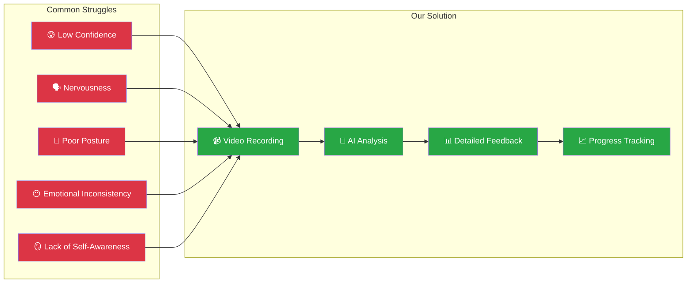

### 1.2 Core Mission

> **Help people communicate better — with confidence, clarity, and emotional awareness.**

### 1.3 The Growth Loop


### 1.4 Target Audience

| Audience                   | Use Cases                              | Value Proposition                   |
| -------------------------- | -------------------------------------- | ----------------------------------- |
| 🎓 **Students**            | Presentations, Viva, Group Discussions | Build confidence before key moments |
| 💼 **Job Seekers**         | HR Interviews, Elevator Pitches        | Practice with instant feedback      |
| 📚 **UPSC/MPSC Aspirants** | Personality Tests, Opinion Questions   | Structured speaking practice        |
| 🎤 **Public Speakers**     | Speech Pacing, Tonality                | Camera comfort & presence           |
| 🌱 **Personal Growth**     | Video Journaling, Self-Awareness       | Daily emotional tracking            |

---

## 2. System Architecture

### 2.1 High-Level Architecture

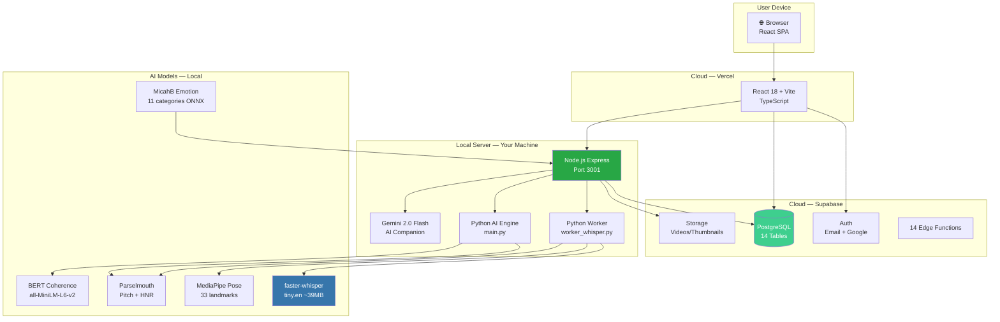

### 2.2 Two-Phase Processing Pipeline

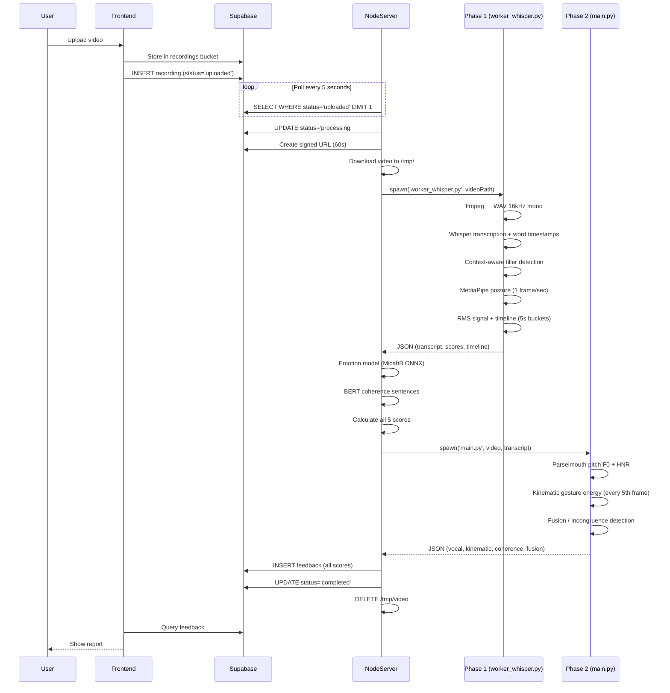

### 2.3 Deployment Architecture

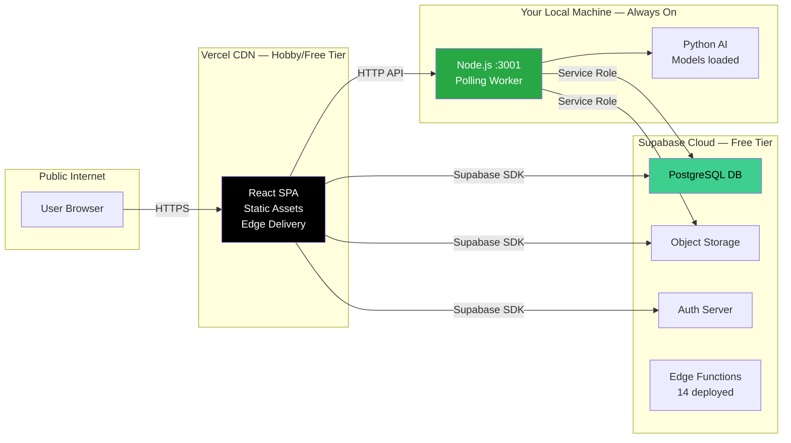

---

## 3. Tech Stack Deep Dive

### 3.1 Technology Overview

| Layer             | Technology                | Version   | Purpose                        |
| ----------------- | ------------------------- | --------- | ------------------------------ |
| **Frontend UI**   | React                     | 18.3.1    | Core UI library                |
| **Build Tool**    | Vite                      | 8.x       | Fast bundling & HMR            |
| **Language**      | TypeScript                | 5.8.3     | Type safety                    |
| **Styling**       | TailwindCSS               | 3.4.17    | Utility-first CSS              |
| **UI Components** | shadcn/ui                 | Latest    | Radix-based components         |
| **State**         | TanStack Query            | 5.83.0    | Server state management        |
| **Routing**       | React Router              | 7.x       | Client-side routing            |
| **Animations**    | Framer Motion             | 12.23.24  | UI animations                  |
| **Charts**        | Recharts                  | 2.15.4    | Data visualization (SVG)       |
| **Report Export** | jsPDF + html2canvas       | 4.x / 1.4 | PNG (3×) + A4 PDF reports      |
| **Backend**       | Express.js (Node.js)      | Latest    | HTTP server + worker           |
| **AI Speech**     | faster-whisper            | Latest    | Speech-to-text (CTranslate2)   |
| **AI Voice**      | Parselmouth (Praat)       | Latest    | Pitch F0 + HNR analysis        |
| **AI Audio**      | Librosa                   | Latest    | Silence & energy analysis      |
| **AI Vision**     | MediaPipe                 | Latest    | Pose + 33 body landmarks       |
| **AI NLP**        | Transformers.js (@xenova) | Latest    | BERT coherence + emotion ONNX  |
| **AI Emotion**    | MicahB emotion classifier | ONNX      | 11-emotion text classification |
| **AI Companion**  | Gemini 2.0 Flash          | Latest    | Contextual coaching chat (cloud API, free tier)  |
| **Text Embed**    | all-MiniLM-L6-v2          | 22M param | Semantic coherence             |
| **Script Gen**    | Ollama (llama3.2)         | Local install | Noted in backend docs; no server endpoint wired yet |
| **Database**      | Supabase (PostgreSQL)     | Latest    | All data persistence           |
| **Auth**          | Supabase Auth             | 2.81.1    | Email + Google OAuth           |
| **Storage**       | Supabase Storage          | —         | Video + thumbnail files        |

### 3.2 AI Model Catalog

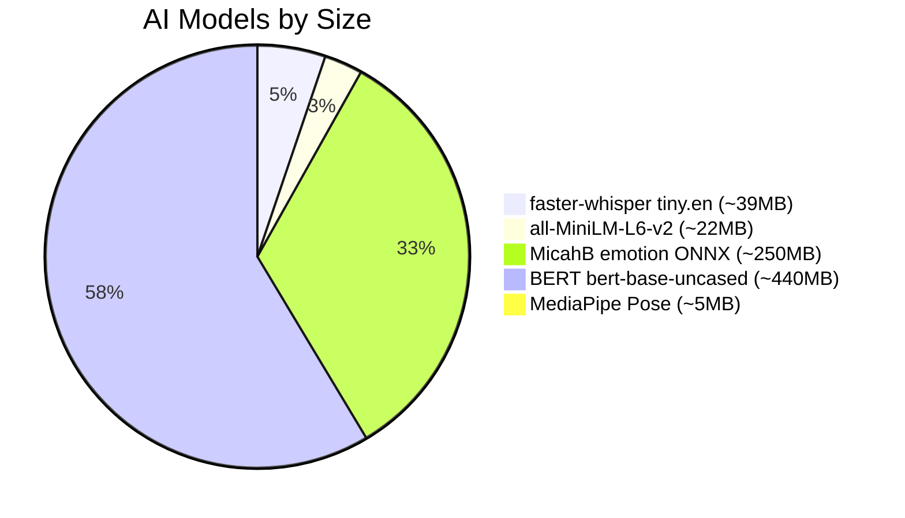

| Model                       | Size    | Purpose                    | Latency on CPU |
| --------------------------- | ------- | -------------------------- | -------------- |
| **faster-whisper** (tiny.en)| ~39MB   | Speech-to-text             | ~0.3× realtime |
| **MediaPipe Pose**          | ~5MB    | 33 body landmarks          | Real-time      |
| **Parselmouth (Praat)**     | Built-in| Pitch F0 + HNR             | Near real-time |
| **MicahB emotion** (ONNX)   | ~250MB  | 11-emotion classification  | < 500ms        |
| **all-MiniLM-L6-v2**        | ~22MB   | Sentence coherence         | < 200ms        |
| **BERT bert-base-uncased**  | ~440MB  | Feature extraction fallback| < 300ms        |

---

## 4. AI Analysis Pipeline

### 4.1 Video Decomposition — The 4 Streams

When you submit a video, it is broken into **4 parallel information streams**:

```mermaid
graph TB
    V[📹 Input Video<br/>5–10 minutes]

    V --> A[🎵 Audio Stream<br/>ffmpeg → WAV 16kHz mono]
    V --> B[🖼️ Frame Stream<br/>1 frame/second<br/>MediaPipe landmarks]
    V --> C[📝 Transcript Stream<br/>Whisper word-level timestamps]
    V --> D[📊 Timeline Stream<br/>5-second RMS buckets]

    A --> A1[Pitch F0 variance<br/>HNR quality<br/>Pause ratio]
    B --> B1[Posture score<br/>Shoulder alignment<br/>Centering offset]
    C --> C1[Filler count<br/>Stutter detection<br/>Emotion labels]
    D --> D1[Energy level (dB)<br/>WPM per bucket<br/>Silence gating]

    style V fill:#2E86AB,color:white
    style A1 fill:#A23B72,color:white
    style B1 fill:#F18F01,color:white
    style C1 fill:#C73E1D,color:white
    style D1 fill:#28a745,color:white
```

### 4.2 Filler Word Detection Logic

The system uses **context-aware** detection — not simple keyword matching:

| Filler Type        | Words / Phrases                | Rule                                              |
| ------------------ | ------------------------------ | ------------------------------------------------- |
| **Always Fillers** | `um, uh, umm, uhh, er, erm, hmm` | Always counted, no context check               |
| **Phrase Fillers** | `you know, sort of, kind of, i mean, you see` | Bigram matching in full text   |
| **"Like"**         | `like`                         | ❌ NOT counted after: feel/looks/sounds/is/was   |
|                    |                                | ❌ NOT counted before: a/an/the/this/that        |
|                    |                                | ✅ Counted in all other positions                 |
| **"Actually"**     | `actually`                     | ❌ NOT counted after: but/well/no/however        |
| **"Basically"**    | `basically`                    | ✅ Counted when followed by comma or end of word  |

### 4.3 Posture Scoring System

MediaPipe detects 3 key landmarks: **nose**, **left shoulder**, **right shoulder**. Then:

```
posture_ratio = neck_length / shoulder_width
             = |nose.y - shoulder_midpoint.y| / distance(left_shoulder, right_shoulder)
```

| Posture Ratio  | Classification | Base Score | Description           |
| -------------- | -------------- | ---------- | --------------------- |
| > 0.50         | 👑 Regal       | 1.0 (100%) | Tall, confident posture |
| 0.35 – 0.50    | ✅ Good        | 0.85 (85%) | Normal upright posture |
| < 0.35         | ⚠️ Slouch      | 0.40 (40%) | Leaning forward/down  |

**Penalties applied:**
- Shoulder tilt > 0.05 → `-0.10` penalty
- Frame not visible → excluded from average entirely

### 4.4 Emotion Classification Math

Model: **MicahB/emotion_text_classifier** — 11 emotion categories.

```
Emotion weights (positive → high, negative → low):
  joy=1.0, love=0.9, optimism=0.8, trust=0.7, anticipation=0.6
  surprise=0.5, sadness=0.3, fear=0.25, pessimism=0.2, disgust=0.15, anger=0.1

For each emotion with confidence > 10%:
  weighted_sum += emotion.score × weight
  total_weight += emotion.score

normalized = weighted_sum / total_weight        → range [0, 1]
tone_score  = 50 + (normalized × 50)           → range [50, 100]
```

The **dominant** emotion (highest score) becomes the human-readable label shown in the report.

### 4.5 Coherence / Thought Flow Analysis

Uses **all-MiniLM-L6-v2** sentence embeddings (384-dimension vectors):

```
For each adjacent sentence pair (S₁, S₂):
  sim(S₁, S₂) = (S₁ · S₂) / (|S₁| × |S₂|)    ← cosine similarity

flow_score = mean( sim(S₁,S₂), sim(S₂,S₃), ... sim(Sₙ₋₁,Sₙ) )
```

- Score near **1.0** = sentences are tightly connected (high coherence)
- Score near **0.0** = topic jumps everywhere (low coherence)

### 4.6 Authenticity / Incongruence Detection

Detects "fake emotion" by comparing 4 normalized signals:

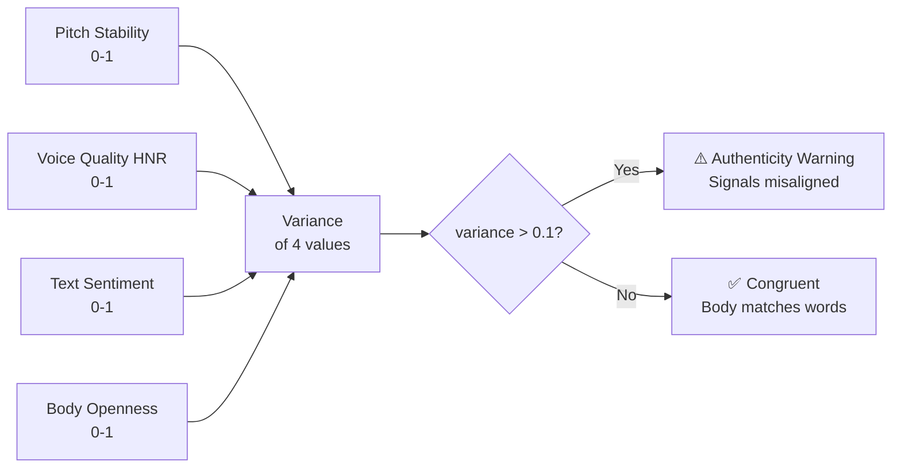

**Example**: Happy words (text_sentiment=0.9) + closed body (body_openness=0.1) + flat voice (pitch_stability=0.9) → high variance → **Authenticity Warning**.

---

## 5. Queue & Processing System

### 5.1 Queue Design (Current — Simple Polling)

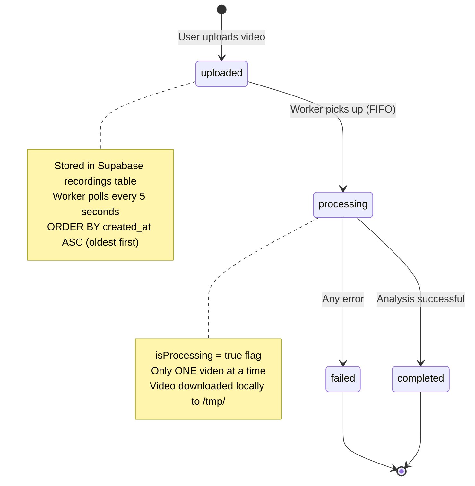

### 5.2 Queue Polling Logic

```javascript
// Every 5 seconds when idle:
SELECT id, video_url FROM recordings
WHERE status = 'uploaded'
ORDER BY created_at ASC   // ← FIFO: oldest first
LIMIT 1

// Pick up job → mark processing → process → mark complete → next
```

**Current limitations:**
- ❌ No priority queue (everyone is equal)
- ❌ Only 1 video processed at a time
- ❌ No retry mechanism (failed = permanently failed)
- ✅ Self-healing: after error, loop continues after 5s

### 5.3 Processing Time Reality

| Video Length | Real Processing Time | Bottleneck Step            |
| ------------ | -------------------- | -------------------------- |
| 1 minute     | ~45–90 seconds       | Whisper transcription      |
| 3 minutes    | ~2–4 minutes         | Posture analysis (1fps)    |
| 5 minutes    | ~3–6 minutes         | All steps combined         |
| 10 minutes   | ~6–12 minutes        | Sequential pipeline        |

> ⚠️ **"Instant report" is actually 2–10 minutes** depending on video length and server hardware.

### 5.4 Current User Capacity

```
Single worker sequential processing:
├── ~6–10 videos/hour (5-min videos)
├── ~40 videos/hour (1-min videos)
├── Comfortable: 5–15 concurrent active users
└── Breaking point: 20+ simultaneous uploads → queue backs up badly

To scale: add more worker instances pointing to same Supabase DB
```

---

## 6. Scoring Mathematics

### 6.1 All Score Formulas

```
━━━━━━━━━━━━━━━━━━━━━━━━━━━━━━━━━━━━━━━━━━━━━━━━━━━━━━━━━
FLUENCY SCORE — Filler Word Penalty (Exponential Decay)
━━━━━━━━━━━━━━━━━━━━━━━━━━━━━━━━━━━━━━━━━━━━━━━━━━━━━━━━━
DFM = filler_count / duration_in_minutes
fluencyScore = 100 × e^(−0.15 × max(0, DFM − 1))
→ 0 fillers/min  → 100
→ 5 fillers/min  → ~55
→ 10 fillers/min → ~30

━━━━━━━━━━━━━━━━━━━━━━━━━━━━━━━━━━━━━━━━━━━━━━━━━━━━━━━━━
PACING SCORE — Gaussian Bell Curve around ideal 145 WPM
━━━━━━━━━━━━━━━━━━━━━━━━━━━━━━━━━━━━━━━━━━━━━━━━━━━━━━━━━
rawPacing = 100 × e^(−(WPM − 145)² / (2 × 50²))
pacingScore = max(0, rawPacing − consistencyPenalty)
→ Optimal zone: 130–170 WPM (score ≥ 80)
→ < 100 WPM: < 50 score (too slow)
→ > 200 WPM: < 50 score (too fast)

━━━━━━━━━━━━━━━━━━━━━━━━━━━━━━━━━━━━━━━━━━━━━━━━━━━━━━━━━
CLARITY SCORE — Combined linguistic metric
━━━━━━━━━━━━━━━━━━━━━━━━━━━━━━━━━━━━━━━━━━━━━━━━━━━━━━━━━
clarityScore = (fluencyScore + pacingScore) / 2

━━━━━━━━━━━━━━━━━━━━━━━━━━━━━━━━━━━━━━━━━━━━━━━━━━━━━━━━━
CONFIDENCE SCORE — Posture geometry
━━━━━━━━━━━━━━━━━━━━━━━━━━━━━━━━━━━━━━━━━━━━━━━━━━━━━━━━━
alignmentScore  = max(0, 50 × (1 − shoulder_tilt / 0.2))
centeringScore  = max(0, 50 × (1 − centering_offset / 0.3))
confidenceScore = visibilityRatio × (alignmentScore + centeringScore)

━━━━━━━━━━━━━━━━━━━━━━━━━━━━━━━━━━━━━━━━━━━━━━━━━━━━━━━━━
ENERGY SCORE — Volume (RMS → dB)
━━━━━━━━━━━━━━━━━━━━━━━━━━━━━━━━━━━━━━━━━━━━━━━━━━━━━━━━━
dB = 20 × log₁₀(avg_rms)
→ dB < 40:  energyScore = max(0, (dB/40) × 50)  [too quiet]
→ 40–80 dB: energyScore = 100                    [perfect]
→ dB > 80:  energyScore = max(0, 100 − (dB−80)×2) [too loud]

━━━━━━━━━━━━━━━━━━━━━━━━━━━━━━━━━━━━━━━━━━━━━━━━━━━━━━━━━
OVERALL SCORE — Weighted average
━━━━━━━━━━━━━━━━━━━━━━━━━━━━━━━━━━━━━━━━━━━━━━━━━━━━━━━━━
overallScore = (clarity × 0.35) + (confidence × 0.25)
             + (tone × 0.20)    + (energy × 0.20)
```

### 6.2 Score Weight Rationale

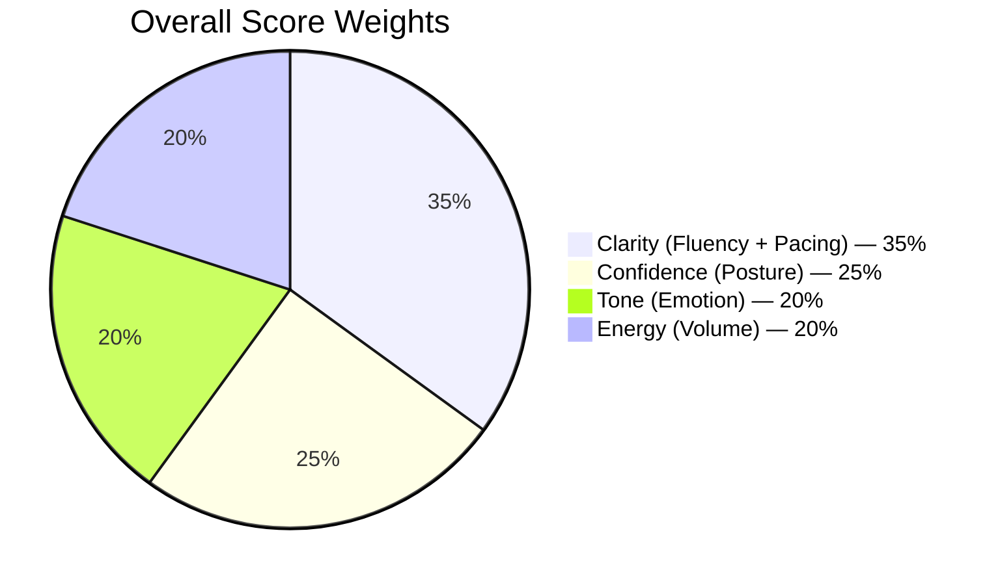

---

## 7. Frontend Implementation

### 7.1 Component Architecture

```mermaid
graph TB
    subgraph "App Root"
        A[App.tsx] --> B[ErrorBoundary]
        B --> C[QueryClientProvider]
        C --> D[AuthProvider]
        D --> E[BrowserRouter]
    end

    subgraph "Public Routes"
        F[/ Home]
        G[/login · /signup · /register]
        H[/onboarding]
        I[/waitlist · /waitlist/confirm]
        P1[/about · /contact · /privacy-policy · /terms]
    end

    subgraph "Protected Routes"
        J[/dashboard]
        K[/record]
        L[/gallery]
        M[/analysis/:id]
        N[/companion — AI Chat]
        O[/profile]
        P[/settings]
        Q[/admin/waitlist · /admin/users]
    end

    E --> F & G & H & I & P1
    E --> J & K & L & M & N & O & P & Q
```

### 7.2 Page Breakdown

| Page               | Key Features                                           |
| ------------------ | ------------------------------------------------------ |
| **Dashboard**      | Stats overview, activity charts, recent recordings     |
| **Record**         | Webcam recording, real-time pose detection, Teleprompter |
| **Analysis**       | 5 metric scores, charts (pacing, confidence, emotion)  |
| **Gallery**        | Past recording grid, playback, delete                  |
| **Companion**      | Gemini 2.0 Flash AI chat with your context             |
| **Profile**        | Goals, anchors, bio, onboarding data                   |
| **Settings**       | Notification preferences, account management           |
| **Onboarding**     | Branching wizard (standard / beta paths)               |
| **Admin**          | Waitlist + user management panels                      |

### 7.3 State Management

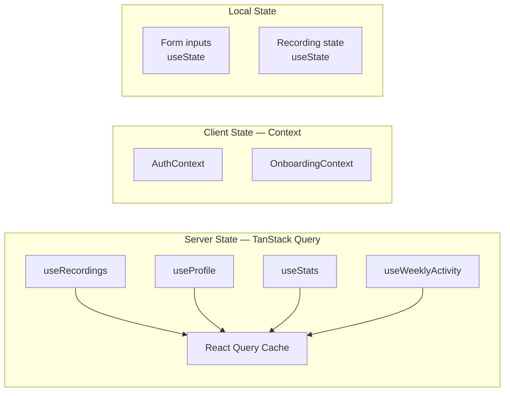

---

## 8. Backend Implementation

### 8.1 Node.js Server Structure

**File**: `backend/local-processor/server.js` — 907 lines, port 3001 (or `PORT` env)

```
API Endpoints:
├── GET  /                      → Health check
├── POST /api/chat            → Gemini 2.0 Flash streaming chat
├── GET  /api/habits          → Habit list + 14-day streak stats
├── POST /api/habits          → Create new habit
├── PUT  /api/habits/:id      → Update / archive habit
├── POST /api/habits/log      → Mark habit complete today
├── GET  /api/insights        → Dashboard coaching nudges
├── GET  /api/profile/context → User goals + anchors
├── POST /api/profile/context → Update goals + anchors
├── GET  /api/memories        → Reflection memories list
├── POST /api/memories        → Save reflection memory
└── DELETE /api/memories/:id  → Delete memory
```

### 8.2 Python AI Engine Files

```
backend/
├── local-processor/
│   ├── server.js                ← Orchestrator + API endpoints (907 lines)
│   ├── worker_whisper.py        ← Phase 1: STT + posture
│   ├── download-model.js        ← One-time ONNX model download
│   └── requirements.txt         ← Phase 1 Python deps
└── ai_engine/
    ├── main.py                  ← Phase 2 orchestrator
    ├── audio_analysis.py        ← Parselmouth: Pitch F0 + HNR
    ├── video_analysis.py        ← Gesture energy (kinematic)
    ├── text_analysis.py         ← BERT semantic coherence
    ├── fusion.py                ← Incongruence / authenticity
    ├── companion.py             ← Reflection readiness synthesis
    └── requirements.txt         ← Phase 2 Python deps
```

### 8.3 Job State Machine

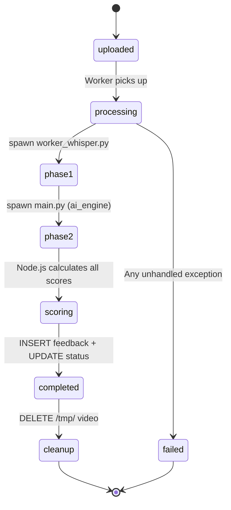

---

## 9. Database Architecture

### 9.1 Schema Overview

14 tables across the migrations (`supabase-organized/supabase/migrations/`):

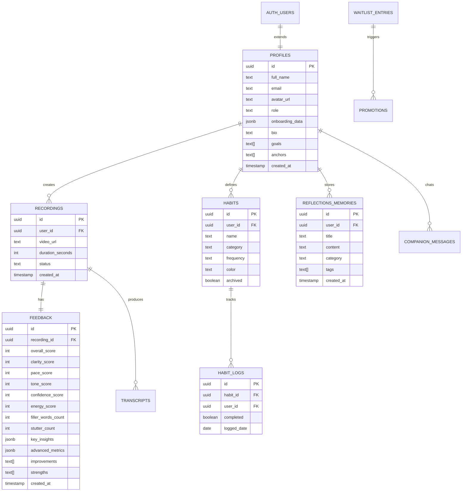

Plus supporting tables (same migrations): `transcripts` (per-recording
transcripts, FK → recordings), `prompts` (generated practice prompts),
`progress` (progress snapshots), `events_analytics` (written by the
`track-event` edge function), `worker_runs` (processor run bookkeeping),
`waitlist_entries` + `promotions` (waitlist flow).

### 9.2 Row-Level Security

All tables have RLS enabled. Users only access their own data:

```sql
-- Example: Users see only their recordings
CREATE POLICY "own recordings" ON recordings
  FOR ALL USING (auth.uid() = user_id);

-- Feedback accessible only through owned recordings
CREATE POLICY "own feedback" ON feedback
  FOR SELECT USING (
    EXISTS (
      SELECT 1 FROM recordings
      WHERE recordings.id = feedback.recording_id
      AND recordings.user_id = auth.uid()
    )
  );
```

---

## 10. Features Overview

### 10.1 Feature Status Matrix

| Category           | Feature                          | Status             | Phase |
| ------------------ | -------------------------------- | ------------------ | ----- |
| **🎥 Recording**   | Webcam recording                 | ✅ Done            | MVP   |
|                    | Video upload (50MB max)          | ✅ Done            | MVP   |
|                    | Real-time pose preview           | ✅ Done            | MVP   |
|                    | Teleprompter overlay             | ✅ Done            | MVP   |
| **🤖 AI Analysis** | Whisper speech-to-text           | ✅ Done            | MVP   |
|                    | Context-aware filler detection   | ✅ Done            | MVP   |
|                    | 11-emotion classification        | ✅ Done            | MVP   |
|                    | MediaPipe posture scoring        | ✅ Done            | MVP   |
|                    | Pitch F0 + HNR (Parselmouth)     | ✅ Done            | v1.7  |
|                    | Semantic coherence (MiniLM)      | ✅ Done            | v1.7  |
|                    | Authenticity / incongruence      | ✅ Done            | v1.7  |
| **📊 Feedback**    | 5-metric score report            | ✅ Done            | MVP   |
|                    | Transcript + timeline viewer     | ✅ Done            | MVP   |
|                    | Pacing graph (WPM over time)     | ✅ Done            | MVP   |
| **📈 Progress**    | Dashboard charts (Recharts)      | ✅ Done            | MVP   |
|                    | Recording history (Gallery)      | ✅ Done            | MVP   |
|                    | Weekly/monthly reports           | ❌ Not built yet   | v2.0  |
| **🤝 AI Companion**| Gemini 2.0 Flash chat            | ✅ Done            | v1.7  |
|                    | Habit tracker (daily streaks)    | ✅ Done            | v1.7  |
|                    | Reflection memory save           | ✅ Basic table     | v1.7  |
|                    | World-class memory system        | 🚧 Planned         | v2.0  |
| **👤 User**        | Supabase Auth (Email + Google)   | ✅ Done            | MVP   |
|                    | Branching onboarding wizard    | ✅ Done            | MVP   |
|                    | Waitlist + admin panel           | ✅ Done            | MVP   |

---

## 11. Memory System

### 11.1 Current Memory Status

Right now, "memory" is a **basic database table** (`reflections_memories`):

```
reflections_memories table:
├── id, user_id, title, content, category, tags, created_at
├── Stored as plain text
├── No semantic search
├── No auto-summarization
├── No cross-session learning
└── AI Companion reads the last 5 entries by date
```

**Problem**: This is just a note-taking app, not real memory. The AI companion has no way to *find relevant context* — it just prepends the 5 newest entries to every chat prompt, regardless of relevance.

### 11.2 What World-Class Memory Looks Like (Supermemory Architecture)

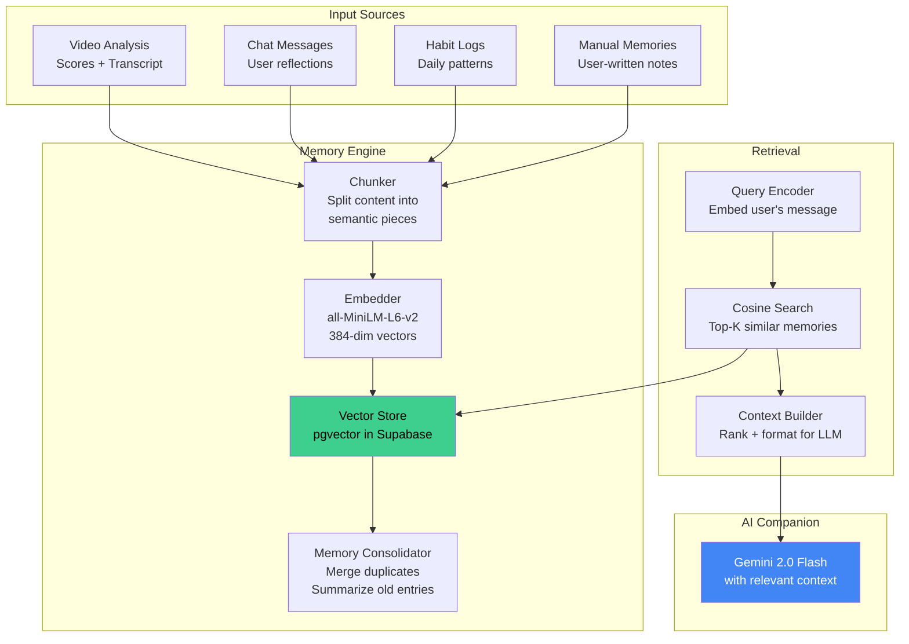

### 11.3 How to Build It Without Relying on Supermemory

**Stack: 100% self-owned, minimal-cost, no 3rd party memory service**

**Step 1 — Enable pgvector in Supabase** (1 SQL command):

```sql
CREATE EXTENSION IF NOT EXISTS vector;

CREATE TABLE memories_vectors (
  id          UUID PRIMARY KEY DEFAULT gen_random_uuid(),
  user_id     UUID REFERENCES profiles(id) ON DELETE CASCADE,
  source_type TEXT NOT NULL,    -- 'video', 'chat', 'habit', 'note'
  source_id   UUID,             -- recording_id or message_id
  content     TEXT NOT NULL,    -- the actual text chunk
  summary     TEXT,             -- auto-generated summary
  embedding   VECTOR(384),      -- all-MiniLM-L6-v2 vectors
  metadata    JSONB,            -- {score, date, emotion, topic}
  created_at  TIMESTAMPTZ DEFAULT now()
);

-- Index for fast similarity search
CREATE INDEX ON memories_vectors
  USING ivfflat (embedding vector_cosine_ops)
  WITH (lists = 100);
```

**Step 2 — Auto-embed on analysis completion** (add to `server.js`):

```javascript
// After writing feedback to Supabase, auto-create a memory
async function embedAndStore(userId, content, sourceType, metadata) {
  const { pipeline } = await import('@xenova/transformers');
  const embedder = await pipeline('feature-extraction', 'Xenova/all-MiniLM-L6-v2');
  const output = await embedder(content, { pooling: 'mean', normalize: true });
  const vector = Array.from(output.data);  // 384-dim float array

  await supabase.from('memories_vectors').insert({
    user_id: userId,
    source_type: sourceType,
    content: content,
    embedding: JSON.stringify(vector),
    metadata: metadata
  });
}

// Call after analysis:
await embedAndStore(
  userId,
  `Session on ${date}: overall score ${score}/100. 
   Top emotion: ${emotion}. Filler words: ${fillerCount}. 
   Main improvement: ${improvements[0]}.`,
  'video',
  { score, emotion, date }
);
```

**Step 3 — Semantic search at chat time** (replace the last-5 lookup):

```javascript
// Instead of: .select('*').order('created_at').limit(5)
// Use semantic search:
async function findRelevantMemories(userId, userMessage) {
  // Embed the user's question
  const embedder = await getEmbedder();
  const qOutput = await embedder(userMessage, { pooling: 'mean', normalize: true });
  const queryVector = Array.from(qOutput.data);

  // pgvector cosine similarity search
  const { data } = await supabase.rpc('match_memories', {
    query_embedding: queryVector,
    match_user_id: userId,
    match_threshold: 0.7,
    match_count: 8
  });

  return data;
}
```

```sql
-- Supabase function for semantic search:
CREATE OR REPLACE FUNCTION match_memories(
  query_embedding VECTOR(384),
  match_user_id UUID,
  match_threshold FLOAT DEFAULT 0.7,
  match_count INT DEFAULT 8
)
RETURNS TABLE (id UUID, content TEXT, similarity FLOAT, metadata JSONB)
LANGUAGE SQL AS $$
  SELECT id, content,
    1 - (embedding <=> query_embedding) AS similarity,
    metadata
  FROM memories_vectors
  WHERE user_id = match_user_id
    AND 1 - (embedding <=> query_embedding) > match_threshold
  ORDER BY embedding <=> query_embedding
  LIMIT match_count;
$$;
```

### 11.4 Memory Architecture Comparison

| Feature                  | Current (Basic Table) | Supermemory API | Our Self-Built System |
| ------------------------ | --------------------- | --------------- | --------------------- |
| Storage                  | Supabase rows         | Supermemory cloud | pgvector in Supabase |
| Search type              | Order by date (last 5)| Semantic vector | Semantic vector cosine|
| Auto-embed on save       | ❌                    | ✅              | ✅                    |
| Cross-session learning   | ❌                    | ✅              | ✅                    |
| Privacy (data stays yours)| ✅                   | ❌ (3rd party)  | ✅                    |
| Cost                     | Free                  | Paid API        | Free (pgvector)       |
| Auto-consolidation       | ❌                    | ✅              | Build in v2.1         |
| Sources: video+chat+habit| Chat only via table   | Any API input   | All 4 sources         |

### 11.5 Memory System Roadmap

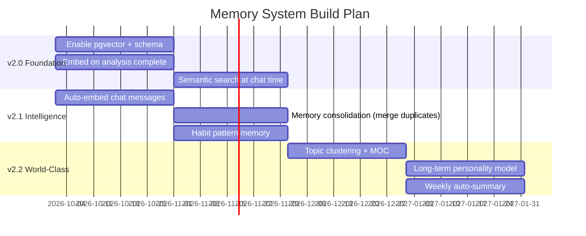

---

## 12. Quick Start Guide

### 12.1 Prerequisites

| Requirement | Version | Purpose             |
| ----------- | ------- | ------------------- |
| Node.js     | 18+     | Runtime (frontend + worker) |
| Python      | 3.11+   | AI pipeline         |
| FFmpeg      | Latest  | Video/audio extraction |
| Git         | Latest  | Version control     |

### 12.2 Installation

```bash
# 1. Clone repo
git clone https://github.com/yashmagar01/The-Future-You.git
cd The-Future-You

# 2. JS dependencies (root, frontend app, local processor worker)
npm install
npm install --prefix frontend
cd backend/local-processor && npm install && cd ../..

# 3. Python AI dependencies (two requirement files)
pip install -r backend/local-processor/requirements.txt
pip install -r backend/ai_engine/requirements.txt

# 4. Environment files (copy examples, fill in real values — see 12.3)
cp .env.example .env
cp frontend/.env.example frontend/.env
cp backend/local-processor/.env.example backend/local-processor/.env

# 5. Start everything (each command from the repo root)
npm run dev          # Frontend → http://localhost:8080
npm run backend:dev  # Local processor (nodemon) → http://localhost:3001
```

Root helper scripts (`package.json`): `dev`, `build`, `preview`, `lint`,
`test` / `test:ui` / `test:coverage` (frontend via Vitest), `backend`
(`node server.js`), `backend:dev` (nodemon).

### 12.3 Environment Variables

All three files start as `.env.example` — copy each to `.env`. Never commit
real keys (all `.env*` paths are git-ignored).

```env
# .env / frontend/.env (Vite — mirrored in both examples)
VITE_SUPABASE_URL=https://your-project.supabase.co
VITE_SUPABASE_PUBLISHABLE_KEY=your_publishable_key
VITE_SUPABASE_PROJECT_ID=your_project_id
VITE_APP_BASE_URL=http://localhost:8080
VITE_GEMINI_API_KEY=your_gemini_key          # AI Companion (client fallback)
VITE_LOCAL_PROCESSOR_URL=http://localhost:3001

# backend/local-processor/.env
SUPABASE_URL=https://your-project.supabase.co
SUPABASE_SERVICE_ROLE_KEY=your_service_role_key
SUPABASE_PROJECT_ID=your_project_id
APP_BASE_URL=http://localhost:8080
GEMINI_API_KEY=your_gemini_key               # optional; server falls back
                                             # to a local companion coach
                                             # without it
```

> [!TIP]
> Frontend: http://localhost:8080 · Backend: http://localhost:3001
> (override backend port with `PORT` env).

### 12.4 Verify Your Setup

```bash
npm run build    # production build must pass (Vite)
npm run test -- run  # Vitest suite, one-shot (23 tests green)
npm run lint     # ESLint (repo has pre-existing warnings; add no new ones)
npm run preview  # serve the production build locally
```

---

## 13. Project Structure

```
The-Future-You/
├── 📂 frontend/                     # React Application (v1.7.0)
│   └── src/
│       ├── components/              # ~97 component files (incl. ui/, companion/, home/)
│       ├── pages/                   # 21 page modules (19 routes + NotFound)
│       ├── hooks/                   # useRecordings, usePoseDetection
│       ├── contexts/                # Auth, Onboarding
│       └── lib/companion/           # Gemini client, context assembler, types
│
├── 📂 backend/
│   ├── local-processor/
│   │   ├── server.js                # Main orchestrator, 907 lines, port 3001
│   │   ├── worker_whisper.py        # Phase 1: STT + posture
│   │   ├── download-model.js        # One-time ONNX model download
│   │   └── requirements.txt         # Phase 1 Python deps
│   └── ai_engine/
│       ├── main.py                  # Phase 2 orchestrator
│       ├── audio_analysis.py        # Pitch F0 + HNR (Parselmouth)
│       ├── video_analysis.py        # Kinematic gesture energy
│       ├── text_analysis.py         # BERT semantic coherence
│       ├── fusion.py                # Incongruence detection
│       ├── companion.py             # Reflection readiness synthesis
│       └── requirements.txt         # Phase 2 Python deps
│
├── 📂 supabase-organized/
│   └── supabase/
│       ├── functions/               # 14 Edge Functions (+ _shared helper)
│       └── migrations/              # SQL migration files (14 tables)
│
├── 📂 docs/
│   ├── ROADMAP_v2.0.md
│   ├── QUICK_START.md
│   ├── MEMORY_SYSTEM.md             # World-class memory design
│   ├── SETUP.md
│   ├── PRODUCTION_URL_CONFIGURATION.md
│   ├── PONYTAIL_QUALITY_FIRST_OPTIMIZATION.md   # Perf spec + execution log
│   └── WHAT_PONYTAIL_DID.md         # Phase-by-phase change record
│
├── vercel.json                      # SPA rewrites, cache headers, favicon fix
├── render.yaml                      # Render.com worker deploy config
├── Dockerfile.worker                # Worker container build
└── README.md                        # This file
```

---

## 14. Performance & Scalability

### 14.1 Processing Benchmarks

| Video Duration | Est. Time (i5 CPU) | Rate Limiter            |
| -------------- | ------------------ | ----------------------- |
| 1 min          | ~45–90 sec         | Whisper transcription   |
| 3 min          | ~2–4 min           | Posture (1fps × 180s)   |
| 5 min          | ~3–6 min           | All combined            |
| 10 min         | ~6–12 min          | Sequential pipeline     |

### 14.2 Scalability Path

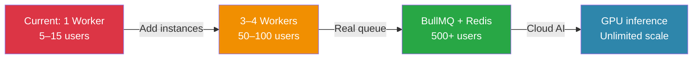

| Scale Level    | Setup                      | User Capacity | Cost      |
| -------------- | -------------------------- | ------------- | --------- |
| **Current MVP**| 1 local Node.js worker     | 5–15 users    | Minimal  |
| **Small Scale**| 3–4 Render.com instances   | 50–100 users  | ~₹2,000/mo|
| **Medium**     | BullMQ + Redis + 10 workers| 500+ users    | ~₹8,000/mo|
| **Large**      | GPU cloud + async queue    | Unlimited     | Per usage |

---

## 15. Cost Analysis

### 15.1 AI Processing — Local vs Cloud API Comparison

The core video analysis (speech-to-text, body language, emotion, coherence) runs **entirely on local hardware** using open-source models, avoiding the following cloud API costs:

| Service            | Cloud API Cost      | Our Approach        | Monthly Saving |
| ------------------ | ------------------- | ------------------- | -------------- |
| Speech-to-Text     | $24 (Google/AWS)    | faster-whisper local| $24            |
| Sentiment Analysis | $15 (AWS Comprehend)| MicahB ONNX local   | $15            |
| Video Analysis     | $40 (Azure/GCP)     | MediaPipe local     | $40            |
| Processing compute | $20 (Lambda)        | Local CPU worker    | $20            |
| **Total savings**  | **$99/month**       | **Local models**    | **$99/mo**     |

> **Annual savings vs cloud AI APIs: ~₹1,00,000+** by running models locally instead of paying per-API-call.

---

### 15.2 Actual Infrastructure Costs (Honest Breakdown)

The platform does depend on cloud services — here is the real pricing at each tier:

| Service | Free Tier | Paid Tier | What it provides |
| ------- | --------- | --------- | ---------------- |
| **Vercel** | Hobby — free (personal projects, 100GB bandwidth) | Pro — $20/month | Frontend hosting, CDN, custom domain, team access |
| **Supabase** | Free — 500MB DB, 1GB storage, 50MB file uploads | Pro — $25/month | 8GB DB, 250GB bandwidth, daily backups, no pause |
| **Render** | Free (cold starts, 512MB RAM) | Starter — $7/month per service | Always-on AI worker, no cold start |
| **Gemini 2.0 Flash API** | Free — 1,500 requests/day, 1M tokens/min | Pay-as-you-go — $0.075/1M input tokens | AI Companion chat (cloud API — not fully offline) |
| **Local AI models** | Free (open-source, runs on your own hardware) | — | faster-whisper, MediaPipe, Parselmouth, BERT, ONNX |
| **Domain** | — | ~₹900/year | Custom domain (optional) |

#### MVP (Current Deployment)

| Tier | Monthly Cost | Notes |
| ---- | ------------ | ----- |
| Vercel Hobby | ₹0 | Within free limits for MVP |
| Supabase Free | ₹0 | 500MB DB sufficient for beta |
| Gemini API | ₹0 | Within 1,500 req/day free tier |
| AI Worker | Runs on Yash's machine | ngrok tunnel for public access |
| **Total** | **Minimal (~₹0 for MVP)** | Local machine must stay on |

#### Production (500+ Users)

| Service | Cost/Month |
| ------- | ---------- |
| Vercel Pro | ~₹1,700 ($20) |
| Supabase Pro | ~₹2,100 ($25) |
| Render Starter (worker) | ~₹600 ($7) |
| Gemini API (est. 50K req/mo) | ~₹300 ($3.75) |
| **Total** | **~₹4,700/month** |

> 💡 **Key insight**: The AI analysis cost stays near-zero indefinitely because it runs on local/cloud hardware using free open-source models. Platform infrastructure (DB, hosting, auth) is the primary cost at scale.

---

### 15.3 Data Privacy & Retention Policy

| User Type | Data Stored | Retention |
| --------- | ----------- | --------- |
| **Beta Users** | Scores + metadata + opt-in session data | Used to improve models; retained until withdrawn |
| **Normal Users** | Scores + anonymized metadata only | Raw video deleted on analysis complete; all personal data deleted within **7 days max** from server |
| **AI Companion chat** | Session memory summaries | Deleted on request or account deletion |

> ⚠️ **Note on emotion/confidence metrics**: These are composite scores derived from acoustic, kinematic, and NLP signals — not standardized clinical measurements. Scores are most meaningful as personal trend data across sessions, not as absolute values.

---

## 16. Roadmap

### 16.1 Roadmap Overview

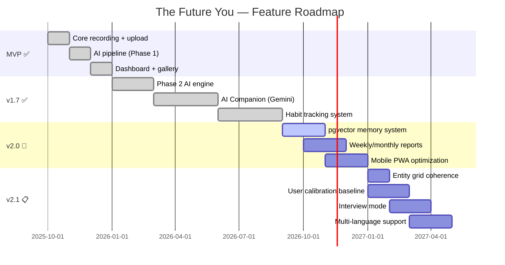

### 16.2 Next Milestones

| Priority | Feature                         | Status | Why It Matters                             |
| -------- | ------------------------------- | ------ | ------------------------------------------ |
| 🔴 P0   | pgvector semantic memory         | 🔲 Not started | AI companion becomes truly smart  |
| 🔴 P0   | Weekly + monthly report page     | 🔲 Not started | Users need long-term trend visibility |
| 🟠 P1   | Auto-embed all sessions          | 🔲 Planned | Every analysis builds the memory graph |
| 🟠 P1   | Multi-worker processing          | 🔲 Planned | Handle more than 15 concurrent users |
| 🟡 P2   | Mobile PWA / App                 | 📋 Early 2027 | Record from phone directly         |
| 🟡 P2   | Interview mode                   | 📋 Planned | Structured Q&A practice with scoring |
| 🟢 P3   | Multi-language support           | 📋 Planned | Expand reach beyond English speakers |
| 🟢 P3   | Duolingo-style gamification      | 📋 Planned | Streaks, XP, badges for habit building |

---

## 📱 Live Demo

**Frontend**: [the-future-you.vercel.app](https://the-future-you.vercel.app)
(same URL as the in-app canonical link, OG tags, and report QR codes)

---

## 👤 Author

**Yash Magar**  
GitHub: [@yashmagar01](https://github.com/yashmagar01)

---

## 📄 License

Educational and personal use.

---

<div align="center">

**Built with ❤️ and jugaad engineering**

_Minimal-cost AI · Full privacy · Unlimited growth_

`Record → Analyze → Improve → Remember → Repeat`

</div>
