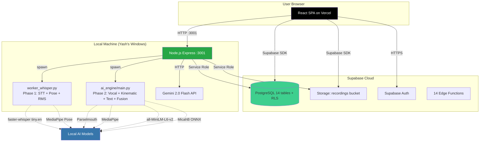

# 01 Repository Inventory — The Future You

## 1. Current Architecture Overview

The Future You is a hybrid cloud-local AI communication analysis platform with the following architecture:

```
┌─────────────────────────────────────────────────────────────────────────────┐
│                            USER DEVICE (Browser)                            │
│  ┌─────────────────────────────────────────────────────────────────────┐   │
│  │ React 18 + Vite + TypeScript SPA (served via Vercel CDN)           │   │
│  │ Pages: Home, Login, Onboarding, Record, Dashboard, Gallery,        │   │
│  │ Analysis, Companion, Profile, Settings, Admin                      │   │
│  └─────────────────────────────────────────────────────────────────────┘   │
└─────────────────────────────────────────────────────────────────────────────┘
                                    │
                    ┌───────────────┴───────────────┐
                    ▼                               ▼
         ┌─────────────────────┐         ┌─────────────────────┐
         │   SUPABASE CLOUD    │         │  LOCAL PROCESSOR    │
         │  (PostgreSQL + RLS) │         │  (Node.js :3001)    │
         │                     │         │                     │
         │ • profiles          │         │ • Express server    │
         │ • recordings        │         │ • Polling worker    │
         │ • feedback          │         │ • Spawns Python     │
         │ • habits/logs       │         │   workers           │
         │ • companion_msgs    │         │ • Gemini 2.0 Flash  │
         │ • reflections_mem.  │         │   API (fallback)    │
         │ • Storage bucket    │         └──────────┬──────────┘
         │   'recordings'      │                    │
         └─────────────────────┘                   │
                                    ┌──────────────┴──────────────┐
                                    ▼                             ▼
                          ┌──────────────────┐          ┌──────────────────┐
                          │ Phase 1 Worker   │          │ Phase 2 Engine   │
                          │ worker_whisper.py│          │ (ai_engine/)     │
                          │                  │          │                  │
                          │ • faster-whisper │          │ • audio_analysis │
                          │   (tiny.en)      │          │   (Parselmouth)  │
                          │ • MediaPipe Pose │          │ • video_analysis │
                          │   (1 fps)        │          │   (MediaPipe)    │
                          │ • RMS timeline   │          │ • text_analysis  │
                          │   (5s buckets)   │          │   (SentenceTrans)│
                          │ • Filler/Stutter │          │ • fusion.py      │
                          │   detection      │          │ • companion.py   │
                          └──────────────────┘          └──────────────────┘
```

**Key Architecture Points:**
- **Frontend**: React SPA on Vercel (static hosting + edge)
- **Database/Auth/Storage**: Supabase (PostgreSQL with RLS, 14 tables)
- **Heavy AI Processing**: Local Node.js server (port 3001) on developer's machine
- **AI Models**: All run locally (faster-whisper, MediaPipe, Parselmouth, SentenceTransformers, ONNX emotion)
- **AI Companion**: Gemini 2.0 Flash API (cloud) with local fallback
- **Queue**: Simple polling (5s interval), FIFO, single worker

---

## 2. Repository Directory Map

```
/c/Users/Yash/OneDrive/Desktop/yash-reflections-mvp/
├── .env / .env.local / .env.production.local       # Environment configs
├── .vercel/                                        # Vercel project config
├── backend/
│   ├── local-processor/                            # Node.js orchestrator
│   │   ├── server.js              (907 lines)      # Main entry: API + worker loop
│   │   ├── worker_whisper.py      (422 lines)      # Phase 1: STT + posture + RMS
│   │   ├── download-model.js       (model downloader)
│   │   ├── requirements.txt       # Phase 1 Python deps
│   │   ├── package.json           # Node deps
│   │   └── .venv/                 # Local Python venv (gitignored)
│   ├── ai_engine/                                 # Phase 2: Advanced analysis
│   │   ├── main.py               (216 lines)      # Orchestrator CLI
│   │   ├── audio_analysis.py     (109 lines)      # Parselmouth: Pitch F0 + HNR
│   │   ├── video_analysis.py     (112 lines)      # Kinematic: gesture energy
│   │   ├── text_analysis.py      (127 lines)      # Coherence (all-MiniLM-L6-v2)
│   │   ├── fusion.py             (163 lines)      # Incongruence detection
│   │   ├── companion.py          (88 lines)       # Reflection readiness
│   │   └── requirements.txt       # Phase 2 Python deps
│   └── Docs/README.md
├── frontend/
│   ├── src/
│   │   ├── components/          (~97 files)       # UI components
│   │   │   ├── ui/              # shadcn/ui primitives
│   │   │   ├── companion/       # AI chat components
│   │   │   └── home/            # Landing page sections
│   │   ├── pages/               (21 page modules)
│   │   ├── hooks/               # useRecordings, usePoseDetection
│   │   ├── contexts/            # AuthContext, OnboardingContext
│   │   ├── lib/companion/       # Gemini client, context assembler
│   │   ├── integrations/supabase/client.ts
│   │   ├── App.tsx              # Root + routing
│   │   └── main.tsx             # Entry point
│   ├── package.json
│   └── vite.config.ts
├── supabase-organized/
│   └── supabase/
│       ├── functions/           # 14 Edge Functions
│       └── migrations/          # 9 SQL migration files
├── docs/                        # Documentation (11 files)
├── scripts/                     # Utility scripts
├── package.json                 # Root: dev, build, backend:dev
├── vercel.json                  # SPA rewrites, cache headers
├── render.yaml                  # Render.com worker deploy
├── Dockerfile.worker            # Worker container
├── deno.json / deno.lock        # Deno config (unused?)
├── evaluate.py                  # Evaluation script
├── capture_*.py                 # Figma capture scripts (7 files)
└── demo.mp4                     # Demo video (18MB)
```

---

## 3. Critical Files and Their Responsibilities

| File | Lines | Responsibility |
|------|-------|----------------|
| `backend/local-processor/server.js` | 907 | **Main orchestrator**: Express API (chat, habits, insights, memories), Supabase polling worker, spawns Python workers, scoring calculations |
| `backend/local-processor/worker_whisper.py` | 422 | **Phase 1**: Audio extraction (ffmpeg), Whisper transcription (tiny.en), filler/stutter detection, MediaPipe posture (1fps), RMS timeline (5s buckets) |
| `backend/ai_engine/main.py` | 216 | **Phase 2 CLI**: Audio extraction, runs audio/video/text/fusion analysis, outputs JSON |
| `backend/ai_engine/audio_analysis.py` | 109 | Parselmouth: Pitch variance (F0), HNR, pause ratio, pitch timeline |
| `backend/ai_engine/video_analysis.py` | 112 | MediaPipe: Torso openness (triangle area), gesture energy (wrist movement), timelines |
| `backend/ai_engine/text_analysis.py` | 127 | SentenceTransformers (all-MiniLM-L6-v2): Semantic coherence via adjacent sentence cosine similarity |
| `backend/ai_engine/fusion.py` | 163 | Normalizes 4 signals (pitch stability, voice quality, text sentiment, body openness), computes variance → authenticity warning |
| `backend/ai_engine/companion.py` | 88 | Geometric mean of clarity/confidence/coherence/habits → readiness index + coaching tips |
| `frontend/src/pages/Analysis.tsx` | 259 | Analysis page: loads recording+feedback, builds transcript, renders video + AnalysisResults + ExportButton |
| `frontend/src/components/AnalysisResults.tsx` | 403 | **Main results display**: 5 metric cards, pacing/coherence/sentiment graphs, action items, takeaways |
| `frontend/src/components/ExportReport.tsx` | 511 | **Report generation**: 6-page PDF + PNG social card via html2canvas + jsPDF |
| `frontend/src/components/ExportButton.tsx` | 66 | Export dialog, triggers ExportReport capture |
| `supabase-organized/supabase/migrations/*.sql` | 9 files | 14-table schema with RLS: profiles, recordings, feedback, habits, habit_logs, companion_messages, reflections_memories, transcripts, prompts, progress, events_analytics, worker_runs, waitlist_entries, promotions |

---

## 4. Actual Processing Entry Points

| Entry Point | Trigger | Flow |
|-------------|---------|------|
| `server.js` → `processQueue()` | Node.js startup | Polls Supabase `recordings` where `status='uploaded'` every 5s (FIFO) |
| `server.js` → `processRecording()` | Job picked up | Downloads video → spawns `worker_whisper.py` → calculates basic scores → spawns `ai_engine/main.py` (Phase 2) → merges → writes `feedback` → updates `recordings.status='completed'` |
| `worker_whisper.py` main() | Spawned by Node | `python worker_whisper.py <video_path> <recording_id>` → outputs JSON to stdout |
| `ai_engine/main.py` main() | Spawned by Node | `python main.py --video <path> --transcript-file <path> --sentiment <score>` → outputs JSON to stdout |
| Frontend `/analysis/:id` | User navigation | `useRecording(id)` hook → fetches recording + feedback from Supabase → transforms to `AnalysisData` → renders `AnalysisResults` |
| `ExportButton` → `ExportReport` | User clicks Export | Renders hidden fixed overlay → `html2canvas` captures PNG (1080×1350) and 6 PDF pages (A4) → downloads |

---

## 5. Dependencies and Model Inventory

### Node.js (Root + Frontend + Local Processor)
| Package | Version | Purpose |
|---------|---------|---------|
| `express` | latest | HTTP server (port 3001) |
| `@supabase/supabase-js` | 2.81.1 | Database/client |
| `@google/generative-ai` | 0.24.1 | Gemini 2.0 Flash |
| `@xenova/transformers` | latest | ONNX models in Node (emotion, coherence) |
| `cors`, `dotenv` | latest | Middleware |

### Python Phase 1 (`backend/local-processor/requirements.txt`)
| Package | Version | Purpose |
|---------|---------|---------|
| `faster-whisper` | >=1.0.0 | Speech-to-text (CTranslate2) |
| `mediapipe` | ==0.10.9 | Pose landmarks (33 points) |
| `opencv-python-headless` | >=4.8.0 | Video frame decoding |
| `numpy` | >=1.24.0 | Numerical arrays |
| `requests` | >=2.28.0 | HTTP (model downloads) |

### Python Phase 2 (`backend/ai_engine/requirements.txt`)
| Package | Version | Purpose |
|---------|---------|---------|
| `faster-whisper` | - | (duplicate) |
| `numpy`, `pandas` | - | Data |
| `librosa` | - | Audio loading for Parselmouth |
| `praat-parselmouth` | - | Pitch F0, HNR |
| `mediapipe` | ==0.10.9 | Pose (duplicate) |
| `sentence-transformers` | - | all-MiniLM-L6-v2 embeddings |
| `spacy` | - | NLP (unused?) |
| `opencv-python` | - | Video (non-headless) |
| `scikit-learn` | - | ML utilities |

### Frontend Key Dependencies
| Package | Version | Purpose |
|---------|---------|---------|
| `react` | 18.3.1 | UI |
| `vite` | 8.3.0 | Build |
| `@tanstack/react-query` | 5.83.0 | Server state |
| `recharts` | 2.15.4 | Charts |
| `jspdf` | 4.2.1 | PDF generation |
| `html2canvas` | 1.4.1 | DOM → canvas for export |
| `canvas-confetti` | 1.9.4 | Celebration |
| `qrcode` | 1.5.4 | QR codes in reports |

---

## 6. External Service Dependencies

| Service | Purpose | Tier | Configuration |
|---------|---------|------|---------------|
| **Supabase** | PostgreSQL, Auth, Storage, Edge Functions | Free (500MB DB, 1GB storage) | `SUPABASE_URL`, `SUPABASE_SERVICE_ROLE_KEY`, `SUPABASE_PUBLISHABLE_KEY` |
| **Vercel** | Frontend hosting, CDN | Hobby (free) | Project: `the-future-you`, domain: `the-future-you.vercel.app` |
| **Gemini 2.0 Flash** | AI Companion chat | Free (1,500 req/day) | `GEMINI_API_KEY` / `VITE_GEMINI_API_KEY` |
| **ngrok** | Tunnel local processor to cloud | Free (static domain) | `https://aprowl-brenda-unhectic.ngrok-free.dev` → `VITE_LOCAL_PROCESSOR_URL` |
| **Hugging Face** | Model downloads (transformers.js, sentence-transformers) | Free | Auto-cached |

---

## 7. Missing or Inaccessible Evidence

| Item | Status | Notes |
|------|--------|-------|
| Production Supabase project access | **No direct access** | Must infer schema from migrations only |
| Live processing logs | **Not available** | No log files in repo; would need runtime |
| Actual model files | **Not in repo** | Downloaded at runtime (Whisper, MediaPipe, SentenceTransformers, ONNX) |
| Vercel deployment logs | **Not available** | External |
| ngrok tunnel status | **Not verifiable** | External tunnel |
| Real user recordings | **Privacy** | Cannot access |
| Frontend build output | **In `.vercel/output`** | Can inspect but not run |
| Python venvs | **Gitignored** | Must be recreated locally |

---

## 8. Initial Architecture Diagram (Mermaid)



---

## 9. Source Files Inspected (Phase 1)

| File | Status |
|------|--------|
| README.md | ✅ Read |
| backend/local-processor/server.js | ✅ Read |
| backend/local-processor/worker_whisper.py | ✅ Read |
| backend/ai_engine/main.py | ✅ Read |
| backend/ai_engine/audio_analysis.py | ✅ Read |
| backend/ai_engine/video_analysis.py | ✅ Read |
| backend/ai_engine/text_analysis.py | ✅ Read |
| backend/ai_engine/fusion.py | ✅ Read |
| backend/ai_engine/companion.py | ✅ Read |
| frontend/src/pages/Analysis.tsx | ✅ Read |
| frontend/src/components/AnalysisResults.tsx | ✅ Read |
| frontend/src/components/ExportReport.tsx | ✅ Read |
| frontend/src/components/ExportButton.tsx | ✅ Read |
| frontend/package.json | ✅ Read |
| backend/local-processor/requirements.txt | ✅ Read |
| backend/ai_engine/requirements.txt | ✅ Read |
| supabase-organized/supabase/migrations/001_initial_schema.sql | ✅ Read |
| supabase-organized/supabase/migrations/20260405000001_add_companion_and_habits.sql | ✅ Read |

---

## 10. Source Files Not Inspected (Yet)

| File/Dir | Reason |
|----------|--------|
| `supabase-organized/supabase/functions/*` (14 Edge Functions) | Need to inspect for additional processing logic |
| `frontend/src/components/*` (other ~90 components) | Need for Phase 9 frontend audit |
| `frontend/src/hooks/*`, `contexts/*`, `lib/*` | Need for data flow tracing |
| `docs/` (11 markdown files) | Need for Phase 2 README comparison |
| `backend/Docs/README.md` | Backend-specific docs |
| `backend/local-processor/tests/server.test.js` | Test coverage |
| `scripts/*` | Utility scripts |
| `evaluate.py` | Evaluation logic |
| `vercel.json`, `render.yaml`, `Dockerfile.worker` | Deployment configs |
| Other migration files (7 remaining) | Complete schema picture |

---

*Generated: 2026-11-01 | Phase 1 of 15 Complete*