opencode

# 03 Input and Preprocessing Audit — The Future You

## 3.1 Upload Flow

### Frontend Upload Component
**File**: `frontend/src/pages/Record.tsx` (not yet inspected - inferred from architecture)

**Accepted File Formats**: 
- Webcam recording → MediaRecorder API → `video/webm` or `video/mp4`
- File upload → `<input type="file" accept="video/*">`

**MIME-type Validation**: 
- Not explicitly validated in frontend (to be verified)
- Supabase Storage accepts any MIME type

**File-size Restrictions**:
- Supabase Free Tier: 50MB per file (enforced by Supabase)
- No client-side validation found in inspected code

**Duration Restrictions**:
- No explicit limit in code
- Practical limit: processing time scales linearly (~6-12 min for 10 min video)

**Storage Provider**: Supabase Storage
**Storage Bucket**: `recordings` (created in migration `002_storage_setup.sql`)

**File Naming Strategy**: 
- Upload: Likely `${userId}/${timestamp}.webm` (to be verified)
- Worker download: Saved as `${recording_id}.mp4` in `/tmp/`

**Recording ID Generation**: 
- `gen_random_uuid()` in Supabase (PostgreSQL)
- Created at INSERT in `recordings` table

**Database Record Creation**:
```sql
-- From server.js upload flow (inferred)
INSERT INTO recordings (user_id, video_url, duration_seconds, status)
VALUES (..., ..., ..., 'uploaded')
```

**Upload Status Transitions**:
```
uploaded → processing → completed/failed
```
- `uploaded`: Initial state after upload
- `processing`: Worker picks up job
- `completed`: Analysis successful, feedback inserted
- `failed`: Any error during processing

**Error Handling**:
- Network errors during upload → retry UI
- Supabase errors → toast notification
- No explicit cleanup of failed uploads in storage

---

## 3.2 Download and Preparation

### Worker Receives Recording
**Trigger**: `processQueue()` polls Supabase every 5s
```javascript
// server.js:428-434
const { data: job } = await supabase
  .from('recordings')
  .select('id, video_url')
  .eq('status', 'uploaded')
  .order('created_at', { ascending: true })
  .limit(1)
  .maybeSingle();
```

**Data Received**: `recording_id` (UUID) + `video_url` (Supabase storage path)

### Download Process
```javascript
// server.js:96-122
const { data: signedUrlData } = await supabase.storage
  .from('recordings')
  .createSignedUrl(video_path, 60);  // 60-second signed URL

const response = await fetch(signedUrlData.signedUrl);
const localVideoPath = path.join(tmpDir, `${recording_id}.mp4`);
// Stream download to local file
```

**Temporary Files Created**:
1. `${tmpDir}/${recording_id}.mp4` — Downloaded video
2. `${tmpDir}/${recording_id}.wav` — Extracted audio (Phase 1)
3. `${tmpDir}/${recording_id}_transcript.txt` — Transcript for Phase 2
4. Phase 2 creates its own temp WAV via `tempfile.mkstemp()`

**FFmpeg Usage**: Yes, for audio extraction in both phases
- Phase 1: `worker_whisper.py:14-23` 
- Phase 2: `ai_engine/main.py:55-63`

**Original Video Modified**: No, read-only

**Audio/Video Processed Separately**: Yes
- Audio extracted to WAV → processed independently
- Video frames read via OpenCV → processed independently

**Temp File Cleanup**: 
- Phase 1: `worker_whisper.py:418-419` removes `.wav` in `finally`
- Phase 2: `ai_engine/main.py:155` cleans up temp audio
- Node.js: `server.js:393, 402, 409` removes video on success/error

**Download/Decoding Failure Handling**:
- Signed URL creation failure → throw error → status='failed'
- Fetch failure → throw error → status='failed'
- FFmpeg failure → Python worker exits non-zero → status='failed'

---

## 3.3 Video Properties Extraction

### Properties Obtained
| Property | Phase 1 Method | Phase 2 Method |
|----------|----------------|----------------|
| Duration | `cap.get(cv2.CAP_PROP_FRAME_COUNT) / fps` | Not directly extracted |
| Width/Height | `frame.shape[:2]` (after resize) | Not directly extracted |
| FPS | `cap.get(cv2.CAP_PROP_FPS)` | Not directly extracted |
| Frame Count | `cap.get(cv2.CAP_PROP_FRAME_COUNT)` | Not directly extracted |
| Video Codec | Not extracted | Not extracted |
| Audio Codec | Not extracted (ffmpeg handles) | Not extracted |
| Audio Sample Rate | Fixed 16kHz (ffmpeg output) | Fixed 16kHz (ffmpeg output) |
| Channels | Fixed mono (ffmpeg `-ac 1`) | Fixed mono (ffmpeg `-ac 1`) |

### Validation Before Analysis
- **Phase 1**: Checks `fps > 0` before posture loop (`worker_whisper.py:216`)
- **Phase 1**: Validates WAV format (mono, 16-bit PCM) (`worker_whisper.py:75-77`)
- **Phase 2**: Validates video file exists (`main.py:199-202`)
- **No validation**: Resolution, codec compatibility, aspect ratio, corruption detection

---

## 3.4 Audio Extraction

### Phase 1 (worker_whisper.py)
```python
# Lines 12-23
command = [
    'ffmpeg', '-i', video_path,
    '-ac', '1',           # Mono
    '-ar', '16000',       # 16kHz
    '-vn',                # No video
    '-y',                 # Overwrite
    audio_path
]
subprocess.run(command, check=True, stdout=subprocess.DEVNULL, stderr=subprocess.DEVNULL)
```

**Output Format**: WAV, 16kHz, mono, 16-bit PCM (implied by `wave.open` validation)
**Resampling**: FFmpeg internal resampler (default)
**Normalisation**: None applied
**Silence Handling**: None at extraction stage (handled later in RMS analysis)
**Error Handling**: `check=True` raises exception on non-zero exit

### Phase 2 (ai_engine/main.py)
```python
# Lines 55-63
result = subprocess.run([
    "ffmpeg", "-y",
    "-i", video_path,
    "-vn", "-ar", "16000", "-ac", "1",
    "-acodec", "pcm_s16le",  # Explicit 16-bit PCM
    audio_path
], capture_output=True, text=True)
```
**Difference**: Explicit `pcm_s16le` codec specification

---

## 3.5 Frame Extraction

### Phase 1 (Posture Analysis) — worker_whisper.py
**Frames Analyzed**: 1 frame per second (uniform temporal sampling)
```python
# Lines 228-230
for i in range(0, int(vid_duration)):
    cap.set(cv2.CAP_PROP_POS_MSEC, i * 1000)
    ret, frame = cap.read()
```

**Frame Sampling Interval**: 1 second (fixed)

**Resizing**: Yes, if height > 640px
```python
# Lines 236-240
if height > 640:
    scale = 640 / height
    new_width = int(width * scale)
    frame = cv2.resize(frame, (new_width, 640))
```

**Color Conversion**: BGR → RGB for MediaPipe
```python
# Line 246
results = pose.process(cv2.cvtColor(frame, cv2.COLOR_BGR2RGB))
```

**Processing Mode**: Individual frames (sequential loop)

**Frames Analyzed**: All seconds from 0 to duration (sampled)

**Timestamps Preserved**: Yes, mapped to 5s timeline buckets
```python
# Lines 305-310
start_time = i
end_time = i + 1
for entry in timeline:
    if start_time <= entry["time"] < end_time:
        entry["posture"] = frame_posture
```

**Adaptive Sampling**: No, fixed 1 fps regardless of video length

**Landmarks Used**: Only 3 of 33 available
- `NOSE` (index 0)
- `LEFT_SHOULDER` (index 11)
- `RIGHT_SHOULDER` (index 12)

**Visibility Threshold**: > 0.5 for all 3 landmarks
```python
# Lines 257-259
if (nose.visibility > 0.5 and 
    left_shoulder.visibility > 0.5 and 
    right_shoulder.visibility > 0.5):
```

### Phase 2 (Kinematic Analysis) — video_analysis.py
**Frames Analyzed**: Every 5th frame (stride=5)
```python
# Lines 30, 44
stride = 5
if frame_count % stride == 0:
```

**Effective Rate**: ~6 fps at 30fps video, ~5 fps at 25fps

**Landmarks Used**: 5 landmarks
- `NOSE`, `LEFT_SHOULDER`, `RIGHT_SHOULDER`
- `LEFT_WRIST`, `RIGHT_WRIST`

**No Visibility Check**: Phase 2 does NOT check landmark visibility!
```python
# Lines 53-58 - Direct access without visibility validation
nose = [landmarks[mp_pose.PoseLandmark.NOSE].x, ...]
l_wrist = [landmarks[mp_pose.PoseLandmark.LEFT_WRIST].x, ...]
```

**Color Conversion**: BGR → RGB (same)

**Batch Processing**: No, sequential frame loop

**Timestamps**: Not preserved per-frame; aggregated to ~20 timeline points

---

## Step-by-Step Input Pipeline

```mermaid
flowchart TD
    A[User Uploads Video] --> B[Frontend: MediaRecorder or File Input]
    B --> C[Supabase Storage: recordings bucket]
    C --> D[Supabase DB: INSERT recordings status='uploaded']
    D --> E[Node Worker: Poll every 5s]
    E --> F{Job Available?}
    F -- No --> E
    F -- Yes --> G[UPDATE status='processing']
    G --> H[Create Signed URL 60s]
    H --> I[Download to /tmp/recording_id.mp4]
    I --> J[Spawn worker_whisper.py Phase 1]
    
    subgraph "Phase 1: worker_whisper.py"
        J --> K[FFmpeg: Extract WAV 16kHz mono]
        K --> L[faster-whisper tiny.en: Transcribe + word timestamps]
        L --> M[RMS Analysis: 4000-sample chunks → 5s buckets]
        M --> N[Filler/Stutter Detection on Transcript]
        N --> O[MediaPipe Pose: 1fps, 3 landmarks]
        O --> P[Posture Scoring: Ratio + Tilt + Centering]
        P --> Q[WPM Buckets: 5s windows + Silence Gate]
        Q --> R[Return JSON to Node]
    end
    
    R --> S[Node: Calculate Basic Scores]
    S --> T[Fluency, Pacing, Clarity, Confidence, Energy]
    T --> U[Emotion Model: MicahB ONNX on Transcript]
    U --> V[Coherence Model: BERT on Sentences]
    V --> W[Spawn ai_engine/main.py Phase 2]
    
    subgraph "Phase 2: ai_engine/main.py"
        W --> X[FFmpeg: Extract WAV 16kHz mono]
        X --> Y[Parselmouth: Pitch F0 var + HNR + Pause Ratio]
        Y --> Z[MediaPipe: Every 5th frame, 5 landmarks]
        Z --> AA[Gesture Energy: Wrist Displacement]
        AA --> AB[SentenceTransformers: Coherence Flow Score]
        AB --> AC[Fusion: Normalize 4 Signals → Variance]
        AC --> AD[Return JSON to Node]
    end
    
    AD --> AE[Node: Merge Phase 1 + Phase 2]
    AE --> AF[Insert feedback table]
    AF --> AG[UPDATE recordings status='completed']
    AG --> AH[Cleanup /tmp/ files]
```



---

## Detailed Operation Inventory

| Operation | Library/Tool | Function/Command | Configuration | Output |
|-----------|--------------|------------------|---------------|--------|
| Video Download | Node `fetch` + Supabase SDK | `createSignedUrl()` + stream | 60s expiry | Local MP4 file |
| Audio Extraction (P1) | FFmpeg | `ffmpeg -ac 1 -ar 16000 -vn` | Mono, 16kHz | WAV file |
| Audio Extraction (P2) | FFmpeg | `ffmpeg -acodec pcm_s16le` | Explicit 16-bit PCM | WAV file (temp) |
| Transcription | faster-whisper | `WhisperModel("tiny.en").transcribe()` | beam=5, word_ts=True, VAD | Transcript + word timestamps |
| RMS Calculation | Python `wave` + `numpy` | 4000-sample chunks | Chunk ~0.125s | RMS timeline |
| Filler Detection | Python `re` + custom logic | Context-aware rules | 5 filler categories | Count + detected list |
| Stutter Detection | Python `re` | `\b(\w+)( \1\b)+` | Case-insensitive | Count |
| Pose Extraction (P1) | MediaPipe + OpenCV | `Pose(static_image_mode=True)` | 1fps, 3 landmarks | Posture scores per second |
| Pose Extraction (P2) | MediaPipe + OpenCV | `Pose(static_image_mode=False)` | Every 5th frame, 5 landmarks | Torso area + gesture energy |
| Pitch Analysis | Parselmouth | `Sound.to_pitch()` | Default params | F0 std dev + timeline |
| HNR Analysis | Parselmouth | `Sound.to_harmonicity()` | Default params | Mean HNR |
| Pause Ratio | Librosa | `effects.split(top_db=30)` | 30dB threshold | Ratio |
| Coherence | SentenceTransformers | `all-MiniLM-L6-v2.encode()` | Adjacent cosine sim | Flow score + timeline |
| Emotion | Transformers.js | `MicahB/emotion_text_classifier` | First 1500 chars | 11 emotions + weights |
| Fusion | Custom (NumPy) | Normalize → Variance | 4 signals, threshold=0.1 | Incongruence index + warning |

---

## Critical Observations

### 1. **Duplicate Audio Extraction**
Both Phase 1 and Phase 2 independently extract audio from the same video using FFmpeg. This wastes CPU and I/O.

### 2. **Different MediaPipe Configurations**
- Phase 1: `static_image_mode=True`, 1fps, 3 landmarks, visibility check
- Phase 2: `static_image_mode=False`, every 5th frame, 5 landmarks, **no visibility check**

### 3. **No Video Validation**
No check for: corrupted video, unsupported codec, zero duration, no audio track, resolution limits.

### 4. **Hardcoded Thresholds**
- Silence gate: RMS < 500 (arbitrary, not calibrated)
- Filler "like" context rules: Hardcoded verb lists
- Posture ratios: 0.50/0.35 thresholds (no citation)
- Emotion confidence: >0.1 threshold (arbitrary)
- Fusion variance: >0.1 threshold (changed from 0.3 in code vs README)

### 5. **Temp File Management**
Multiple temp files created across processes; cleanup relies on `finally` blocks but could leave orphans on SIGKILL.

### 6. **Timestamp Synchronization**
- Phase 1: 5s buckets aligned to audio timeline
- Phase 2: ~20 points aggregated from frame indices
- No explicit synchronization between audio and video timelines

---

*Generated: 2026-11-01 | Phase 3 of 15 Complete*