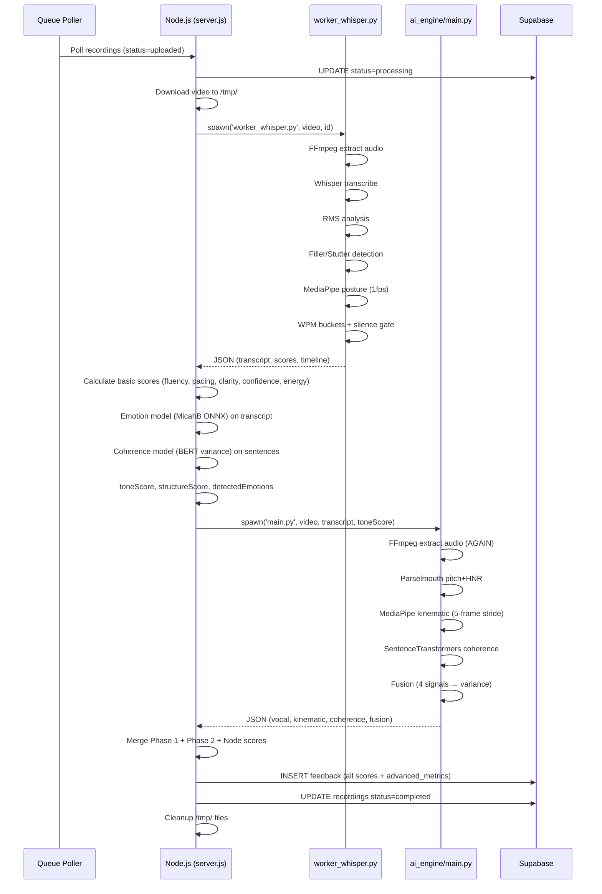

# 07 Processing and Fusion Audit — The Future You

## 7.1 Phase 1 Processing (worker_whisper.py)

### 7.1.1 Entry Point
**File**: `backend/local-processor/worker_whisper.py`
**Function**: `main()` at line 389
**Invocation**: `python worker_whisper.py <video_path> <recording_id>`
**Spawned by**: `server.js:135-137` via `child_process.spawn()`

### 7.1.2 Processing Functions (Sequential Order)

| Step | Function | Input | Output | Lines |
|------|----------|-------|--------|-------|
| 1 | `extract_audio()` | video_path | audio_path (WAV) | 12-23 |
| 2 | `analyze_audio()` | audio_path | Full results dict | 26-387 |
| 3 | `main()` wrapper | video_path, recording_id | JSON to stdout | 389-422 |

### 7.1.3 analyze_audio() Internal Flow (Sequential)

```python
def analyze_audio(audio_path, model_path_unused):
    # 1. WHISPER TRANSCRIPTION (blocking)
    model = WhisperModel("tiny.en", device="cpu", compute_type="int8")
    segments, info = model.transcribe(...)
    # → transcript, all_words[] with timestamps
    
    # 2. RMS SIGNAL & TIMELINE (blocking)
    wf = wave.open(audio_path)
    # → rms_values[], timeline[] (0.125s resolution)
    
    # 3. FILLER & STUTTER DETECTION (blocking)
    # → filler_count, filler_words_detected[], stutter_count
    
    # 4. POSTURE ANALYSIS (blocking, SLOWEST)
    # → 1fps MediaPipe loop over entire video
    # → posture_score, avg_slope, avg_offset, avg_posture_ratio
    
    # 5. WPM & TIMELINE AGGREGATION (blocking)
    # → 5s buckets, silence gate, aggregated_timeline
    
    return {...}
```

**Execution Model**: **Fully Sequential** — each step completes before next begins

### 7.1.4 Intermediate JSON Structure (stdout output)

```json
{
  "transcript": "string",
  "filler_count": 5,
  "filler_words_detected": ["um", "like", "you know"],
  "stutter_count": 1,
  "posture_score": 0.78,
  "average_shoulder_slope": 0.02,
  "average_centering_offset": 0.05,
  "average_posture_ratio": 0.42,
  "average_rms": 1234.5,
  "wpm_std_dev": 23.4,
  "duration": 125.3,
  "timeline": [
    {"time": "0-5s", "rms": 1100, "posture": "Good", "wpm": 130},
    ...
  ],
  "recording_id": "uuid",
  "status": "completed"
}
```

### 7.1.5 Error Handling
- **Whisper failure**: Try/except → print error JSON → `sys.exit(1)` (line 70-71)
- **Audio format invalid**: Validation at line 75-77 → exit
- **MediaPipe missing**: Caught at line 319-322 → warning, continues with defaults
- **Any exception**: Line 414-416 → error JSON to stderr → exit(1)
- **Cleanup**: `finally` block removes temp WAV (line 417-419)

### 7.1.6 Completion Status
- **Success**: `print(json.dumps(results))` to stdout, exit code 0
- **Failure**: `print(json.dumps({"error": "...", "status": "failed"}))` to stderr, exit code 1

---

## 7.2 Phase 2 Processing (ai_engine/main.py)

### 7.2.1 Entry Point
**File**: `backend/ai_engine/main.py`
**Function**: `main()` at line 160
**Invocation**: `python main.py --video <path> --transcript-file <path> --sentiment <score>`
**Spawned by**: `server.js:315-320` via `child_process.spawn()`

### 7.2.2 Processing Functions (Sequential Order)

| Step | Function | Module | Input | Output |
|------|----------|--------|-------|--------|
| 1 | `extract_audio()` | main.py | video_path | temp WAV path |
| 2 | `analyze_audio()` | audio_analysis.py | WAV path | vocal dict |
| 3 | `analyze_video()` | video_analysis.py | video_path | kinematic dict |
| 4 | `calculate_coherence()` | text_analysis.py | transcript | coherence dict |
| 5 | `analyze_fusion()` | fusion.py | 4 raw metrics | fusion dict |

### 7.2.3 run_analysis() Flow (Sequential)

```python
def run_analysis(video_path, transcript, text_sentiment):
    result = {"vocal": {}, "kinematic": {}, "coherence": {}, "fusion": {}}
    
    # 1. Extract audio (FFmpeg)
    audio_path = extract_audio(video_path)
    
    # 2. Vocal Analysis (Parselmouth + Librosa)
    if audio_path:
        result["vocal"] = analyze_audio(audio_path)
    
    # 3. Kinematic Analysis (MediaPipe)
    result["kinematic"] = analyze_video(video_path)
    
    # 4. Coherence (SentenceTransformers)
    if transcript:
        result["coherence"] = calculate_coherence(transcript)
    
    # 5. Fusion (Custom)
    fusion_input = {
        "pitch_var": result["vocal"].get("pitch_var", 30),
        "hnr_mean": result["vocal"].get("hnr_mean", 15),
        "text_sentiment": text_sentiment,  # From Node.js emotion model
        "posture_index": result["kinematic"].get("posture_index", 0.5)
    }
    result["fusion"] = analyze_fusion(fusion_input)
    
    return result
```

**Execution Model**: **Fully Sequential** — no parallelism within Phase 2

### 7.2.4 Intermediate JSON Structure (stdout output)

```json
{
  "vocal": {
    "pitch_var": 28.5,
    "hnr_mean": 18.2,
    "pause_ratio": 0.15,
    "pitch_timeline": [120, 125, 118, ...]
  },
  "kinematic": {
    "posture_index": 0.034,
    "gesture_energy": 12.7,
    "frames_processed": 180,
    "total_frames": 900,
    "gesture_timeline": [0.02, 0.03, 0.01, ...]
  },
  "coherence": {
    "flow_score": 0.72,
    "coherence_timeline": [0.81, 0.65, 0.78, ...],
    "sentence_count": 8
  },
  "fusion": {
    "incongruence_index": 0.045,
    "authenticity_warning": false,
    "signal_spread": 0.32,
    "strongest_signal": "text_sentiment",
    "weakest_signal": "pitch_stability",
    "normalized_scores": {
      "pitch_stability": 0.52,
      "voice_quality": 0.61,
      "text_sentiment": 0.75,
      "body_openness": 0.43
    }
  }
}
```

### 7.2.5 Error Handling
- **FFmpeg failure**: Returns `None` → vocal = `{"error": "Audio extraction failed"}` (line 119-120)
- **Video open failure**: Returns `{"error": "Could not open video file"}` (line 27)
- **No poses detected**: Returns `{"error": "No poses detected in video"}` (line 83)
- **Model load failure**: Try/except in each module → error dict
- **Top-level**: Try/except in `run_analysis` → adds `"error"` to result (line 149-151)
- **Cleanup**: `finally` block removes temp audio (line 155)

### 7.2.6 Completion Status
- **Success**: `print(json.dumps(result))` to stdout, exit code 0
- **Failure**: Still prints result (with error fields), exit code 0 (Node.js checks for `advancedData`)

---

## 7.3 Node.js Orchestration (server.js)

### 7.3.1 Complete Processing Pipeline



### 7.3.2 Sequential vs Parallel Analysis

| Stage | Parallel? | Evidence |
|-------|-----------|----------|
| Queue polling | Single-threaded | `isProcessing` flag (line 422) |
| Video download | Sequential | `await fetch()` + stream write |
| Phase 1 (worker_whisper) | Sequential internal | Single Python process, sequential steps |
| Node.js scoring | Sequential | Lines 164-290 |
| Emotion model | Sequential | `await getEmotionModel()` + `await emotionClassifier()` |
| Coherence model | Sequential | `await getCoherenceModel()` + loop over sentences |
| Phase 2 (ai_engine) | Sequential internal | Single Python process, sequential steps |
| Phase 1 ↔ Phase 2 | **Sequential** | Phase 2 spawned AFTER Phase 1 completes (line 308-356) |
| Database writes | Sequential | `await supabase.insert()` then `await supabase.update()` |

**Conclusion**: **Entirely Sequential** — No parallelism anywhere in the pipeline

### 7.3.3 Phase 1 → Phase 2 Data Flow

| Data | Phase 1 Output | Phase 2 Input | Used? |
|------|----------------|---------------|-------|
| Transcript | `results.transcript` | `--transcript-file` | ✅ Yes (coherence) |
| Tone Score | Node.js calculates | `--sentiment` | ✅ Yes (fusion) |
| Video Path | Node.js has | `--video` | ✅ Yes (kinematic, vocal) |
| Phase 1 Scores | Node.js calculates | Not passed | ❌ No |
| Word Timestamps | `results.all_words` | Not passed | ❌ No |
| RMS Timeline | `results.timeline` | Not passed | ❌ No |

**Critical**: Phase 2 re-extracts audio (duplicate FFmpeg), doesn't receive Phase 1 acoustic features

---

## 7.4 Fusion Analysis (fusion.py)

### 7.4.1 Fusion Pipeline

```python
def analyze_fusion(raw_metrics):
    # 1. Normalize all 4 signals to 0-1
    normalized = normalize_scores(raw_metrics)
    # 2. Detect incongruence via variance
    return detect_incongruence(normalized)
```

### 7.4.2 Normalization Details (`fusion.py:22-60`)

| Raw Signal | Source | Normalization Formula | Output Range |
|------------|--------|----------------------|--------------|
| `pitch_var` (Hz) | Phase 2 vocal | `pitch_stability = 1 - min(pitch_var/60, 1)` | 0-1 (inverted) |
| `hnr_mean` (dB) | Phase 2 vocal | `voice_quality = min(max(hnr, 0)/30, 1)` | 0-1 |
| `text_sentiment` (0-100) | Node.js emotion | `text_sentiment = sentiment/100` | 0.5-1.0 |
| `posture_index` (0-1) | Phase 2 kinematic | `body_openness = min(max(posture, 0), 1)` | 0-1 |

**Note**: `pitch_stability` is INVERTED (low variance = high stability)

### 7.4.3 Incongruence Detection (`fusion.py:63-117`)

```python
values = list(normalized.values())  # 4 values
variance = np.var(values)           # Population variance
authenticity_warning = variance > 0.1  # CODE threshold (README says 0.3)
spread = max(values) - min(values)
strongest = max(normalized, key=normalized.get)
weakest = min(normalized, key=normalized.get)
```

### 7.4.4 Fusion Output

```json
{
  "incongruence_index": 0.045,
  "authenticity_warning": false,
  "signal_spread": 0.32,
  "strongest_signal": "text_sentiment",
  "weakest_signal": "pitch_stability",
  "normalized_scores": {...}
}
```

### 7.4.5 Fusion Input Sources — Critical Traceability

| Fusion Input | Actual Source | Computed Where |
|--------------|---------------|----------------|
| `pitch_var` | Parselmouth (Phase 2) | `audio_analysis.py` |
| `hnr_mean` | Parselmouth (Phase 2) | `audio_analysis.py` |
| `text_sentiment` | MicahB ONNX (Node.js) | `server.js:272-273` |
| `posture_index` | MediaPipe kinematic (Phase 2) | `video_analysis.py` |

**Phase 1 posture (`posture_score`) is NOT used in fusion** — Phase 2 computes its own `posture_index` (different formula!)

---

## 7.5 Data Flow Diagram

```mermaid
flowchart TD
    subgraph "Node.js Orchestrator"
        A[Download Video] --> B[Spawn Phase 1]
        B --> C[Parse Phase 1 JSON]
        C --> D[Calculate Basic Scores]
        D --> E[Run Emotion Model]
        E --> F[Run Coherence Model]
        F --> G[Spawn Phase 2]
        G --> H[Parse Phase 2 JSON]
        H --> I[Merge All Results]
        I --> J[Insert Feedback]
        J --> K[Update Recording Status]
    end
    
    subgraph "Phase 1: worker_whisper.py"
        B --> P1A[FFmpeg: Video→WAV]
        P1A --> P1B[Whisper: WAV→Transcript+Words]
        P1B --> P1C[RMS: WAV→Timeline]
        P1C --> P1D[Fillers: Transcript→Count]
        P1D --> P1E[MediaPipe: Video→Posture@1fps]
        P1E --> P1F[WPM: Words→Buckets+SilenceGate]
        P1F --> P1G[Return JSON]
    end
    
    subgraph "Phase 2: ai_engine/main.py"
        G --> P2A[FFmpeg: Video→WAV (again)]
        P2A --> P2B[Parselmouth: WAV→Pitch+HNR]
        P2A --> P2C[Librosa: WAV→PauseRatio]
        P2B --> P2D[MediaPipe: Video→Kinematic@5frame]
        P2D --> P2E[SentenceTrans: Transcript→Coherence]
        P2B --> P2F[Fusion: 4 Signals→Variance]
        P2F --> P2G[Return JSON]
    end
    
    subgraph "Models (Loaded Per-Job)"
        P1B --> M1[faster-whisper tiny.en]
        P1E --> M2[MediaPipe Pose]
        P2B --> M3[Parselmouth]
        P2C --> M4[Librosa]
        P2D --> M5[MediaPipe Pose]
        P2E --> M6[all-MiniLM-L6-v2]
        E --> M7[MicahB ONNX]
        F --> M8[BERT base-uncased]
    end
```

---

## 7.6 Phase 2 Impact on Final Scores

### Does Phase 2 Change Overall Score?

**NO** — Phase 2 results are stored in `advanced_metrics` but **do not affect** the 4 main scores or overall score!

**Evidence from `server.js`**:
```javascript
// Lines 298-300: Overall score uses ONLY Node.js calculated scores
const overallScore = Math.round(
  (clarityScore * 0.35) + (confidenceScore * 0.25) + (toneScore * 0.20) + (energyScore * 0.20)
);

// Line 368: advancedMetrics stored but NOT used in scoring
advanced_metrics: advancedMetrics,  // Just stored
```

### What Phase 2 Actually Contributes

| Output | Used in Scoring? | Used in Frontend? | Used in Report? |
|--------|------------------|-------------------|-----------------|
| `vocal.pitch_var` | ❌ | ❌ | ❌ |
| `vocal.hnr_mean` | ❌ | ❌ | ❌ |
| `vocal.pause_ratio` | ❌ | ❌ | ❌ |
| `vocal.pitch_timeline` | ❌ | ❌ (Chart?) | ❌ |
| `kinematic.posture_index` | ❌ | ❌ | ❌ |
| `kinematic.gesture_energy` | ❌ | ❌ | ❌ |
| `kinematic.gesture_timeline` | ❌ | ❌ | ❌ |
| `coherence.flow_score` | ❌ | ✅ CoherenceGraph | ✅ PDF Page 4 |
| `coherence.coherence_timeline` | ❌ | ✅ CoherenceGraph | ❌ |
| `fusion.incongruence_index` | ❌ | ✅ AuthenticityStatus | ✅ PDF Page 1 |
| `fusion.authenticity_warning` | ❌ | ✅ AuthenticityStatus + Coach | ✅ PDF Page 1 |
| `fusion.normalized_scores` | ❌ | ✅ AuthenticityStatus | ❌ |

**Conclusion**: Phase 2 generates **insights only** — no impact on core scores. The "Overall Score" is entirely determined by Phase 1 + Node.js models.

---

## 7.7 Missing-Value Handling in Fusion

### Default Values Used (fusion.py:139-144)
```python
fusion_input = {
    "pitch_var": result["vocal"].get("pitch_var", 30),      // Default 30 Hz
    "hnr_mean": result["vocal"].get("hnr_mean", 15),        // Default 15 dB
    "text_sentiment": text_sentiment,                        // From Node.js (50-100)
    "posture_index": result["kinematic"].get("posture_index", 0.5)  // Default 0.5
}
```

### Normalization with Defaults
| Signal | Default Raw | Normalized | Effect |
|--------|-------------|------------|--------|
| pitch_stability | 30 Hz | 1 - 30/60 = 0.5 | Neutral |
| voice_quality | 15 dB | 15/30 = 0.5 | Neutral |
| text_sentiment | 50 (if missing) | 0.5 | Neutral |
| body_openness | 0.5 | 0.5 | Neutral |

**Result**: If Phase 2 fails completely, fusion sees [0.5, 0.5, 0.5, 0.5] → variance = 0 → **no authenticity warning**

**But**: Node.js still has `toneScore` from emotion model (default 60) → `text_sentiment = 0.6`

---

## 7.8 Processing Time Breakdown (Estimated)

| Stage | Estimated Time | Bottleneck |
|-------|----------------|------------|
| Video download | 5-30s | Network |
| Phase 1: FFmpeg | 2-5s | CPU |
| Phase 1: Whisper | 30-120s | CPU (model size) |
| Phase 1: RMS | 1-3s | CPU |
| Phase 1: Fillers | <1s | CPU |
| Phase 1: MediaPipe Pose | 10-60s | CPU (1fps × duration) |
| Phase 1: WPM buckets | <1s | CPU |
| Node.js: Emotion | 2-5s | ONNX inference |
| Node.js: Coherence | 5-15s | BERT per-sentence |
| Phase 2: FFmpeg | 2-5s | CPU (duplicate!) |
| Phase 2: Parselmouth | 1-3s | CPU |
| Phase 2: MediaPipe | 5-20s | CPU (5-frame stride) |
| Phase 2: SentenceTransformers | 2-5s | CPU |
| Phase 2: Fusion | <1s | CPU |
| Database writes | 1-3s | Network |
| **Total (5 min video)** | **~3-6 minutes** | Whisper + MediaPipe |

---

## 7.9 Key Findings

| Finding | Severity | Description |
|---------|----------|-------------|
| **Entirely Sequential** | P1 | No parallelism; Phase 2 waits for Phase 1; models loaded per-job |
| **Duplicate Audio Extraction** | P2 | FFmpeg runs twice (Phase 1 + Phase 2) — wasteful |
| **Phase 2 Doesn't Affect Scores** | P1 | Advanced metrics stored but not used in overall/clarity/confidence/tone/energy |
| **Two Different Posture Metrics** | P2 | Phase 1: neck/shoulder ratio; Phase 2: triangle area — both stored, different |
| **Two Different Coherence Metrics** | P1 | Node.js: BERT variance; Phase 2: SentenceTransformers cosine — both stored |
| **Fusion Uses Phase 2 Posture Only** | P2 | Phase 1 posture_score ignored in fusion |
| **Default Values Mask Failures** | P2 | Failed Phase 2 → neutral fusion → no warning |
| **Models Reloaded Per Job** | P1 | No model caching across videos — slow for queue |
| **Node.js Models Are Singletons** | ✅ Good | Emotion + Coherence models cached in server.js |

---

## 7.10 Recommendations

1. **Cache Models**: Load Whisper, MediaPipe, Parselmouth once at worker startup
2. **Share Audio**: Extract once in Node.js, pass WAV path to both phases
3. **Unify Posture**: Use single posture metric (prefer Phase 1 — more frames, visibility check)
4. **Unify Coherence**: Pick one (SentenceTransformers flow_score is better grounded)
5. **Make Fusion Affect Scores**: Consider authenticity warning as score modifier
6. **Parallelize**: Run Phase 1 audio + video in parallel; run Phase 2 modules in parallel
7. **Add Phase 2 to Scoring**: If Phase 2 adds value, integrate into overall score formula

---

*Generated: 2026-11-01 | Phase 7 of 15 Complete*