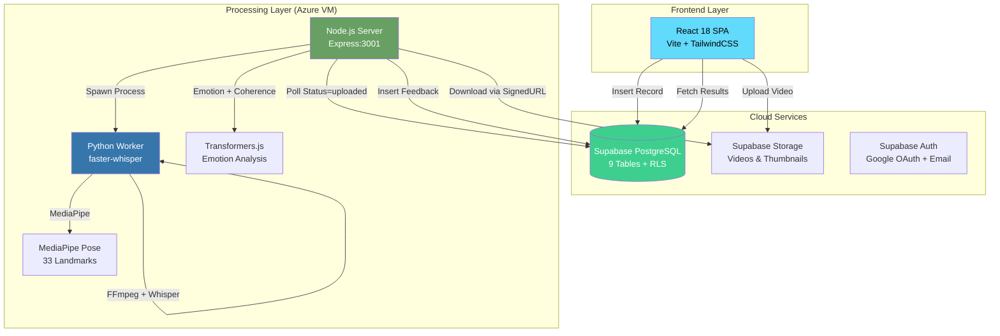
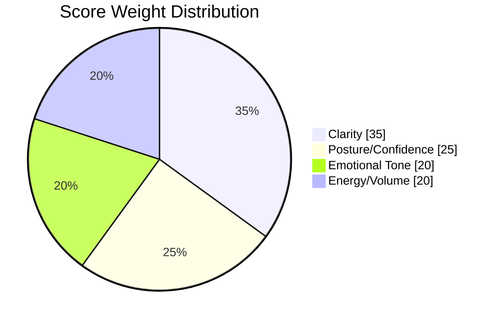
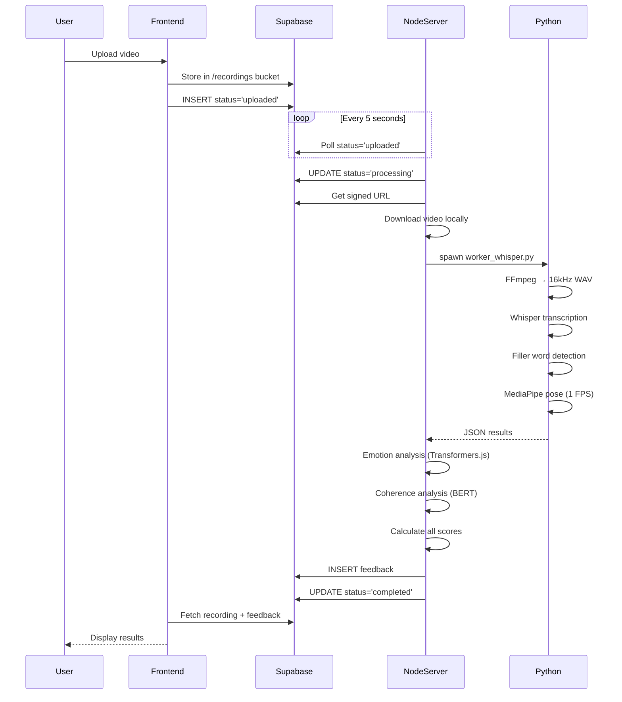

# 🏗️ Architecture v1.5.0 — The Future You (Stable MVP)

> **Release Date:** December 19, 2025\
> **Status:** ✅ Production-Ready (Private Cloud)\
> **Codename:** "Jugaad Stack"

---

## 📊 System Overview



---

## 🔧 Current Technology Stack

| Layer            | Technology                     | Version                 | Purpose                        |
| ---------------- | ------------------------------ | ----------------------- | ------------------------------ |
| **Frontend**     | React + Vite + TypeScript      | 18.3.1 / 5.4.19 / 5.8.3 | SPA with HMR                   |
| **Styling**      | TailwindCSS + shadcn/ui        | 3.4.17                  | 49 Radix-based components      |
| **State**        | TanStack Query                 | 5.83.0                  | Server state caching           |
| **Backend**      | Node.js + Express              | Latest                  | HTTP server, job orchestration |
| **AI Speech**    | faster-whisper (base.en)       | CTranslate2             | Speech-to-text, ~150MB model   |
| **AI Vision**    | MediaPipe Pose                 | Latest                  | 33 body landmarks              |
| **AI Emotion**   | MicahB/emotion_text_classifier | Transformers.js         | 11 emotion categories          |
| **AI Coherence** | Xenova/bert-base-uncased       | Transformers.js         | Feature extraction             |
| **Database**     | Supabase PostgreSQL            | Latest                  | 9 tables with RLS              |
| **Storage**      | Supabase Storage               | Latest                  | Video/thumbnail buckets        |
| **Hosting**      | Azure VM (Docker)              | B2s                     | 2 vCPU, 4GB RAM                |

---

## 📐 Scoring Logic (v1.5.0)

### Overall Score Formula

```
overallScore = (clarity × 0.35) + (confidence × 0.25) + (tone × 0.20) + (energy × 0.20)
```



### Individual Metrics

| Metric         | Formula                                         | Source        |
| -------------- | ----------------------------------------------- | ------------- |
| **Clarity**    | `(fluencyScore + pacingScore) / 2`              | server.js:173 |
| **Fluency**    | `100 × e^(-0.15 × max(0, fillers_per_min - 1))` | server.js:166 |
| **Pacing**     | `100 × e^(-(WPM - 145)² / (2 × 50²))`           | server.js:168 |
| **Confidence** | `visibility × (alignment + centering)`          | server.js:180 |
| **Tone**       | `50 + (weighted_emotion_avg × 50)`              | server.js:265 |
| **Energy**     | Linear scale in 40-80 dB range                  | server.js:283 |
| **Coherence**  | `60 + (coherent_ratio × 35)`                    | server.js:219 |

### Posture Classification Thresholds

| Posture Ratio | Label     | Score |
| ------------- | --------- | ----- |
| > 0.50        | 👑 Regal  | 1.0   |
| ≥ 0.35        | ✅ Good   | 0.85  |
| < 0.35        | ⚠️ Slouch | 0.40  |

> **Posture Ratio** = `neck_length / shoulder_width`\
> **Sampling Rate:** 1 frame per second

### Emotion Weights (Weighted Average)

```javascript
{
  'joy': 1.0, 'love': 0.9, 'optimism': 0.8, 'trust': 0.7,
  'anticipation': 0.6, 'surprise': 0.5, 'sadness': 0.3,
  'fear': 0.25, 'pessimism': 0.2, 'disgust': 0.15, 'anger': 0.1
}
```

---

## 🔄 Processing Pipeline



---

## 📁 Project Structure

```
yash-reflections-mvp/
├── frontend/                    # React SPA
│   ├── src/
│   │   ├── components/         # 49 shadcn/ui components
│   │   ├── pages/              # 17 route pages
│   │   ├── hooks/              # 5 custom hooks
│   │   └── lib/                # Supabase client, utilities
│   └── package.json            # v1.5.0
│
├── backend/
│   └── local-processor/        # AI Processing Server
│       ├── server.js           # 530 lines - Node.js orchestrator
│       ├── worker_whisper.py   # 421 lines - Python AI worker
│       ├── Dockerfile          # Azure deployment config
│       └── package.json        # v1.5.0
│
├── docs/                       # Documentation
│   ├── ARCHITECTURE_v1.5.md    # This file
│   ├── ROADMAP_v2.0.md         # Future upgrades
│   └── LOGIC_AUDIT_REPORT.md   # Detailed algorithm analysis
│
└── README.md                   # v1.5.0 (Private Cloud MVP)
```

---

## ⚠️ Known Limitations (v1.5.0)

| Component      | Limitation                                             | Impact                                         |
| -------------- | ------------------------------------------------------ | ---------------------------------------------- |
| **Coherence**  | Uses BERT embedding variance, not linguistic coherence | May misclassify complex but coherent sentences |
| **Posture**    | 1 FPS sampling                                         | May miss brief slouches                        |
| **Emotion**    | First 1500 chars only                                  | Ignores emotional arc over long videos         |
| **Tone Floor** | Minimum score is 50                                    | Pure negative emotions still score 50+         |
| **Weights**    | Hardcoded in source                                    | Cannot be configured per user                  |
| **WPM Target** | Fixed at 145 WPM                                       | One-size-fits-all pacing                       |

---

## 🔐 Security Notes

- **Backend uses Supabase Service Role Key** (bypasses RLS for background
  processing)
- **Row-Level Security** enabled on all user-facing tables
- **Signed URLs** used for video downloads (60-second expiry)
- **No user data stored locally** - all processing artifacts cleaned up

---

_Document generated for Release v1.5.0 — December 19, 2025_
