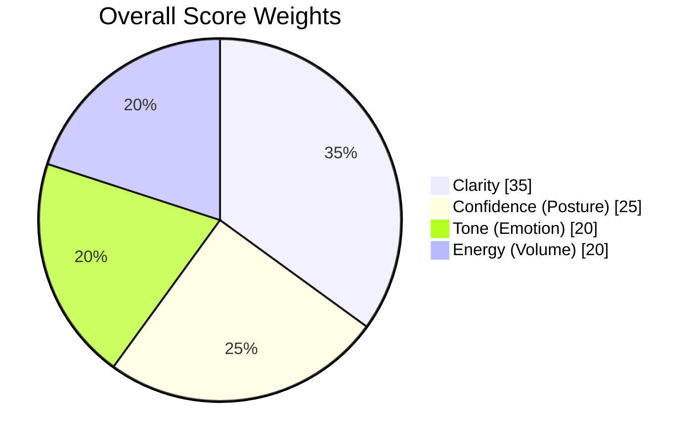
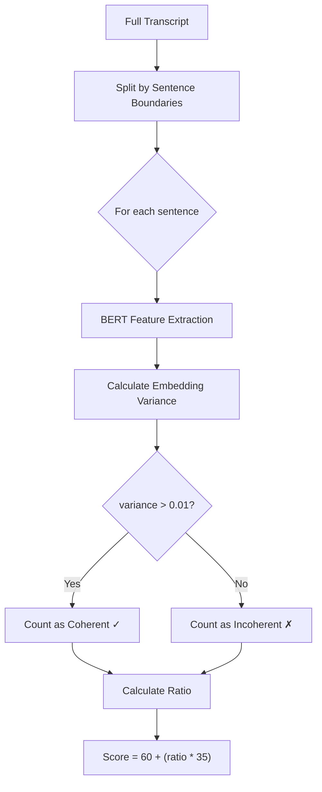
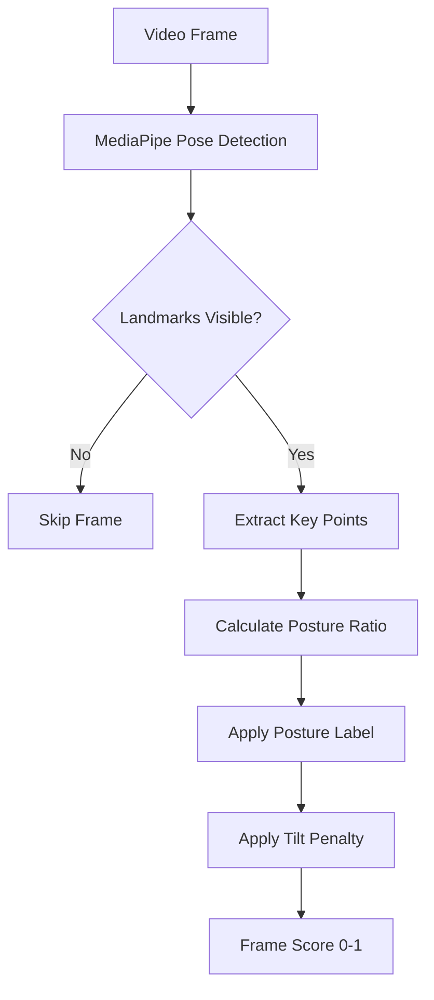
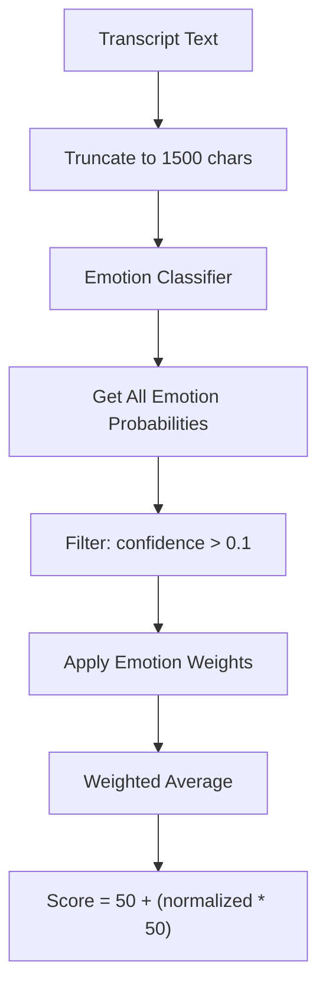
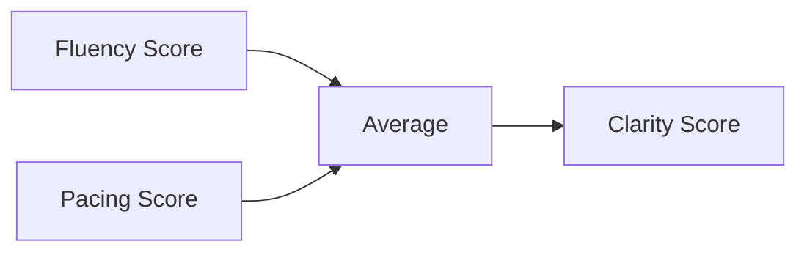
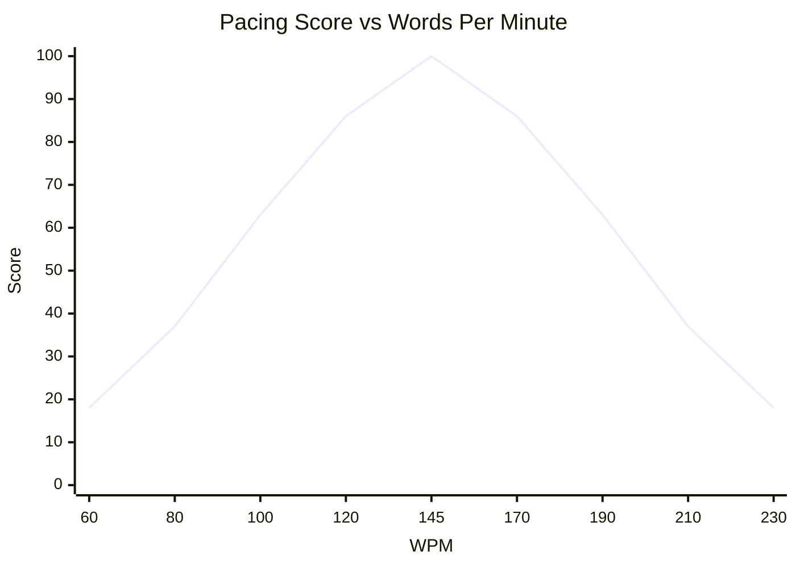
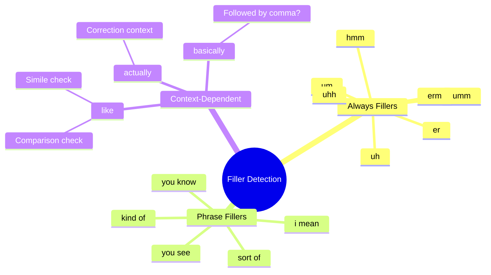

# 🔬 AI Processing Pipeline - Logic Audit Report

> **Generated:** December 19, 2025\
> **Target Version:** Current Production\
> **Audit Scope:** Scoring Algorithms & Metrics Calculations

---

## 📊 Executive Summary

This audit examines the complete AI processing pipeline across two core files:

| File                                                                                                                       | Lines | Purpose                                                              |
| -------------------------------------------------------------------------------------------------------------------------- | ----- | -------------------------------------------------------------------- |
| [server.js](file:///c:/Users/Yash/OneDrive/Desktop/yash-reflections-mvp/backend/local-processor/server.js)                 | 530   | Node.js orchestrator + JS-based scoring + Emotion/Coherence analysis |
| [worker_whisper.py](file:///c:/Users/Yash/OneDrive/Desktop/yash-reflections-mvp/backend/local-processor/worker_whisper.py) | 421   | Python worker for transcription, posture analysis, filler detection  |

```mermaid
flowchart LR
    subgraph Input
        A[📹 Video Upload]
    end
    
    subgraph Python Worker
        B[🎵 FFmpeg Audio Extract]
        C[🎤 Whisper Transcription]
        D[📏 RMS Signal Analysis]
        E[🧍 MediaPipe Posture]
        F[💬 Filler Word Detection]
    end
    
    subgraph Node.js Server
        G[🧠 Emotion Classification]
        H[📝 Coherence Analysis]
        I[📊 Score Aggregation]
    end
    
    subgraph Output
        J[💾 Supabase Storage]
    end
    
    A --> B --> C --> D --> E --> F --> G --> H --> I --> J
```



---

## 1️⃣ Overall Confidence Score (The Big Number)

| Property        | Value                                                                                                                        |
| --------------- | ---------------------------------------------------------------------------------------------------------------------------- |
| **Metric Name** | `overall_score`                                                                                                              |
| **Source File** | [server.js:290-292](file:///c:/Users/Yash/OneDrive/Desktop/yash-reflections-mvp/backend/local-processor/server.js#L290-L292) |
| **Type**        | Weighted Average                                                                                                             |

### 🧮 Formula

```javascript
const overallScore = Math.round(
    (clarityScore * 0.35) +
        (confidenceScore * 0.25) +
        (toneScore * 0.20) +
        (energyScore * 0.20),
);
```

### 📊 Weight Distribution



> [!IMPORTANT]
> **Suspicion Answered:** The score is **NOT** hardcoded. It is derived from 4
> sub-metrics with fixed weights:
>
> - **35%** Clarity (fluency + pacing)
> - **25%** Confidence (posture analysis)
> - **20%** Tone (emotion classification)
> - **20%** Energy (audio volume/RMS)

### ⚠️ Current Limitations

| Issue                   | Details                                                              |
| ----------------------- | -------------------------------------------------------------------- |
| **Hardcoded Weights**   | Weights (0.35, 0.25, 0.20, 0.20) are fixed in code, not configurable |
| **No User Calibration** | Same weights apply to all users regardless of goals                  |
| **Missing Metrics**     | Eye contact, gesture analysis not included                           |

---

## 2️⃣ Thought Structure / Coherence Score

| Property        | Value                                                                                                                        |
| --------------- | ---------------------------------------------------------------------------------------------------------------------------- |
| **Metric Name** | `structureScore` (stored in `key_insights.sentiment.structure_score`)                                                        |
| **Source File** | [server.js:194-222](file:///c:/Users/Yash/OneDrive/Desktop/yash-reflections-mvp/backend/local-processor/server.js#L194-L222) |
| **Model**       | `Xenova/bert-base-uncased` (feature-extraction task)                                                                         |

### 🧮 Algorithm Breakdown



### 📐 Exact Formula

```javascript
// Step 1: Split transcript into sentences
const sentences = results.transcript.match(/[^.!?]+[.!?]+/g) ||
    [results.transcript];

// Step 2: For each sentence, get BERT embeddings
for (const sentence of sentences) {
    if (sentence.trim().length < 10) continue; // Skip short sentences

    const output = await coherenceClassifier(sentence.trim());
    const data = output.data;

    // Step 3: Calculate variance of embeddings
    const mean = sum(data) / data.length;
    const variance = sum((data[i] - mean) ^ 2) / data.length;

    // Step 4: High variance = diverse features = coherent
    if (variance > 0.01) coherentSentences++;
}

// Step 5: Final score calculation
const ratio = coherentSentences / totalSentences;
structureScore = Math.round(60 + (ratio * 35));
// Range: 60-95 (baseline 60, max bonus 35)
```

> [!WARNING]
> **Critical Finding:** This is measuring **embedding variance**, not
> traditional linguistic coherence metrics like perplexity or sentence
> similarity. The assumption is that "more varied embeddings = more meaningful
> content."

### Score Interpretation

| Score Range | Meaning                                            |
| ----------- | -------------------------------------------------- |
| **95**      | All sentences have varied, feature-rich embeddings |
| **60-94**   | Mixed coherence levels                             |
| **60**      | All sentences flagged as potentially incoherent    |

### ⚠️ Current Limitations

| Issue                   | Location                                                                                                          | Details                                                |
| ----------------------- | ----------------------------------------------------------------------------------------------------------------- | ------------------------------------------------------ |
| **Fallback Model**      | [server.js:39](file:///c:/Users/Yash/OneDrive/Desktop/yash-reflections-mvp/backend/local-processor/server.js#L39) | If model fails, returns dummy `[[0.1, 0.2, 0.3]]`      |
| **No Summary**          | N/A                                                                                                               | "Key Takeaways" feature does **NOT exist** in codebase |
| **Threshold Hardcoded** | Line 212                                                                                                          | `variance > 0.01` is arbitrary                         |
| **Short Sentence Skip** | Line 200                                                                                                          | Sentences < 10 chars ignored                           |

---

## 3️⃣ Posture / Confidence Score (Body Language)

| Property          | Value                                                                                                                                                                                                                                                                                            |
| ----------------- | ------------------------------------------------------------------------------------------------------------------------------------------------------------------------------------------------------------------------------------------------------------------------------------------------ |
| **Metric Name**   | `confidenceScore` (confusingly named - this is posture)                                                                                                                                                                                                                                          |
| **Source Files**  | [worker_whisper.py:194-314](file:///c:/Users/Yash/OneDrive/Desktop/yash-reflections-mvp/backend/local-processor/worker_whisper.py#L194-L314) (analysis) + [server.js:175-180](file:///c:/Users/Yash/OneDrive/Desktop/yash-reflections-mvp/backend/local-processor/server.js#L175-L180) (scoring) |
| **Model**         | MediaPipe Pose                                                                                                                                                                                                                                                                                   |
| **Sampling Rate** | **1 frame per second**                                                                                                                                                                                                                                                                           |

### 🧮 Two-Stage Algorithm

#### Stage 1: Python Worker (Per-Frame Analysis)



```python
# Posture Ratio Calculation (worker_whisper.py:262-268)
shoulder_width = sqrt((left_shoulder.x - right_shoulder.x)^2 + (left_shoulder.y - right_shoulder.y)^2)
neck_length = abs(nose.y - shoulder_mid_y)
posture_ratio = neck_length / shoulder_width

# Posture Classification (worker_whisper.py:273-281)
if posture_ratio > 0.50:
    frame_score = 1.0   # "Regal"
elif posture_ratio >= 0.35:
    frame_score = 0.85  # "Good"
else:
    frame_score = 0.40  # "Slouch" ⚠️

# Tilt Penalty (worker_whisper.py:284-286)
shoulder_tilt = abs(left_shoulder.y - right_shoulder.y)
if shoulder_tilt > 0.05:
    frame_score -= 0.1
```

#### Stage 2: Node.js Server (Final Score)

```javascript
// server.js:175-180
const visibilityRatio = results.posture_score; // Average frame score (0-1)
const slope = results.average_shoulder_slope;
const offset = results.average_centering_offset;

// Alignment: Penalize uneven shoulders (max penalty at slope=0.2)
const alignmentScore = Math.max(0, 50 * (1 - (slope / 0.2)));

// Centering: Penalize off-center positioning (max penalty at offset=0.3)
const centeringScore = Math.max(0, 50 * (1 - (offset / 0.3)));

// Final (0-100 range)
const confidenceScore = Math.round(
    visibilityRatio * (alignmentScore + centeringScore),
);
```

### 📊 Slouch Detection Criteria

| Trigger           | Threshold | Location                                                                                                                                     |
| ----------------- | --------- | -------------------------------------------------------------------------------------------------------------------------------------------- |
| **Posture Ratio** | < 0.35    | [worker_whisper.py:279-281](file:///c:/Users/Yash/OneDrive/Desktop/yash-reflections-mvp/backend/local-processor/worker_whisper.py#L279-L281) |
| **Shoulder Tilt** | > 0.05    | [worker_whisper.py:284](file:///c:/Users/Yash/OneDrive/Desktop/yash-reflections-mvp/backend/local-processor/worker_whisper.py#L284)          |

> [!NOTE]
> **Posture Ratio** = `neck_length / shoulder_width`. A slouch occurs when you
> "turtle" - bringing shoulders up and head forward, reducing the vertical
> distance between nose and shoulders relative to shoulder width.

### ⚠️ Current Limitations

| Issue                    | Details                                                                              |
| ------------------------ | ------------------------------------------------------------------------------------ |
| **Naming Confusion**     | Variable called `confidenceScore` but measures posture, not psychological confidence |
| **1 FPS Sampling**       | May miss brief slouches or micro-adjustments                                         |
| **Visibility Required**  | If landmarks not visible (>0.5 confidence), frame is skipped                         |
| **Hardcoded Thresholds** | All values (0.35, 0.50, 0.05, 0.2, 0.3) are magic numbers                            |
| **Frame Resizing**       | Frames resized to max 640px for performance - may affect accuracy                    |

---

## 4️⃣ Emotional Tone Analysis

| Property              | Value                                                                                                                        |
| --------------------- | ---------------------------------------------------------------------------------------------------------------------------- |
| **Metric Name**       | `toneScore` + `sentimentLabel`                                                                                               |
| **Source File**       | [server.js:224-277](file:///c:/Users/Yash/OneDrive/Desktop/yash-reflections-mvp/backend/local-processor/server.js#L224-L277) |
| **Model**             | `MicahB/emotion_text_classifier`                                                                                             |
| **Emotions Detected** | joy, love, optimism, trust, anticipation, surprise, sadness, fear, pessimism, disgust, anger                                 |

### 🧮 Aggregation Method



### 📊 Emotion Weight Table

```javascript
// server.js:233-245
const emotionWeights = {
    "joy": 1.0, // Most positive
    "love": 0.9,
    "optimism": 0.8,
    "trust": 0.7,
    "anticipation": 0.6,
    "surprise": 0.5, // Neutral
    "sadness": 0.3,
    "fear": 0.25,
    "pessimism": 0.2,
    "disgust": 0.15,
    "anger": 0.1, // Most negative
};
```

### 📐 Exact Formula

```javascript
// Step 1: Get emotion predictions for first 1500 chars
const textToAnalyze = results.transcript.substring(0, 1500);
const emotionOutput = await emotionClassifier(textToAnalyze);

// Step 2: Calculate weighted sum (only emotions with confidence > 0.1)
let weightedSum = 0;
let totalWeight = 0;

for (const emotion of emotionOutput) {
    if (emotion.score > 0.1) { // Threshold
        const weight = emotionWeights[emotion.label] || 0.5;
        weightedSum += emotion.score * weight;
        totalWeight += emotion.score;
    }
}

// Step 3: Normalize and scale
const normalizedScore = weightedSum / totalWeight; // 0-1 range
toneScore = Math.round(50 + (normalizedScore * 50)); // 50-100 range

// Step 4: Pick dominant emotion as label
sentimentLabel = capitalizeFirst(emotionOutput[0].label);
```

> [!IMPORTANT]
> **Key Finding:** The system uses **weighted average** across ALL detected
> emotions, not just the peak emotion. The dominant emotion is used only for the
> label, not the score.

### Score Interpretation

| Score   | Meaning                      |
| ------- | ---------------------------- |
| **100** | Pure joy detected            |
| **75**  | Optimistic/positive mix      |
| **50**  | Neutral or balanced emotions |
| **<50** | Impossible (floor is 50)     |

### ⚠️ Current Limitations

| Issue                    | Details                                                        |
| ------------------------ | -------------------------------------------------------------- |
| **Text Truncation**      | Only first 1500 chars analyzed - may miss emotional arc        |
| **Single Model**         | No temporal emotion tracking (start vs. end of video)          |
| **Floor at 50**          | Score can never go below 50, even for pure anger               |
| **Confidence Threshold** | 0.1 threshold may exclude low-confidence but relevant emotions |

---

## 5️⃣ Clarity & Pacing Analysis

| Property         | Value                                                                                                                                                                                                                                                                                                   |
| ---------------- | ------------------------------------------------------------------------------------------------------------------------------------------------------------------------------------------------------------------------------------------------------------------------------------------------------- |
| **Metric Names** | `clarityScore`, `pacingScore`, `fluencyScore`, `wpm`                                                                                                                                                                                                                                                    |
| **Source Files** | [server.js:156-173](file:///c:/Users/Yash/OneDrive/Desktop/yash-reflections-mvp/backend/local-processor/server.js#L156-L173) (calculation) + [worker_whisper.py:322-370](file:///c:/Users/Yash/OneDrive/Desktop/yash-reflections-mvp/backend/local-processor/worker_whisper.py#L322-L370) (WPM buckets) |

### 🧮 Clarity Score Formula



```javascript
// Clarity is simple average of fluency and pacing
const clarityScore = Math.round((fluencyScore + pacingScore) / 2);
```

### 📐 Fluency Score (Filler Word Penalty)

```javascript
// server.js:164-166
const durationMin = Math.max(duration / 60, 0.01);
const dfm = results.filler_count / durationMin; // Fillers per minute

// Exponential decay from 100 (penalty starts after 1 filler/min)
const fluencyScore = Math.round(100 * Math.exp(-0.15 * Math.max(0, dfm - 1)));
```

| Fillers/Min | Score |
| ----------- | ----- |
| 0-1         | 100   |
| 3           | 74    |
| 5           | 55    |
| 10          | 22    |
| 15          | 8     |

### 📐 Pacing Score (WPM Target)

```javascript
// server.js:168-171
// Gaussian centered at 145 WPM, std dev 50
const rawPacingScore = 100 *
    Math.exp(-Math.pow(wpm - 145, 2) / (2 * Math.pow(50, 2)));

// Consistency penalty (waived if WPM is in ideal range)
let consistencyPenalty = results.wpm_std_dev || 0;
if (wpm >= 130 && wpm <= 170) consistencyPenalty = 0;

const pacingScore = Math.max(
    0,
    Math.round(rawPacingScore - consistencyPenalty),
);
```



> [!TIP]
> **Optimal WPM Range:** 130-170 WPM (consistency penalty waived)

### 📐 WPM Calculation

```python
# worker_whisper.py:322-333
bucket_size = 5.0  # 5-second windows
wpm_buckets = [0] * num_buckets

for word in all_words:
    mid = (word['start'] + word['end']) / 2
    bucket_idx = int(mid / bucket_size)
    wpm_buckets[bucket_idx] += 1

# Convert to WPM (words per 5 sec * 12 = words per minute)
wpm_series = [count * 12 for count in wpm_buckets]

# Silence Gate (worker_whisper.py:352-357)
SILENCE_THRESHOLD = 500  # RMS threshold
if avg_rms_bucket < SILENCE_THRESHOLD:
    current_wpm = 0  # Ignore silent segments
```

> [!IMPORTANT]
> **Silence IS Excluded:** The Silence Gate zeros out WPM for buckets with RMS <
> 500, preventing silence from artificially lowering the score.

### ⚠️ Current Limitations

| Issue                           | Details                                          |
| ------------------------------- | ------------------------------------------------ |
| **Target WPM Hardcoded**        | 145 WPM is one-size-fits-all                     |
| **Bucket Size Fixed**           | 5-second windows may be too coarse               |
| **Whisper Confidence Not Used** | Clarity is NOT based on transcription confidence |

---

## 6️⃣ Filler Word Detection

| Property        | Value                                                                                                                                        |
| --------------- | -------------------------------------------------------------------------------------------------------------------------------------------- |
| **Metric Name** | `filler_count`, `filler_words_detected`                                                                                                      |
| **Source File** | [worker_whisper.py:113-192](file:///c:/Users/Yash/OneDrive/Desktop/yash-reflections-mvp/backend/local-processor/worker_whisper.py#L113-L192) |
| **Method**      | Context-Aware Pattern Matching (NOT simple regex)                                                                                            |

### 🧮 Detection Categories



### 📐 Context-Aware Logic

#### "Like" Detection ([worker_whisper.py:119-134](file:///c:/Users/Yash/OneDrive/Desktop/yash-reflections-mvp/backend/local-processor/worker_whisper.py#L119-L134))

```python
def is_like_filler(words, idx):
    # Starting sentence with 'like' = filler
    if idx == 0:
        return True
    
    prev_word = words[idx-1].lower()
    next_word = words[idx+1].lower()
    
    # "looks like", "feels like" = NOT filler
    comparison_verbs = {"feel", "felt", "looks", "sounds", "seem", "is", "was", ...}
    if prev_word in comparison_verbs:
        return False
    
    # "like a dog" = simile, NOT filler
    if next_word in {"a", "an", "the", "this", "that", "my", "your", ...}:
        return False
    
    return True  # Default: filler
```

### 📊 Stutter Detection

```python
# worker_whisper.py:188-192
# Regex: Find repeated words (e.g., "I I", "the the")
stutters = re.findall(r"\b(\w+)( \1\b)+", transcript, re.IGNORECASE)
stutter_count = len(stutters)
```

> [!NOTE]
> **Score Penalty:** Yes, filler words DO penalize the score via the Fluency
> Score formula: `100 * exp(-0.15 * max(0, fillers_per_minute - 1))`

### ⚠️ Current Limitations

| Issue                  | Details                                       |
| ---------------------- | --------------------------------------------- |
| **English Only**       | No multi-language filler support              |
| **Context Heuristics** | Rule-based, may miss edge cases               |
| **No Timestamp**       | Detected fillers not mapped to specific times |
| **Stutters Basic**     | Only catches adjacent word repetition         |

---

## 7️⃣ Energy Score

| Property         | Value                                                                                                                                                                                                                                                                                                 |
| ---------------- | ----------------------------------------------------------------------------------------------------------------------------------------------------------------------------------------------------------------------------------------------------------------------------------------------------- |
| **Metric Name**  | `energyScore`                                                                                                                                                                                                                                                                                         |
| **Source Files** | [worker_whisper.py:71-111](file:///c:/Users/Yash/OneDrive/Desktop/yash-reflections-mvp/backend/local-processor/worker_whisper.py#L71-L111) (RMS calculation) + [server.js:283-288](file:///c:/Users/Yash/OneDrive/Desktop/yash-reflections-mvp/backend/local-processor/server.js#L283-L288) (scoring) |

### 🧮 RMS to Score Conversion

```javascript
// server.js:284-288
const rms = results.average_rms || 1;
const db = 20 * Math.log10(rms); // Convert RMS to decibels

let energyScore = 100;
if (db < 40) {
    energyScore = Math.max(0, Math.round((db / 40) * 50)); // Too quiet
} else if (db > 80) {
    energyScore = Math.max(0, Math.round(100 - ((db - 80) * 2))); // Too loud
}
```

| dB Level | Score      | Interpretation |
| -------- | ---------- | -------------- |
| < 40     | 0-50       | Too quiet      |
| 40-80    | 100        | Optimal        |
| > 80     | Decreasing | Too loud       |

---

## 📋 Complete Metrics Summary Table

| Metric              | Source                        | Model/Method    | Formula Summary                                              | Hardcoded Values           |
| ------------------- | ----------------------------- | --------------- | ------------------------------------------------------------ | -------------------------- |
| **Overall Score**   | server.js:290                 | Weighted avg    | `(clarity*0.35)+(confidence*0.25)+(tone*0.20)+(energy*0.20)` | Weights                    |
| **Structure Score** | server.js:219                 | BERT embeddings | `60 + (coherent_ratio * 35)`                                 | Variance threshold 0.01    |
| **Posture Score**   | server.js:180 + worker.py:273 | MediaPipe       | `visibility * (alignment + centering)`                       | Ratio thresholds 0.35/0.50 |
| **Tone Score**      | server.js:265                 | MicahB emotion  | `50 + (weighted_emotion_avg * 50)`                           | Emotion weights            |
| **Clarity Score**   | server.js:173                 | Derived         | `(fluency + pacing) / 2`                                     | None                       |
| **Fluency Score**   | server.js:166                 | Filler penalty  | `100 * exp(-0.15 * max(0, fpm-1))`                           | 0.15 decay rate            |
| **Pacing Score**    | server.js:168-171             | Gaussian WPM    | `100 * exp(-(wpm-145)²/(2*50²))`                             | Target 145, σ=50           |
| **Energy Score**    | server.js:283                 | RMS to dB       | Linear in 40-80 dB range                                     | 40/80 dB thresholds        |
| **Filler Count**    | worker.py:113                 | Context rules   | Pattern matching + heuristics                                | Word lists                 |
| **WPM**             | worker.py:327                 | Word timestamps | `words / (duration/60)`                                      | 5s bucket size             |

---

## 🚧 Upgrade Recommendations

> [!CAUTION]
> The following issues should be addressed before the scoring algorithm upgrade:

1. **Configurable Weights** - Move all magic numbers to config file
2. **User Profiles** - Allow different target WPM for presentation vs. casual
   speech
3. **Coherence Model** - Replace variance-based check with proper linguistic
   coherence
4. **Emotion Temporal** - Track emotion changes over time, not just aggregate
5. **Posture Naming** - Rename `confidenceScore` to `postureScore` to avoid
   confusion
6. **Full Transcript Analysis** - Remove 1500 char limit for emotion analysis

---

_Report generated by Antigravity Logic Audit Tool v1.0_
