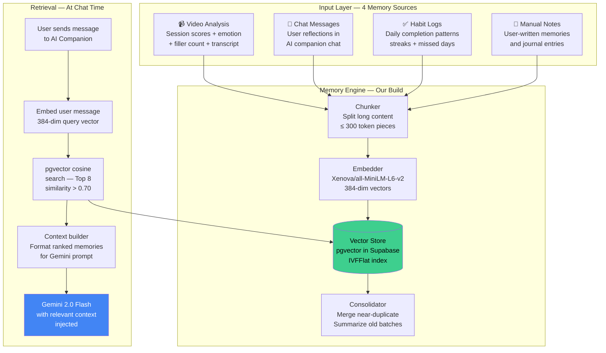
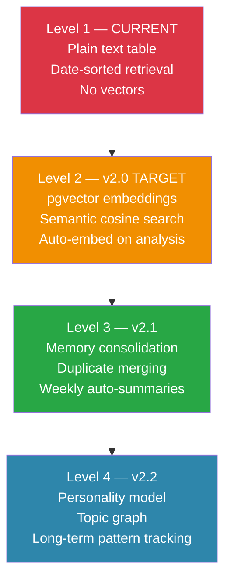

# 🧠 Memory System — Design & Implementation Guide

**Version**: v2.0 Design  
**Status**: 🚧 In Development  
**Doc updated**: September 2026

---

## 1. Current State of Memory

### What Exists Now


**The honest problem:**
- Memories are stored as plain text rows
- AI reads the 5 newest entries **regardless of relevance**
- If you ask "what was going wrong with my confidence last month?", the AI searches by *date*, not by *meaning*
- No cross-session learning — each chat is mostly stateless
- No auto-summarization — your reflections pile up but are never synthesized

---

## 2. What World-Class Memory Looks Like

### 2.1 The Supermemory Architecture (reference)

Supermemory (supermemoryai/supermemory) is an open-source memory layer for AI apps. Its core idea:

> "Store memories as **embeddings** (semantic vectors), not row text. When you need context, find memories that are *semantically similar* to the current question — not just the most recent ones."

**Key components:**
1. **Ingestion** — any text/event is chunked → embedded → stored in vector DB
2. **Retrieval** — user query is embedded → cosine search returns top-K relevant memories
3. **Consolidation** — duplicate/similar memories are merged over time
4. **Context building** — relevant memories are formatted and injected into the LLM prompt

### 2.2 Our Self-Owned Version

We build the **same behaviour** without depending on any external memory API:



---

## 3. Implementation Plan (Step by Step)

### Step 1 — Enable pgvector in Supabase

Run in Supabase SQL Editor:

```sql
-- Enable vector extension
CREATE EXTENSION IF NOT EXISTS vector;

-- Main memory table
CREATE TABLE memories_vectors (
  id           UUID PRIMARY KEY DEFAULT gen_random_uuid(),
  user_id      UUID REFERENCES profiles(id) ON DELETE CASCADE NOT NULL,
  source_type  TEXT NOT NULL CHECK (source_type IN ('video', 'chat', 'habit', 'note')),
  source_id    UUID,                    -- FK to recording_id or message_id
  content      TEXT NOT NULL,           -- The text chunk
  summary      TEXT,                    -- Auto-generated 1-line summary
  embedding    VECTOR(384) NOT NULL,    -- all-MiniLM-L6-v2 output
  importance   FLOAT DEFAULT 0.5,       -- 0-1, boosted for insights
  metadata     JSONB DEFAULT '{}',      -- {score, emotion, date, topic}
  created_at   TIMESTAMPTZ DEFAULT now()
);

-- Fast cosine similarity index
CREATE INDEX memories_ivfflat_idx
  ON memories_vectors
  USING ivfflat (embedding vector_cosine_ops)
  WITH (lists = 100);

-- User + date filtering index
CREATE INDEX memories_user_idx ON memories_vectors (user_id, created_at DESC);
```

### Step 2 — Semantic Search Function

```sql
CREATE OR REPLACE FUNCTION match_memories(
  query_embedding  VECTOR(384),
  match_user_id    UUID,
  match_threshold  FLOAT   DEFAULT 0.70,
  match_count      INT     DEFAULT 8
)
RETURNS TABLE (
  id         UUID,
  content    TEXT,
  summary    TEXT,
  similarity FLOAT,
  source_type TEXT,
  metadata   JSONB,
  created_at TIMESTAMPTZ
)
LANGUAGE SQL STABLE AS $$
  SELECT
    id, content, summary,
    1 - (embedding <=> query_embedding) AS similarity,
    source_type, metadata, created_at
  FROM memories_vectors
  WHERE user_id = match_user_id
    AND 1 - (embedding <=> query_embedding) > match_threshold
  ORDER BY embedding <=> query_embedding
  LIMIT match_count;
$$;
```

### Step 3 — Embedder Module (Node.js)

Create `backend/local-processor/memory_engine.js`:

```javascript
const { createClient } = require('@supabase/supabase-js');
let _embedder = null;

async function getEmbedder() {
  if (!_embedder) {
    const { pipeline } = await import('@xenova/transformers');
    _embedder = await pipeline('feature-extraction', 'Xenova/all-MiniLM-L6-v2');
  }
  return _embedder;
}

async function embedText(text) {
  const embedder = await getEmbedder();
  const output = await embedder(text.slice(0, 512), {
    pooling: 'mean',
    normalize: true
  });
  return Array.from(output.data); // 384 floats
}

/**
 * Store a memory from a video analysis session.
 */
async function storeVideoMemory(supabase, userId, recordingId, feedbackData) {
  const content = [
    `Video session on ${new Date().toDateString()}.`,
    `Overall score: ${feedbackData.overall_score}/100.`,
    `Clarity: ${feedbackData.clarity_score}/100. Pace: ${feedbackData.pace_score}/100.`,
    `Confidence: ${feedbackData.confidence_score}/100. Tone: ${feedbackData.tone_score}/100.`,
    `Dominant emotion: ${feedbackData.key_insights?.sentiment?.score || 'neutral'}.`,
    `Filler words: ${feedbackData.filler_words_count}.`,
    `Key improvement: ${(feedbackData.improvements || [])[0] || 'continue practicing'}.`
  ].join(' ');

  const vector = await embedText(content);

  await supabase.from('memories_vectors').insert({
    user_id: userId,
    source_type: 'video',
    source_id: recordingId,
    content,
    embedding: JSON.stringify(vector),
    importance: feedbackData.overall_score > 70 ? 0.7 : 0.5,
    metadata: {
      score: feedbackData.overall_score,
      emotion: feedbackData.key_insights?.sentiment?.score,
      date: new Date().toISOString()
    }
  });
}

/**
 * Store a memory from a chat message (when user shares a reflection).
 */
async function storeChatMemory(supabase, userId, messageContent, messageId) {
  // Only store user messages that are reflective (length > 80 chars)
  if (messageContent.length < 80) return;

  const vector = await embedText(messageContent);

  await supabase.from('memories_vectors').insert({
    user_id: userId,
    source_type: 'chat',
    source_id: messageId,
    content: messageContent,
    embedding: JSON.stringify(vector),
    importance: 0.6,
    metadata: { date: new Date().toISOString() }
  });
}

/**
 * Find memories relevant to a user's chat message.
 * Replaces: .select('*').order('created_at').limit(5)
 */
async function findRelevantMemories(supabase, userId, userMessage) {
  const queryVector = await embedText(userMessage);

  const { data, error } = await supabase.rpc('match_memories', {
    query_embedding: queryVector,
    match_user_id: userId,
    match_threshold: 0.70,
    match_count: 8
  });

  if (error) {
    console.error('[Memory] Semantic search failed:', error);
    // Fallback: return last 5 by date
    const { data: fallback } = await supabase
      .from('reflections_memories')
      .select('title, content, category')
      .eq('user_id', userId)
      .order('created_at', { ascending: false })
      .limit(5);
    return fallback || [];
  }

  return data || [];
}

module.exports = { storeVideoMemory, storeChatMemory, findRelevantMemories };
```

### Step 4 — Hook Into Processing Pipeline

In `server.js`, after the Supabase `INSERT` for feedback:

```javascript
// After: await supabase.from('feedback').insert([feedbackData])
// ADD:
const { storeVideoMemory } = require('./memory_engine');
await storeVideoMemory(supabase, userId, recording_id, feedbackData);
console.log('[Memory] Video session embedded & stored.');
```

In the `/api/chat` endpoint, replace the memories fetch:

```javascript
// BEFORE (current):
const { data: memories } = await supabase
  .from('reflections_memories')
  .select('title, content, category')
  .eq('user_id', userId)
  .order('created_at', { ascending: false })
  .limit(5);

// AFTER (semantic):
const { findRelevantMemories } = require('./memory_engine');
const memories = await findRelevantMemories(supabase, userId, message);
```

---

## 4. Memory Quality Levels



### Level 2 (v2.0) — What We're Building Now

- ✅ pgvector table + IVFFlat index
- ✅ Auto-embed every video analysis session
- ✅ Semantic search at chat time (replace last-5 lookup)
- ✅ Chat messages > 80 chars auto-embedded

### Level 3 (v2.1) — Memory Consolidation

```javascript
// Weekly cron: merge memories that are > 90% similar
async function consolidateMemories(supabase, userId) {
  const { data: memories } = await supabase
    .from('memories_vectors')
    .select('id, content, embedding')
    .eq('user_id', userId)
    .lt('created_at', '30 days ago');

  // Find pairs with cosine sim > 0.90
  // Merge content → re-embed → delete originals
  // Store 1 consolidated memory with higher importance
}
```

### Level 4 (v2.2) — Personality Model

Track patterns across all sessions:
- "User scores highest on energy on weekday mornings"
- "Confidence drops when topic is interviews"
- "Filler word 'like' reduced by 40% over 3 months"

These become long-term "anchor memories" injected into every chat.

---

## 5. The Companion Before vs After

### Before (current behaviour)

```
User: "Why do I keep freezing during interviews?"

AI gets context:
  - Memory 1 (5 days ago): "I'm nervous about my upcoming interview"
  - Memory 2 (1 week ago): "Had a good day today"
  - Memory 3 (2 weeks ago): "Feeling anxious"
  - Memory 4 (3 weeks ago): "Morning routine completed"
  - Memory 5 (1 month ago): "Practice session was good"

→ AI gives generic advice. No specific pattern detected.
```

### After (semantic memory)

```
User: "Why do I keep freezing during interviews?"

System embeds: "freeze, interview, why, keep"
Semantic search finds TOP 8 matches:
  - "Session on Oct 3: confidence score 32/100, emotion: fear, topic: interview"
  - "Chat Oct 1: talked about freezing when people stare"
  - "Session Sep 28: confidence 40/100, posture: slouch during interview practice"
  - "Session Sep 15: overall 45/100, main issue: pacing too fast under pressure"
  - "Note: 'I freeze because I fear judgment from the interviewer'"

→ AI sees a PATTERN: confidence < 40 consistently on interview topics.
→ AI gives specific, data-backed coaching based on YOUR 3-month history.
```

---

## 6. Why Not Just Use Supermemory API?

| Concern          | Supermemory API          | Our Build            |
| ---------------- | ------------------------ | -------------------- |
| Privacy          | Data leaves your server  | Stays in your Supabase |
| Cost             | Paid after free tier     | Free (pgvector)      |
| Vendor lock-in   | Depends on their API     | You own the stack    |
| Customization    | Limited                  | Full control         |
| Integration      | Extra HTTP calls         | Direct DB calls      |
| Offline support  | No                       | Yes (local models)   |

Supermemory is a great product for apps that want to plug-in memory quickly. But for **The Future You** — where privacy and zero-cost are core values — building it ourselves with pgvector + the embedder we already have makes more sense.

---

## 7. Testing Memory Quality

Once implemented, evaluate with these checks:

```javascript
// Test 1: Relevant retrieval
const q1 = "How was my confidence last month?";
// Expected: returns video sessions, NOT habit logs about exercise

// Test 2: Topic isolation
const q2 = "What emotions did I feel during interview practice?";
// Expected: only sessions tagged with interview context

// Test 3: Cross-source retrieval
const q3 = "When do I feel most anxious?";
// Expected: pulls from both chat messages AND video emotion scores

// Test 4: Threshold quality
// memories with similarity < 0.70 should NOT appear
// Verify by checking all returned results' similarity scores
```

---

*This document is the authoritative design spec for the v2.0 memory system build.*
