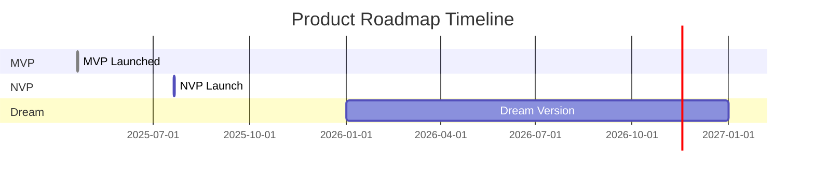
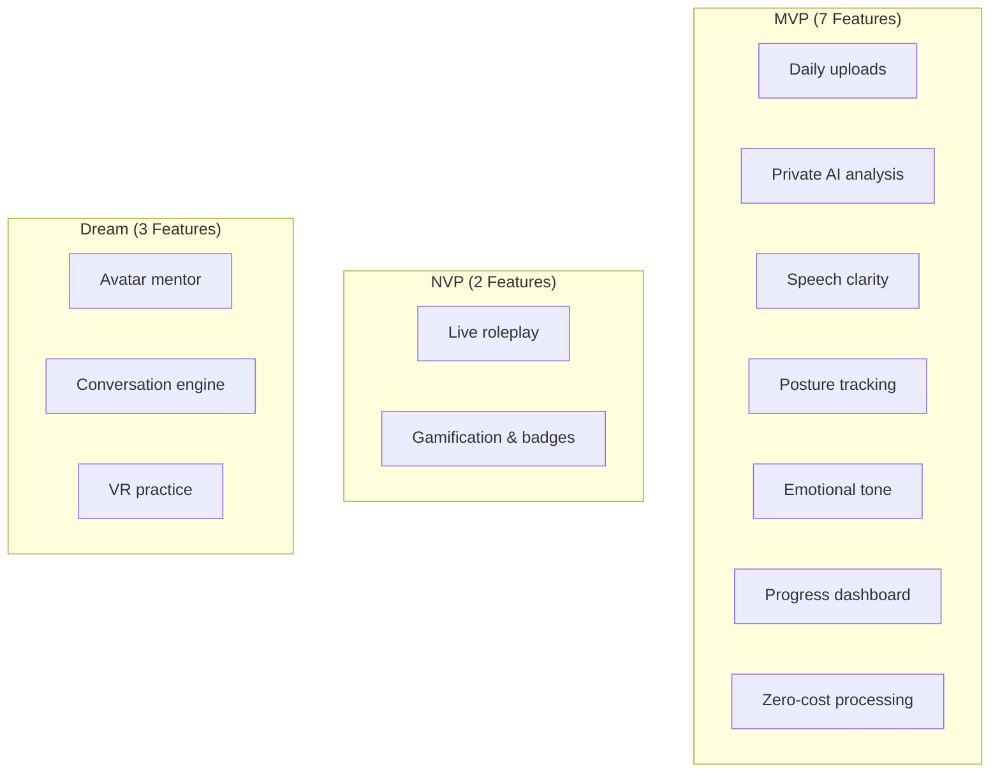

# 🗺️ Product Roadmap Implementation Guide

## Roadmap Timeline Component Documentation

**Component Version**: 1.0\
**Status**: Production Ready ✅\
**Last Updated**: December 15, 2025

---

## 📋 Table of Contents

1. [Overview](#1-overview)
2. [Files Created](#2-files-created)
3. [Files Modified](#3-files-modified)
4. [Features](#4-features)
5. [Usage](#5-usage)
6. [Customization](#6-customization)
7. [Testing](#7-testing)

---

## 1. Overview

A clean, responsive Product Roadmap timeline has been added to the homepage,
displaying milestones with exact launch dates.



### Milestone Status

| Milestone         | Date          | Status       | Color  |
| ----------------- | ------------- | ------------ | ------ |
| **MVP Launched**  | 19 April 2025 | ✅ Completed | Green  |
| **NVP Launch**    | 20 July 2025  | 🔶 Scheduled | Orange |
| **Dream Version** | 2026+         | 🔵 Future    | Blue   |

---

## 2. Files Created

### 2.1 Data Structure (`src/data/timelineData.ts`)

Centralized data structure for all roadmap milestones:

```typescript
export interface Milestone {
  id: string;
  title: string;
  date: string;
  status: "completed" | "scheduled" | "future";
  color: { bg; text; border; indicator };
  features: string[];
  description: string;
  accessButton?: { admin; user };
}
```

### 2.2 Component (`src/components/home/ProductRoadmap.tsx`)

```
┌─────────────────────────────────────────────────────────────────────┐
│                    COMPONENT FEATURES                               │
├─────────────────────────────────────────────────────────────────────┤
│                                                                     │
│  📱 Mobile View                                                     │
│     └── Vertical collapsible accordion timeline                    │
│                                                                     │
│  🖥️ Desktop View                                                    │
│     └── Horizontal timeline with gradient connector line           │
│                                                                     │
│  👤 Role-Based                                                      │
│     ├── Admin/Tester → "Get Early Access" button                   │
│     └── User → "Join Waitlist" button                              │
│                                                                     │
└─────────────────────────────────────────────────────────────────────┘
```

---

## 3. Files Modified

### 3.1 Home Page (`src/pages/Home.tsx`)

```tsx
import ProductRoadmap from "@/components/home/ProductRoadmap";

// Added after MVPFeatureGrid:
<ProductRoadmap userRole="user" />;
```

### 3.2 Feature Grid (`src/components/MVPFeatureGrid.tsx`)

Updated legend dates:

- MVP: "Launched 19 April 2025"
- NVP: "Launch 20 July 2025"
- Fixed status indicators to use `green-500`

---

## 4. Features

### 4.1 Feature Lists Per Milestone



### 4.2 Responsive Design

| Breakpoint            | Layout              | Behavior                      |
| --------------------- | ------------------- | ----------------------------- |
| **Desktop** (≥1024px) | Horizontal 3-column | Timeline with connecting line |
| **Mobile** (<1024px)  | Vertical accordion  | Collapsible cards             |

### 4.3 Accessibility

| Feature             | Implementation      |
| ------------------- | ------------------- |
| ARIA Labels         | ✅ Proper labeling  |
| Keyboard Navigation | ✅ Full support     |
| Semantic HTML       | ✅ Proper structure |
| Role Attributes     | ✅ Defined          |

---

## 5. Usage

### 5.1 Basic Usage

```tsx
import ProductRoadmap from "@/components/home/ProductRoadmap";

// Default usage
<ProductRoadmap />;
```

### 5.2 With User Role

```tsx
<ProductRoadmap userRole="admin" />   // Early access button
<ProductRoadmap userRole="tester" />  // Early access button
<ProductRoadmap userRole="user" />    // Waitlist button
```

### 5.3 Update Timeline Data

```tsx
// File: src/data/timelineData.ts

export const timelineData: Milestone[] = [
  {
    id: "mvp",
    title: "MVP Launched",
    date: "19 April 2025", // ← Update date here
    status: "completed",
    features: [
      "Daily uploads", // ← Add/remove features
      "Private AI analysis",
      // ...
    ],
  },
];
```

---

## 6. Customization

### 6.1 Change Colors

```typescript
// File: src/data/timelineData.ts

color: {
  bg: 'bg-purple-500/10',       // Background
  text: 'text-purple-600',      // Text color
  border: 'border-purple-500/20', // Border
  indicator: 'bg-purple-500'    // Icon background
}
```

### 6.2 Add New Milestone

```typescript
{
  id: 'v2',
  title: 'Version 2.0',
  date: '15 December 2025',
  status: 'future',
  color: {
    bg: 'bg-indigo-500/10',
    text: 'text-indigo-600',
    border: 'border-indigo-500/20',
    indicator: 'bg-indigo-500'
  },
  features: ['Feature 1', 'Feature 2'],
  description: 'Major version update'
}
```

### 6.3 Change Button Text

```typescript
accessButton: {
  admin: 'Beta Access Now',   // Shown to admins/testers
  user: 'Get Notified'        // Shown to regular users
}
```

---

## 7. Testing

### 7.1 Desktop Testing Checklist

| Test                                   | Status |
| -------------------------------------- | ------ |
| Horizontal timeline displays correctly | ☐      |
| Gradient connector line visible        | ☐      |
| All 3 milestones side-by-side          | ☐      |
| Icons centered above cards             | ☐      |
| Feature lists readable                 | ☐      |

### 7.2 Mobile Testing Checklist

| Test                              | Status |
| --------------------------------- | ------ |
| Vertical timeline displays        | ☐      |
| Cards collapse/expand on tap      | ☐      |
| Vertical connectors between cards | ☐      |
| No horizontal scroll              | ☐      |
| Touch-friendly spacing            | ☐      |

### 7.3 Role-Based Testing

| Scenario                 | Expected Button    |
| ------------------------ | ------------------ |
| Admin views NVP          | "Get Early Access" |
| Tester views NVP         | "Get Early Access" |
| User views NVP           | "Join Waitlist"    |
| Any user views MVP/Dream | No button          |

---

## 📍 Homepage Component Order

```
┌─────────────────────────────────────────────────────────────────────┐
│                    HOMEPAGE SECTIONS                                │
├─────────────────────────────────────────────────────────────────────┤
│                                                                     │
│   1.  Hero                                                         │
│   2.  Video Embed (NotebookLM)                                     │
│   3.  Problem-Solution-Outcome                                     │
│   4.  How It Works                                                 │
│   5.  Tech Cards                                                   │
│   6.  Tech Stack Summary                                           │
│   7.  MVP Feature Grid                                             │
│   8.  🆕 Product Roadmap Timeline ← NEW                            │
│   9.  Roadmap (Original detailed version)                          │
│  10.  Testimonials                                                 │
│  11.  Footer CTA                                                   │
│  12.  Footer                                                       │
│                                                                     │
└─────────────────────────────────────────────────────────────────────┘
```

---

## 🔮 Future Enhancements

| Enhancement                      | Priority | Status    |
| -------------------------------- | -------- | --------- |
| Progress percentage bars         | Medium   | ☐ Planned |
| Email capture on "Join Waitlist" | High     | ☐ Planned |
| Admin dashboard integration      | Medium   | ☐ Planned |
| Milestone completion animations  | Low      | ☐ Planned |
| Confetti on completed milestones | Low      | ☐ Planned |
| Email notifications for releases | Medium   | ☐ Planned |

---

> [!NOTE]
> **Design Consistency**: The roadmap uses existing Tailwind utilities and
> design tokens to maintain visual consistency with the rest of the application.

> [!TIP]
> **Easy Maintenance**: All dates and features are centralized in
> `timelineData.ts` for easy updates without touching component code.

---

<div align="center">

**Component Status: Production Ready ✅**

_Last Updated: December 15, 2025_

</div>
