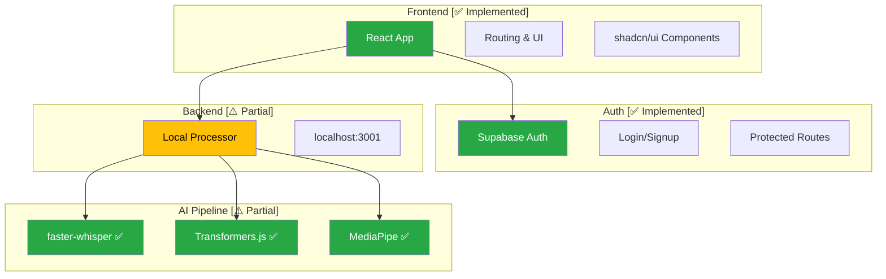
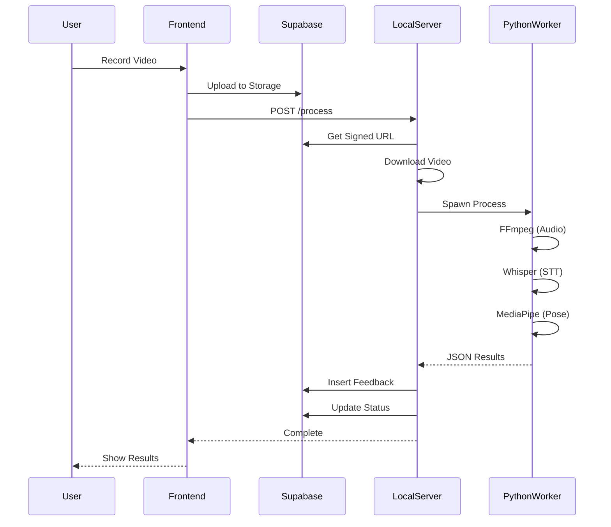

# 📋 Project Handoff Report

## Current System Implementation & Status

**Report Date**: November 29, 2025 (Updated: December 15, 2025)\
**Project**: The Future You (AI Personal Communication Coach)\
**Auditor**: Antigravity (Systems Architect)

---

## 📋 Table of Contents

1. [Executive Summary](#1-executive-summary)
2. [Component Status](#2-component-status)
3. [Current Limitations](#3-current-limitations)
4. [Critical Issues](#4-critical-issues)
5. [Data Flow Analysis](#5-data-flow-analysis)
6. [Next Steps](#6-next-steps)

---

## 1. Executive Summary

### 1.1 Project Status

```
┌─────────────────────────────────────────────────────────────────────┐
│                      PROJECT HEALTH                                 │
├─────────────────────────────────────────────────────────────────────┤
│                                                                     │
│   Status:           MVP In-Progress (Hybrid Local/Cloud)           │
│   Completion:       ████████████░░░░░░░░░  65%                     │
│   Production Ready: ⚠️ Limited (localhost dependency)              │
│                                                                     │
│   ✅ Core flows (Auth, Record, Upload) work                        │
│   ⚠️ AI processing implemented but fragile                         │
│   ❌ Local-only processing reliance                                │
│                                                                     │
└─────────────────────────────────────────────────────────────────────┘
```

### 1.2 Technology Stack Confirmation

| Layer              | Technology  | Version          |
| ------------------ | ----------- | ---------------- |
| **Runtime**        | Node.js     | v16+ required    |
| **Python**         | Python      | 3.11+ for AI     |
| **Frontend**       | React       | 18.3.1           |
| **Build**          | Vite        | 5.4.19           |
| **Language**       | TypeScript  | 5.8.3            |
| **UI**             | TailwindCSS | 3.4.17           |
| **Components**     | shadcn/ui   | Radix Primitives |
| **Backend**        | Express.js  | Local Processor  |
| **Edge Functions** | Deno        | Supabase         |
| **Database**       | PostgreSQL  | Supabase         |
| **Auth**           | GoTrue      | Supabase         |

---

## 2. Component Status



### Detailed Status

| Component                 | Status         | Notes                                                         |
| ------------------------- | -------------- | ------------------------------------------------------------- |
| **Frontend Routing & UI** | ✅ Implemented | Comprehensive routing, protected routes, shadcn/ui components |
| **Supabase Integration**  | ✅ Implemented | Auth, Storage, Database connected                             |
| **Backend Orchestration** | ⚠️ Partial     | Works locally on `localhost:3001` only                        |
| **AI Model Integration**  | ✅ Implemented | faster-whisper, Transformers.js, MediaPipe working            |
| **Event Loop/Queue**      | ⚠️ Partial     | Polling-based, triggers via HTTP to localhost                 |

---

## 3. Current Limitations

### 3.1 Missing Features

```
┌─────────────────────────────────────────────────────────────────────┐
│                    KNOWN LIMITATIONS                                │
├─────────────────────────────────────────────────────────────────────┤
│                                                                     │
│  🔴 Cloud Fallback                                                  │
│     └── Backend requires local server running                      │
│                                                                     │
│  🟡 Real-time Feedback                                              │
│     └── Processing is async, no real-time during recording         │
│                                                                     │
│  🟡 Blocking Operations                                             │
│     └── Video processing is synchronous and CPU-intensive          │
│                                                                     │
└─────────────────────────────────────────────────────────────────────┘
```

### 3.2 Resource Constraints

| Constraint                | Impact                     | Mitigation                   |
| ------------------------- | -------------------------- | ---------------------------- |
| **Local Dependency**      | Server must run locally    | Deploy to cloud or use ngrok |
| **CPU Intensive**         | Blocking during processing | Add job queue                |
| **Sequential Processing** | One video at a time        | Add parallel workers         |

---

## 4. Critical Issues

### 4.1 Hardcoded Localhost

> [!CAUTION]
> The frontend makes direct calls to `http://localhost:3001/process`. This WILL
> FAIL for users not running the backend locally.

**Location**: `frontend/src/pages/Record.tsx`

```tsx
// ❌ Current (problematic)
fetch("http://localhost:3001/process");

// ✅ Should be
fetch(import.meta.env.VITE_PROCESSING_URL || "/api/process");
```

### 4.2 Security Gaps

| Issue                   | Risk Level | Status                   |
| ----------------------- | ---------- | ------------------------ |
| CORS allows all origins | Medium     | ⚠️ Dev only              |
| Direct API exposure     | Low        | ⚠️ Acceptable for MVP    |
| No rate limiting        | Medium     | ⚠️ Add before production |

---

## 5. Data Flow Analysis

### 5.1 Current Processing Flow



### 5.2 Flow Breakpoints

```
┌─────────────────────────────────────────────────────────────────────┐
│                    CRITICAL PATHS                                   │
├─────────────────────────────────────────────────────────────────────┤
│                                                                     │
│  ✅ WORKING                                                         │
│     ├── User → Frontend → Supabase Storage                         │
│     ├── LocalServer → Supabase (signed URLs)                       │
│     └── PythonWorker → AI Analysis                                 │
│                                                                     │
│  ⚠️ FRAGILE                                                         │
│     ├── Frontend → localhost:3001 (fails if server down)           │
│     └── Edge Function → LOCAL_PROCESSING_ENDPOINT                  │
│                                                                     │
│  ❌ BROKEN IF OFFLINE                                               │
│     └── Any user without local server running                      │
│                                                                     │
└─────────────────────────────────────────────────────────────────────┘
```

---

## 6. Next Steps

### 6.1 Immediate Actions

| Priority | Action                     | File          | Description                  |
| -------- | -------------------------- | ------------- | ---------------------------- |
| 🔴 P0    | Remove hardcoded localhost | `Record.tsx`  | Use environment variables    |
| 🔴 P0    | Add processing URL config  | `.env`        | `VITE_PROCESSING_URL`        |
| 🟠 P1    | Remote processing support  | Edge Function | Support ngrok/cloud URLs     |
| 🟢 P2    | Add requirements.txt       | Backend       | Document Python dependencies |

### 6.2 Recommended Changes


### 6.3 Code Changes Needed

**1. Update Record.tsx**

```tsx
// Remove direct localhost call
// Use Supabase trigger or Edge Function instead
```

**2. Update Edge Function**

```typescript
// Support remote processing URL
const endpoint = Deno.env.get("PROCESSING_ENDPOINT") ||
  "http://localhost:3001";
```

**3. Create requirements.txt**

```
faster-whisper
mediapipe
opencv-python
numpy
```

---

## 📊 Summary Metrics

| Metric                   | Value  |
| ------------------------ | ------ |
| **Overall Completion**   | 65%    |
| **Frontend**             | 90% ✅ |
| **Backend**              | 70% ⚠️ |
| **AI Pipeline**          | 85% ✅ |
| **Production Readiness** | 40% ❌ |
| **Documentation**        | 75% ✅ |

---

> [!IMPORTANT]
> The system has a functional MVP but requires decoupling the frontend from
> localhost before production deployment.

---

<div align="center">

**Report Status: Current as of December 2025**

_Next Review: After localhost decoupling implementation_

</div>
