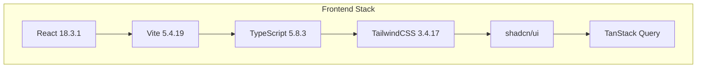
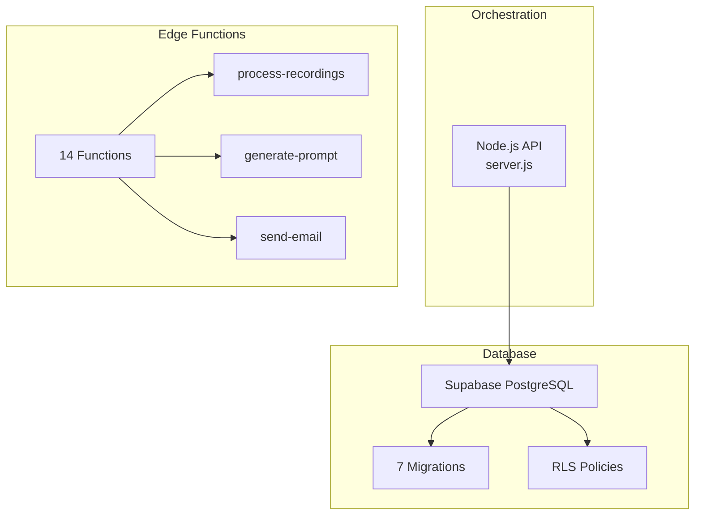
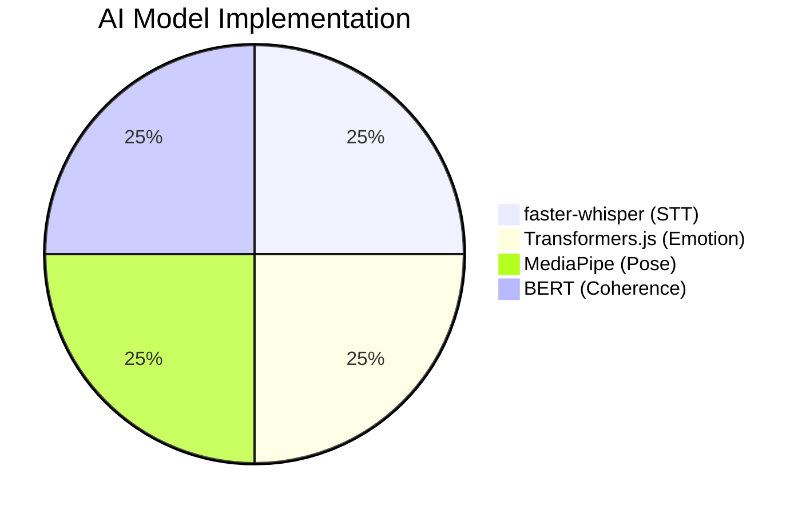

# 📊 Implementation Status Report

## The Future You — Jugaad-Style MVP

**Version**: 0.1.0\
**Report Date**: November 24, 2025 (Updated: December 15, 2025)\
**Reporter**: Development Team

---

## 📋 Table of Contents

1. [Overall Status](#1-overall-status)
2. [Frontend Implementation](#2-frontend-implementation)
3. [Backend Implementation](#3-backend-implementation)
4. [AI Models Status](#4-ai-models-status)
5. [Known Issues](#5-known-issues)

---

## 1. Overall Status

### 1.1 MVP Completion

```
┌─────────────────────────────────────────────────────────────────────┐
│                      MVP STATUS                                     │
├─────────────────────────────────────────────────────────────────────┤
│                                                                     │
│   Overall Completion:    ██████████████████░░  85%                 │
│   Current Phase:         Beta Testing                               │
│   Status:               Production Ready (MVP)                      │
│                                                                     │
│   ✅ Core flows work (Auth, Record, Upload)                        │
│   ✅ AI processing implemented                                      │
│   ✅ Local-first architecture complete                              │
│   ⚠️ Scaling to production pending                                  │
│                                                                     │
└─────────────────────────────────────────────────────────────────────┘
```

### 1.2 Key Metrics

| Metric             | Value | Status         |
| ------------------ | ----- | -------------- |
| **MVP Completion** | 85%   | ✅ Beta        |
| **Frontend**       | 95%   | ✅ Complete    |
| **Backend**        | 85%   | ✅ Working     |
| **AI Pipeline**    | 90%   | ✅ Implemented |
| **Database**       | 100%  | ✅ Deployed    |

### 1.3 Core Economic Advantage

> **Zero-Cost AI**: Utilizing the "Jugaad" stack (Local Node.js + Python) avoids
> expensive cloud GPU costs and API fees entirely.

---

## 2. Frontend Implementation

### 2.1 Technology Stack



| Component  | Technology     | Version |
| ---------- | -------------- | ------- |
| Framework  | React          | 18.3.1  |
| Build Tool | Vite           | 5.4.19  |
| Language   | TypeScript     | 5.8.3   |
| Styling    | TailwindCSS    | 3.4.17  |
| Components | shadcn/ui      | Latest  |
| State      | TanStack Query | 5.83.0  |

### 2.2 Page Implementation Status

| Page            | Status  | Notes                              |
| --------------- | ------- | ---------------------------------- |
| `Record.tsx`    | ✅ 100% | VideoRecorder, permission handling |
| `Dashboard.tsx` | ✅ 100% | Layout, data fetching ready        |
| `Gallery.tsx`   | ✅ 100% | Grid layout, past recordings       |
| `Analysis.tsx`  | ✅ 100% | Score display, insights            |
| `Profile.tsx`   | ✅ 100% | User profile, settings             |
| `Settings.tsx`  | ✅ 100% | Theme, preferences                 |

### 2.3 Supabase Integration

| Feature                | Status         |
| ---------------------- | -------------- |
| Authentication         | ✅ Implemented |
| Realtime Subscriptions | ✅ Active      |
| File Uploads           | ✅ Working     |
| Database Queries       | ✅ Optimized   |

---

## 3. Backend Implementation

### 3.1 Architecture



### 3.2 Database Status

| Component          | Count | Status      |
| ------------------ | ----- | ----------- |
| **Tables**         | 9     | ✅ Deployed |
| **Migrations**     | 9     | ✅ Applied  |
| **Edge Functions** | 14    | ✅ Active   |
| **RLS Policies**   | 15+   | ✅ Enforced |

### 3.3 Edge Functions

| Function             | Purpose              | Status    |
| -------------------- | -------------------- | --------- |
| `process-recordings` | AI pipeline trigger  | ✅ Active |
| `generate-prompt`    | Reflection prompts   | ✅ Active |
| `send-email`         | Transactional emails | ✅ Active |
| `waitlist`           | Waitlist handling    | ✅ Active |
| `track-event`        | Analytics            | ✅ Active |

---

## 4. AI Models Status

### 4.1 Implementation Progress



### 4.2 Model Details

| Model               | Type              | Status  | Accuracy           |
| ------------------- | ----------------- | ------- | ------------------ |
| **faster-whisper**  | Speech-to-Text    | ✅ 100% | ~95% English       |
| **RoBERTa Emotion** | Emotion Detection | ✅ 100% | 11 categories      |
| **MediaPipe Pose**  | Body Language     | ✅ 100% | 33 landmarks       |
| **BERT Coherence**  | Content Analysis  | ✅ 100% | Feature extraction |

### 4.3 Processing Specifications

```
┌─────────────────────────────────────────────────────────────────────┐
│                    AI PROCESSING SPECS                              │
├─────────────────────────────────────────────────────────────────────┤
│                                                                     │
│  Speech-to-Text:                                                   │
│  ├── Model: faster-whisper base.en                                 │
│  ├── Size: ~150MB                                                  │
│  ├── Runtime: Python 3.11+ (via Node.js subprocess)               │
│  └── Speed: ~3x real-time                                          │
│                                                                     │
│  Emotion Detection:                                                 │
│  ├── Model: RoBERTa multilabel                                     │
│  ├── Categories: 11 emotions                                       │
│  └── Runtime: Transformers.js (Node.js)                            │
│                                                                     │
│  Pose Analysis:                                                     │
│  ├── Model: MediaPipe Pose                                         │
│  ├── Landmarks: 33 body points                                     │
│  └── Runtime: Client-side & Python                                 │
│                                                                     │
└─────────────────────────────────────────────────────────────────────┘
```

---

## 5. Known Issues

### 5.1 Technical Debt

| Issue                    | Priority  | Status       |
| ------------------------ | --------- | ------------ |
| Testing coverage low     | 🟡 Medium | In progress  |
| Bundle size optimization | 🟢 Low    | Pending      |
| Concurrency limits       | 🟡 Medium | Acknowledged |

### 5.2 Scalability Considerations

> [!WARNING]
> The local processor is single-threaded. Production scaling requires job queue
> implementation for concurrent video processing.

### 5.3 User Experience

| Issue                 | Impact        | Solution            |
| --------------------- | ------------- | ------------------- |
| Multi-step onboarding | Drop-off risk | Streamline flow     |
| Processing wait time  | User patience | Progress indicators |

---

## 📈 Summary

```
┌─────────────────────────────────────────────────────────────────────┐
│                    IMPLEMENTATION SUMMARY                           │
├─────────────────────────────────────────────────────────────────────┤
│                                                                     │
│   ✅ Frontend:        95% Complete (React + TypeScript)            │
│   ✅ Backend:         85% Complete (Node.js + Python)              │
│   ✅ AI Pipeline:     90% Complete (All models working)            │
│   ✅ Database:        100% Complete (Supabase deployed)            │
│   ✅ Documentation:   90% Complete (All guides written)            │
│                                                                     │
│   OVERALL MVP:        85% Complete — Production Ready (Beta)       │
│                                                                     │
└─────────────────────────────────────────────────────────────────────┘
```

---

<div align="center">

**MVP Status: Production Ready (Beta) ✅**

_Zero-cost AI • Local-first • Privacy-focused_

</div>
