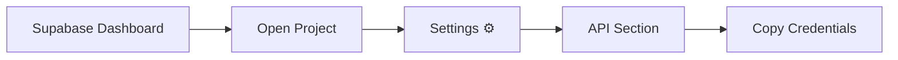
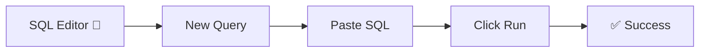
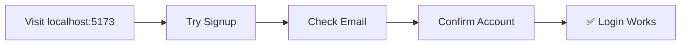

# ⚡ Quick Start Guide

## Get Your Backend Running in 5 Minutes

**Difficulty Level**: Beginner\
**Time Required**: 5–10 minutes\
**Last Updated**: September 2026\
**Version**: v1.7.0

---

## 📋 Table of Contents

1. [Pre-requisites](#-pre-requisites)
2. [Step-by-Step Setup](#-step-by-step-setup)
3. [Verification](#-verification)
4. [Troubleshooting](#-troubleshooting)

---

## 🎯 Pre-requisites

Before you begin, ensure you have:

| Requirement      | Where to Get                         | Status |
| ---------------- | ------------------------------------ | ------ |
| Supabase Account | [supabase.com](https://supabase.com) | ☐      |
| Project Created  | Supabase Dashboard                   | ☐      |
| API Credentials  | Settings → API                       | ☐      |

---

## 📝 Step-by-Step Setup

### Step 1: Get API Credentials (2 min)



**Navigate to:**

```
https://supabase.com/dashboard → Your Project → Settings ⚙️ → API
```

**Copy these values:**

| Credential             | Example                     | Where to Find                            |
| ---------------------- | --------------------------- | ---------------------------------------- |
| 📋 **Project URL**     | `https://xxxxx.supabase.co` | Settings → API → Project URL             |
| 🔑 **anon/public key** | `eyJhbGciOiJIUz...`         | Settings → API → anon key                |
| 🆔 **Project ID**      | `xxxxx`                     | From URL: supabase.com/project/**xxxxx** |

---

### Step 2: Update Environment File (30 sec)

Create or edit your `.env` file:

```bash
# Copy from template
cp .env.example .env
```

**Add your credentials:**

```env
VITE_SUPABASE_URL=your-url-here
VITE_SUPABASE_ANON_KEY=your-key-here
VITE_SUPABASE_PROJECT_ID=your-id-here
```

> [!IMPORTANT]
> Ensure the `.env` file is ALSO placed in the `frontend/` directory, as Vite
> looks for environment variables there. See [SETUP.md](SETUP.md) for details.

> [!TIP]
> Make sure to restart your dev server after modifying `.env` files!

---

### Step 3: Run Migration 1 — Initial Schema (1 min)



**Steps:**

| Step | Action                                             | Expected Result                |
| ---- | -------------------------------------------------- | ------------------------------ |
| 1    | Open Supabase Dashboard → SQL Editor (📝)          | Editor opens                   |
| 2    | Click "New query"                                  | Empty query panel              |
| 3    | Open: `supabase/migrations/001_initial_schema.sql` | File contents                  |
| 4    | Copy ALL → Paste → Click "Run"                     | Query executes                 |
| 5    | Check result                                       | ✅ "Success. No rows returned" |

**What this creates:**

| Type       | Component       | Purpose                     |
| ---------- | --------------- | --------------------------- |
| **Tables** | `profiles`      | User profiles with metadata |
| **Tables** | `recordings`    | Video recordings metadata   |
| **Tables** | `feedback`      | AI analysis results         |
| **Tables** | `progress`      | User progress tracking      |
| **Other**  | RLS Policies 🔒 | Row-level security          |
| **Other**  | Triggers ⚡     | Automatic profile creation  |

---

### Step 4: Run Migration 2 — Storage Setup (1 min)

**Repeat the same process:**

| Step | Action                                            |
| ---- | ------------------------------------------------- |
| 1    | SQL Editor → "New query"                          |
| 2    | Open: `supabase/migrations/002_storage_setup.sql` |
| 3    | Copy ALL → Paste → Click "Run"                    |
| 4    | Verify: ✅ "Success. No rows returned"            |

**What this creates:**

| Type         | Component           | Purpose                     |
| ------------ | ------------------- | --------------------------- |
| **Buckets**  | `recordings` 📁     | Video file storage          |
| **Buckets**  | `thumbnails` 📁     | Video thumbnail images      |
| **Policies** | Storage Policies 🔒 | Upload/download permissions |

---

### Step 5: Verify Setup (30 sec)

```bash
# Restart your dev server
npm run dev
```

---

## ✅ Verification

**Check these items in Supabase Dashboard:**

| Check   | Location          | Expected          |
| ------- | ----------------- | ----------------- |
| Tables  | Table Editor (📊) | 4+ tables visible |
| Storage | Storage section   | 2 buckets visible |
| Auth    | Authentication    | Providers enabled |

**Test in browser:**



---

## 🎉 Success!

Your backend is now fully configured. You can:

| Feature       | Status   |
| ------------- | -------- |
| Sign up users | ✅ Ready |
| Record videos | ✅ Ready |
| Upload files  | ✅ Ready |
| View gallery  | ✅ Ready |
| See analytics | ✅ Ready |

---

## 🆘 Troubleshooting

### Common Issues

| Problem                               | Solution                                                                                          |
| ------------------------------------- | ------------------------------------------------------------------------------------------------- |
| **Error running migration**           | Copy the ENTIRE file (including first line). Check for red error messages. Re-run.                |
| **No tables showing**                 | Refresh browser. Check Table Editor (📊) in sidebar.                                              |
| **Can't login after signup**          | Check email for confirmation. Enable Email provider in Auth settings.                             |
| **Environment variables not working** | Ensure `.env` exists (not `.env.example`). Restart dev server. Variables must start with `VITE_`. |

> [!WARNING]
> If you see RLS policy errors, make sure you ran BOTH migration files in order.

---

## 📚 Additional Resources

| Document                                           | Description              |
| -------------------------------------------------- | ------------------------ |
| [SETUP.md](SETUP.md)                               | Detailed setup checklist |
| [Backend README](../backend/Docs/README.md)        | Local processor setup    |
| [Supabase README](../supabase-organized/README.md) | Database configuration   |

---

<div align="center">

**🎉 That's it! You're ready to record videos!**

_Setup complete in 5 minutes or less_

</div>
