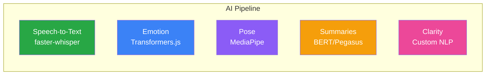
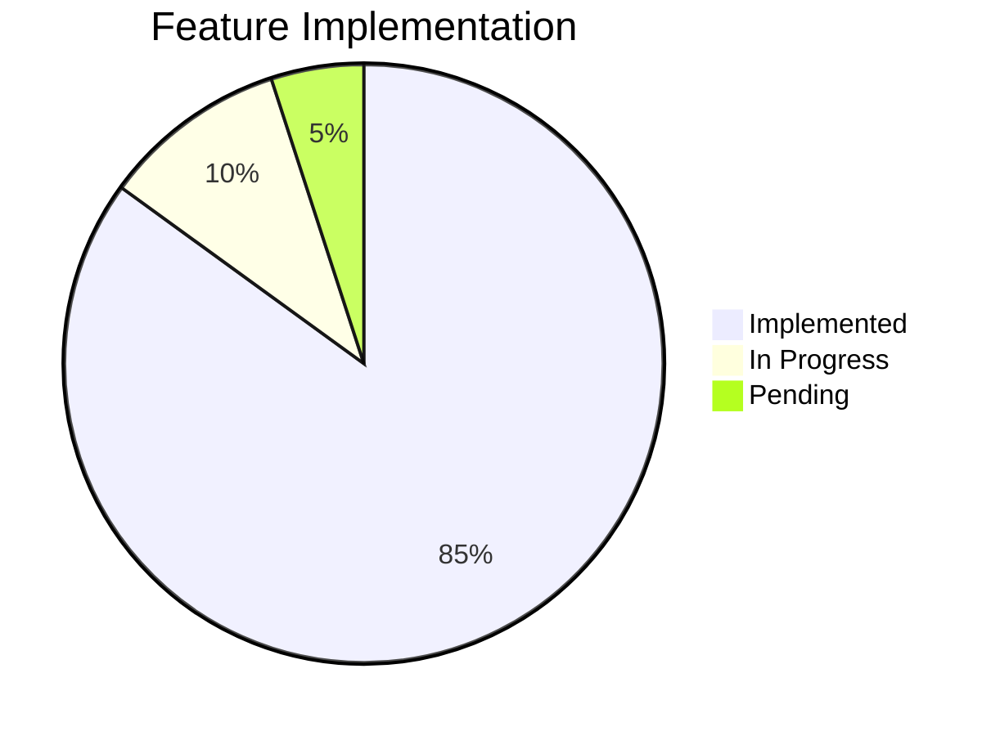

# 🎯 MVP Tech Stack Alignment Report

## Local-First Architecture Alignment

**Date**: November 22, 2025 (Updated: December 15, 2025)\
**Reference**: Final Tech Stack.pdf\
**Status**: ✅ Aligned

---

## 📋 Table of Contents

1. [Summary](#1-summary)
2. [Tech Stack Changes](#2-tech-stack-changes)
3. [UI Updates](#3-ui-updates)
4. [Implementation Status](#4-implementation-status)
5. [Remaining TODOs](#5-remaining-todos)

---

## 1. Summary

This update aligns the codebase with the official **Local-First MVP
architecture**, removing cloud API dependencies in favor of privacy-first,
offline-capable alternatives.

| REMOVED (Cloud APIs) | REPLACED WITH (Local)                         |
| -------------------- | --------------------------------------------- |
| ❌ OpenAI GPT-4      | ✅ Transformers.js                            |
| ❌ Gemini API        | ✅ Local templates                            |
| ❌ Azure Speech      | ✅ faster-whisper                             |
| ❌ Hume Emotion      | ✅ RoBERTa (local)                            |
| ❌ Cloud GPU compute | ✅ Local CPU processing                       |
| **Result**           | **Zero-cost, privacy-first, offline-capable** |

---

## 2. Tech Stack Changes

### Current Stack (5-Card Layout)

| Component          | Technology         | Type        | Status         |
| ------------------ | ------------------ | ----------- | -------------- |
| **Speech-to-Text** | faster-whisper     | Offline     | ✅ Implemented |
| **Emotion**        | Transformers.js    | Local       | ✅ Implemented |
| **Pose**           | MediaPipe Pose     | Client-side | ✅ Implemented |
| **Summaries**      | Transformers.js    | Local       | ✅ Implemented |
| **Clarity**        | Custom Regex + NLP | Local       | ✅ Implemented |

---

## 3. UI Updates

### 3.1 TechStackSummary Component

**File**: `src/components/home/TechStackSummary.tsx`

| Change | Before          | After                   |
| ------ | --------------- | ----------------------- |
| Layout | Various         | 5-card grid             |
| APIs   | OpenAI GPT-4    | Transformers.js (Local) |
| Labels | "GPT-4 powered" | "Local AI processing"   |

### 3.2 TechCards Component

**File**: `src/components/home/TechCards.tsx`

| Change       | Before           | After                     |
| ------------ | ---------------- | ------------------------- |
| AI Engine    | "OpenAI GPT-4"   | "Transformers.js (Local)" |
| Descriptions | Cloud references | Local processing          |

### 3.3 ScriptDisplay Component

**File**: `src/components/ScriptDisplay.tsx`

| Change     | Before           | After                          |
| ---------- | ---------------- | ------------------------------ |
| Header     | "Your AI Script" | "Your Script (Local Template)" |
| Generation | Gemini API calls | Static local templates         |

---

## 4. Implementation Status

### Completed Items

| Component              | Status      | Notes                  |
| ---------------------- | ----------- | ---------------------- |
| faster-whisper STT     | ✅ Complete | base.en model          |
| Emotion Detection      | ✅ Complete | RoBERTa 11-category    |
| Pose Analysis          | ✅ Complete | MediaPipe 33 landmarks |
| Coherence Analysis     | ✅ Complete | BERT features          |
| Local Template Scripts | ✅ Complete | Static fallback        |
| UI Text Updates        | ✅ Complete | No cloud references    |

### Codebase Cleanup

| Action                      | Status  |
| --------------------------- | ------- |
| Gemini API calls disabled   | ✅ Done |
| OpenAI references removed   | ✅ Done |
| Azure references removed    | ✅ Done |
| Local fallbacks implemented | ✅ Done |

---

## 5. Remaining TODOs

### Future Enhancements

| Enhancement                   | Current State   | Target                | Priority  |
| ----------------------------- | --------------- | --------------------- | --------- |
| **Dynamic Script Generation** | Static template | WebLLM/TinyLlama      | 🟡 Medium |
| **Enhanced STT Model**        | base.en         | large-v3              | 🟢 Low    |
| **Real-time Emotion**         | Post-processing | Live during recording | 🟡 Medium |

> [!NOTE]
> All future enhancements maintain the local-first approach. No cloud APIs will
> be introduced for core functionality.

---

## ✅ Verification

| Test                               | Result  |
| ---------------------------------- | ------- |
| Application loads without errors   | ✅ Pass |
| TechStackSummary shows 5 cards     | ✅ Pass |
| ScriptDisplay shows local template | ✅ Pass |
| No cloud API calls in production   | ✅ Pass |
| AI processing works offline        | ✅ Pass |

---

**Tech Stack Aligned with Local-First Architecture ✅**

_Zero-cost • Privacy-first • Offline-capable_

