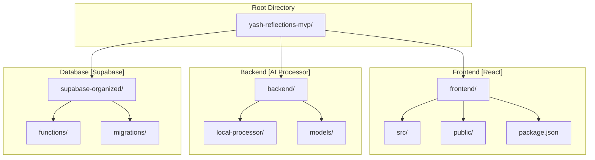
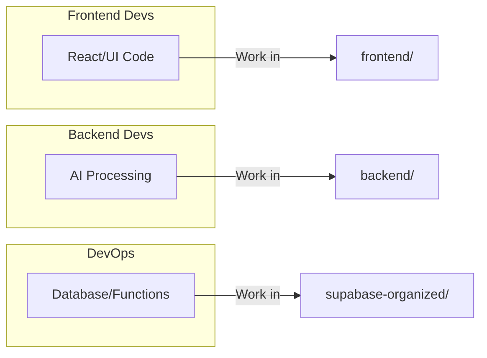
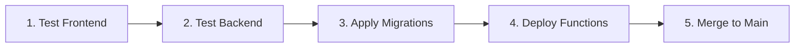

# 📁 Project Reorganization Summary

## Directory Structure Refactoring Complete

**Status**: ✅ Completed\
**Date**: December 15, 2025

---

## 📋 Table of Contents

1. [New Structure](#-new-structure)
2. [Benefits](#-benefits)
3. [Usage](#-usage)
4. [File Movement Summary](#-file-movement-summary)
5. [Verification](#-verification)
6. [Next Steps](#-next-steps)
7. [Documentation Index](#-documentation-index)

---

## 📁 New Structure

The project has been reorganized into three main directories:



### Directory Tree

| Directory                          | Contents                                          |
| ---------------------------------- | ------------------------------------------------- |
| **`yash-reflections-mvp/`**        | Root directory                                    |
| └── **`frontend/`** 📂             | React Frontend                                    |
| &nbsp;&nbsp;└── `src/`             | React source (components, pages, hooks, contexts) |
| &nbsp;&nbsp;└── `public/`          | Static assets                                     |
| &nbsp;&nbsp;└── `package.json`     | Frontend dependencies                             |
| └── **`backend/`** 📂              | Local AI Processing                               |
| &nbsp;&nbsp;└── `local-processor/` | Node.js + Express (server.js, worker.py)          |
| └── **`supabase-organized/`** 📂   | Supabase Configuration                            |
| &nbsp;&nbsp;└── `supabase/`        | Edge Functions & Migrations                       |
| └── **`docs/`** 📂                 | Documentation                                     |
| └── `package.json`                 | Root scripts                                      |
| └── `README.md`                    | Main README                                       |

---

## 🎯 Benefits

### Separation of Concerns



| Benefit                     | Description                                     |
| --------------------------- | ----------------------------------------------- |
| **Clear Separation**        | Frontend, Backend, Database completely isolated |
| **Independent Development** | Teams work in their own directories             |
| **Easy Navigation**         | Each directory has its own README               |
| **Better Deployment**       | Deploy each component independently             |
| **Scalability**             | Add microservices or new frontends easily       |

---

## 🚀 Usage

### Run from Root (Recommended)

```bash
# Frontend (starts on :5173)
npm run dev

# Backend (starts on :3001)
npm run backend

# Build for production
npm run build
```

### Run from Each Directory

```bash
# Frontend
cd frontend && npm install && npm run dev

# Backend
cd backend/local-processor && npm install && npm start

# Deploy Supabase Functions
cd supabase-organized && supabase functions deploy
```

### Port Reference

| Service          | Port  | Command           |
| ---------------- | ----- | ----------------- |
| Frontend         | 5173  | `npm run dev`     |
| Backend          | 3001  | `npm run backend` |
| Supabase (local) | 54321 | `supabase start`  |

---

## 📊 File Movement Summary

### Moved to `frontend/`

| Original             | New Location                  |
| -------------------- | ----------------------------- |
| `src/`               | `frontend/src/`               |
| `public/`            | `frontend/public/`            |
| `index.html`         | `frontend/index.html`         |
| `vite.config.ts`     | `frontend/vite.config.ts`     |
| `tailwind.config.ts` | `frontend/tailwind.config.ts` |
| `tsconfig*.json`     | `frontend/tsconfig*.json`     |
| `eslint.config.js`   | `frontend/eslint.config.js`   |

### Moved to `backend/`

| Original                 | New Location               |
| ------------------------ | -------------------------- |
| `local-processor/`       | `backend/local-processor/` |
| `JUGAAD_SETUP.md`        | `backend/Docs/`            |
| `REFACTORING_SUMMARY.md` | `backend/Docs/`            |

### Moved to `supabase-organized/`

| Original      | New Location                   |
| ------------- | ------------------------------ |
| `supabase/`   | `supabase-organized/supabase/` |
| Database docs | `supabase-organized/Docs/`     |

### New Files Created

| File                           | Purpose              |
| ------------------------------ | -------------------- |
| `frontend/README.md`           | Frontend setup guide |
| `backend/README.md`            | Backend setup guide  |
| `supabase-organized/README.md` | Database setup guide |
| `REORGANIZATION_SUMMARY.md`    | This file            |

---

## ✅ Verification

| Check                                  | Status      |
| -------------------------------------- | ----------- |
| Frontend code in `frontend/`           | ✅ Complete |
| Backend code in `backend/`             | ✅ Complete |
| Supabase code in `supabase-organized/` | ✅ Complete |
| Documentation organized by domain      | ✅ Complete |
| Each directory has README              | ✅ Complete |
| Root README updated                    | ✅ Complete |
| Package.json scripts updated           | ✅ Complete |
| All files tracked in git               | ✅ Complete |

---

## 🎓 Next Steps



| Step                    | Command                                     |
| ----------------------- | ------------------------------------------- |
| **1. Test Frontend**    | `cd frontend && npm run dev`                |
| **2. Test Backend**     | `cd backend/local-processor && npm start`   |
| **3. Apply Migrations** | `cd supabase-organized && supabase db push` |
| **4. Deploy Functions** | `supabase functions deploy`                 |
| **5. Merge to Main**    | After testing, merge branch to `main`       |

---

## 📚 Documentation Index

### Main Guides

| Document                                                        | Description                      |
| --------------------------------------------------------------- | -------------------------------- |
| [README.md](../README.md)                                       | Project overview and quick start |
| [frontend/README.md](../frontend/README.md)                     | React frontend setup             |
| [backend/README.md](../backend/README.md)                       | AI processor setup               |
| [supabase-organized/README.md](../supabase-organized/README.md) | Database & functions             |

### Detailed Guides

| Document                                                 | Description              |
| -------------------------------------------------------- | ------------------------ |
| [QUICK_START.md](QUICK_START.md)                         | 5-minute setup           |
| [SETUP.md](SETUP.md)                                     | Complete setup checklist |
| [TECHNICAL_DOCUMENTATION.md](TECHNICAL_DOCUMENTATION.md) | Architecture details     |
| [PRODUCTION-GUIDE.md](PRODUCTION-GUIDE.md)               | Production setup         |

---

## 🎉 Summary

| Component                 | Status      | Description                                              |
| ------------------------- | ----------- | -------------------------------------------------------- |
| **`frontend/`**           | ✅ Complete | React application                                        |
| **`backend/`**            | ✅ Complete | Local AI processor                                       |
| **`supabase-organized/`** | ✅ Complete | Database & serverless functions                          |
| **`docs/`**               | ✅ Complete | All documentation                                        |
| **Result**                | 🎉          | Better maintainability, easier onboarding, cleaner code! |

> [!TIP]
> Each component can now be developed, tested, and deployed independently while
> maintaining clear boundaries and responsibilities.

---

<div align="center">

**Project Successfully Reorganized! 🚀**

_Clean directories • Independent development • Easy deployment_

</div>
