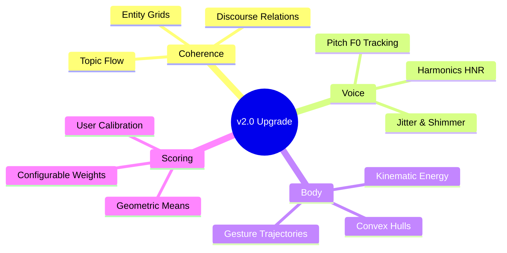
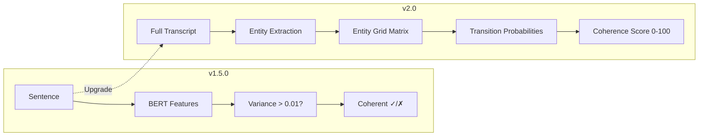
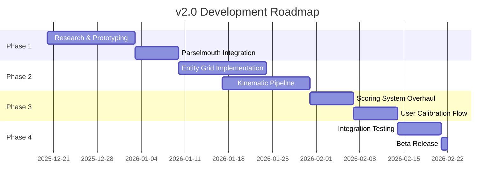

# 🚀 Roadmap v2.0 — Computational Paralinguistics + World-Class Memory

> **Target Release:** Q4 2026\
> **Codename:** "Beyond Words"\
> **Status:** 🚧 Development — Phase 2 AI engine SHIPPED (v1.7.0); pgvector memory not yet started

## ✅ What's Already Done (v1.7.0)

| Feature | Status | Merged |
|---------|--------|--------|
| Phase 2 AI engine (Parselmouth + kinematic) | ✅ Done | v1.7 |
| AI Companion (Gemini 2.0 Flash + streaming) | ✅ Done | v1.7 |
| Habit tracking system (streaks + logs)       | ✅ Done | v1.7 |
| Reflection memories (basic table)            | ✅ Done | v1.7 |
| Authenticity / incongruence detection        | ✅ Done | v1.7 |
| Semantic coherence (all-MiniLM-L6-v2)        | ✅ Done | v1.7 |

---

---

## 📊 Executive Summary

Version 2.0 represents a fundamental shift from **heuristic scoring** to
**computational paralinguistics** — the scientific study of vocal and non-verbal
communication patterns.



---

## 🎯 The Four Pillars of v2.0

### 1️⃣ Coherence: Entity Grids → Discourse Relations

| Aspect       | v1.5.0 (Current)           | v2.0 (Upgrade)                     |
| ------------ | -------------------------- | ---------------------------------- |
| **Method**   | BERT embedding variance    | Entity Grid analysis               |
| **Measures** | "Feature diversity"        | Actual discourse coherence         |
| **Model**    | Generic bert-base-uncased  | Fine-tuned CoLA or cross-encoder   |
| **Output**   | Binary coherent/incoherent | Coherence score + topic flow graph |

#### Technical Upgrade Path



**Key References:**

- Barzilay & Lapata (2008): Entity-based Coherence
- Guinaudeau & Strube (2013): Graph-based Coherence

---

### 2️⃣ Voice: RMS Volume → Acoustic Paralinguistics

| Aspect          | v1.5.0 (Current)   | v2.0 (Upgrade)                 |
| --------------- | ------------------ | ------------------------------ |
| **Energy**      | RMS amplitude only | F0 (pitch) contours            |
| **Quality**     | Not measured       | HNR (Harmonics-to-Noise Ratio) |
| **Variability** | Not measured       | Jitter & Shimmer               |
| **Library**     | NumPy basics       | Praat/Parselmouth or librosa   |

#### Acoustic Features to Extract

```python
# v2.0 Acoustic Pipeline (Conceptual)
from parselmouth import Sound
import parselmouth.praat as praat

def analyze_voice(audio_path):
    sound = Sound(audio_path)
    
    # Pitch (F0) - Fundamental frequency
    pitch = sound.to_pitch()
    f0_mean = praat.call(pitch, "Get mean", 0, 0, "Hertz")
    f0_std = praat.call(pitch, "Get standard deviation", 0, 0, "Hertz")
    
    # HNR - Harmonics-to-Noise Ratio (voice clarity)
    harmonicity = sound.to_harmonicity()
    hnr = praat.call(harmonicity, "Get mean", 0, 0)
    
    # Jitter - Pitch instability (nervousness indicator)
    point_process = praat.call(sound, "To PointProcess (periodic, cc)", 75, 500)
    jitter = praat.call(point_process, "Get jitter (local)", 0, 0, 0.0001, 0.02, 1.3)
    
    return {
        "f0_mean": f0_mean,
        "f0_variability": f0_std,
        "hnr": hnr,  # Higher = clearer voice
        "jitter": jitter  # Lower = more stable
    }
```

#### Interpretation Guide

| Metric               | Optimal Range | Meaning               |
| -------------------- | ------------- | --------------------- |
| **F0 Mean (Male)**   | 85-180 Hz     | Fundamental pitch     |
| **F0 Mean (Female)** | 165-255 Hz    | Fundamental pitch     |
| **F0 Variability**   | 20-40 Hz      | Monotone ↔ Expressive |
| **HNR**              | > 20 dB       | Voice clarity/quality |
| **Jitter**           | < 1%          | Pitch stability       |
| **Shimmer**          | < 3%          | Amplitude stability   |

---

### 3️⃣ Body: Static Ratios → Kinematic Analysis

| Aspect       | v1.5.0 (Current)           | v2.0 (Upgrade)             |
| ------------ | -------------------------- | -------------------------- |
| **Posture**  | neck_length/shoulder_width | Dynamic posture energy     |
| **Gestures** | Not measured               | Hand trajectory analysis   |
| **Sampling** | 1 FPS                      | 5-10 FPS                   |
| **Metrics**  | Ratio thresholds           | Convex hull area, velocity |

#### Kinematic Energy Formula

```python
# v2.0 Body Language Pipeline (Conceptual)
import numpy as np

def calculate_kinematic_energy(landmarks_sequence):
    """
    Calculate dynamic movement energy from landmark positions over time.
    
    landmarks_sequence: List of frames, each containing 33 MediaPipe landmarks
    """
    velocities = []
    
    for i in range(1, len(landmarks_sequence)):
        prev_frame = landmarks_sequence[i-1]
        curr_frame = landmarks_sequence[i]
        
        # Calculate velocity for each landmark
        frame_velocity = 0
        for j in range(len(curr_frame)):
            dx = curr_frame[j].x - prev_frame[j].x
            dy = curr_frame[j].y - prev_frame[j].y
            dz = curr_frame[j].z - prev_frame[j].z
            velocity = np.sqrt(dx**2 + dy**2 + dz**2)
            frame_velocity += velocity
        
        velocities.append(frame_velocity)
    
    return {
        "mean_kinematic_energy": np.mean(velocities),
        "peak_energy": np.max(velocities),
        "energy_variability": np.std(velocities)
    }

def calculate_gesture_space(hand_landmarks):
    """
    Calculate convex hull area of hand movements.
    Larger area = more expressive gestures.
    """
    from scipy.spatial import ConvexHull
    
    points = [(l.x, l.y) for l in hand_landmarks]
    hull = ConvexHull(points)
    
    return hull.volume  # 2D convex hull "volume" = area
```

#### Body Language Metrics (v2.0)

| Metric                | Description                    | Interpretation                   |
| --------------------- | ------------------------------ | -------------------------------- |
| **Kinematic Energy**  | Average landmark velocity      | Low = static, High = dynamic     |
| **Gesture Space**     | Convex hull of hand positions  | Bigger = more expressive         |
| **Head Stability**    | Nose landmark variance         | Low = focused, High = distracted |
| **Shoulder Symmetry** | L/R shoulder height difference | Low = confident posture          |

---

### 4️⃣ Scoring: Linear Averages → Geometric Means

| Aspect           | v1.5.0 (Current)         | v2.0 (Upgrade)                |
| ---------------- | ------------------------ | ----------------------------- |
| **Method**       | Weighted arithmetic mean | Geometric mean                |
| **Weights**      | Hardcoded (35/25/20/20)  | Configurable per user         |
| **Floor Effect** | No protection            | Minimum threshold enforcement |
| **Calibration**  | None                     | First-session baseline        |

#### Why Geometric Mean?

```javascript
// v1.5.0 (Current) - Arithmetic Mean
overallScore = (clarity * 0.35) + (confidence * 0.25) + (tone * 0.20) +
    (energy * 0.20);
// Problem: A 0 in one metric can be masked by others

// v2.0 (Upgrade) - Geometric Mean
overallScore = Math.pow(
    clarity * confidence * tone * energy,
    1 / 4, // 4th root for 4 metrics
);
// Benefit: All metrics must be non-zero for a good score
```

#### Configurable Weight Example

```javascript
// v2.0 User Profile Config
const userConfig = {
    weights: {
        clarity: 0.40, // User prioritizes clarity
        confidence: 0.30, // Important for presentations
        tone: 0.15, // Less focus on emotion
        energy: 0.15, // Less focus on volume
    },
    targets: {
        wpm: 160, // User speaks faster
        f0_variability: 30, // User prefers expressive tone
    },
};
```

---

## 📅 Implementation Timeline



---

## 📦 Dependency Changes

### New Python Dependencies

```txt
# requirements.txt additions for v2.0
parselmouth>=0.4.3      # Praat bindings for acoustic analysis
scipy>=1.11.0           # Convex hull calculations
networkx>=3.2           # Entity grid graph analysis
spacy>=3.7.0            # Entity extraction (en_core_web_sm)
```

### New Node.js Dependencies

```json
{
    "dependencies": {
        "@huggingface/inference": "^2.6.0" // Optional: Cloud fallback for heavy models
    }
}
```

---

## 🔬 Research References

1. **Entity Grids:** Barzilay, R., & Lapata, M. (2008). "Modeling Local
   Coherence: An Entity-Based Approach"
2. **Acoustic Paralinguistics:** Schuller, B., et al. (2013). "The INTERSPEECH
   2013 Computational Paralinguistics Challenge"
3. **Kinematic Analysis:** Mehta, Y., et al. (2019). "Gesture Recognition for
   Human-Robot Interaction"
4. **Geometric Scoring:** Combining research on multi-criteria decision analysis
   (MCDA)

---

## ⚠️ Migration Notes

> [!CAUTION]
> v2.0 will introduce **breaking changes** to the feedback schema. Historical
> data will require migration scripts.

### Schema Changes (Preview)

```sql
-- New columns in feedback table
ALTER TABLE feedback ADD COLUMN f0_mean FLOAT;
ALTER TABLE feedback ADD COLUMN f0_variability FLOAT;
ALTER TABLE feedback ADD COLUMN hnr FLOAT;
ALTER TABLE feedback ADD COLUMN kinematic_energy FLOAT;
ALTER TABLE feedback ADD COLUMN gesture_space FLOAT;
ALTER TABLE feedback ADD COLUMN coherence_graph JSONB;
```

---

_Roadmap document for v2.0 — Created December 19, 2025_
