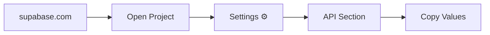
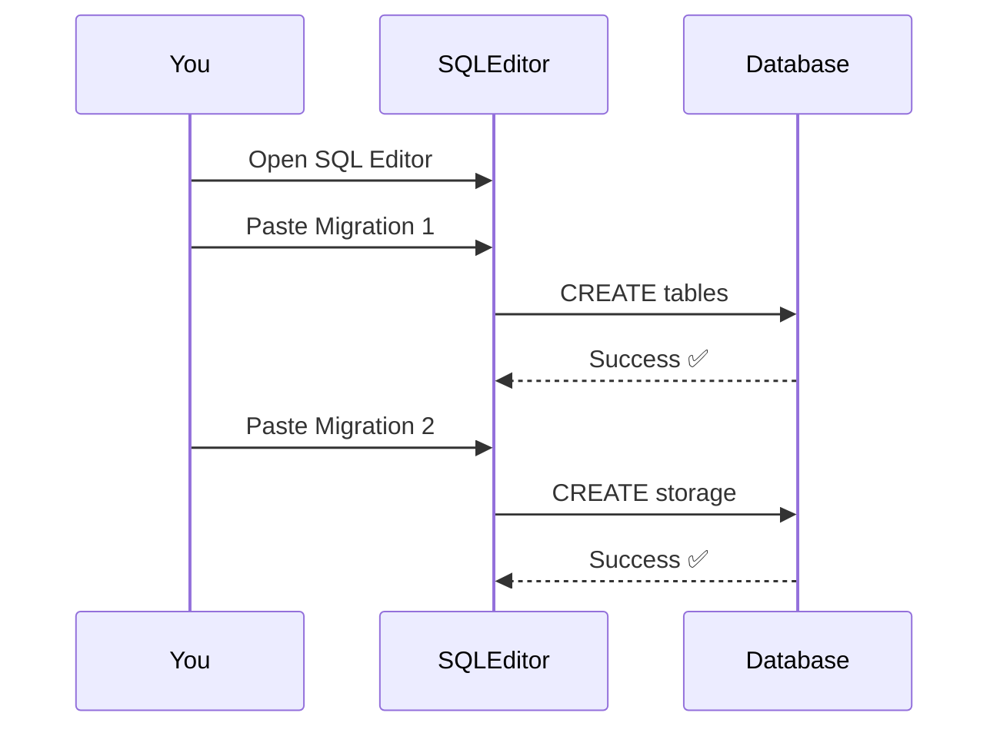
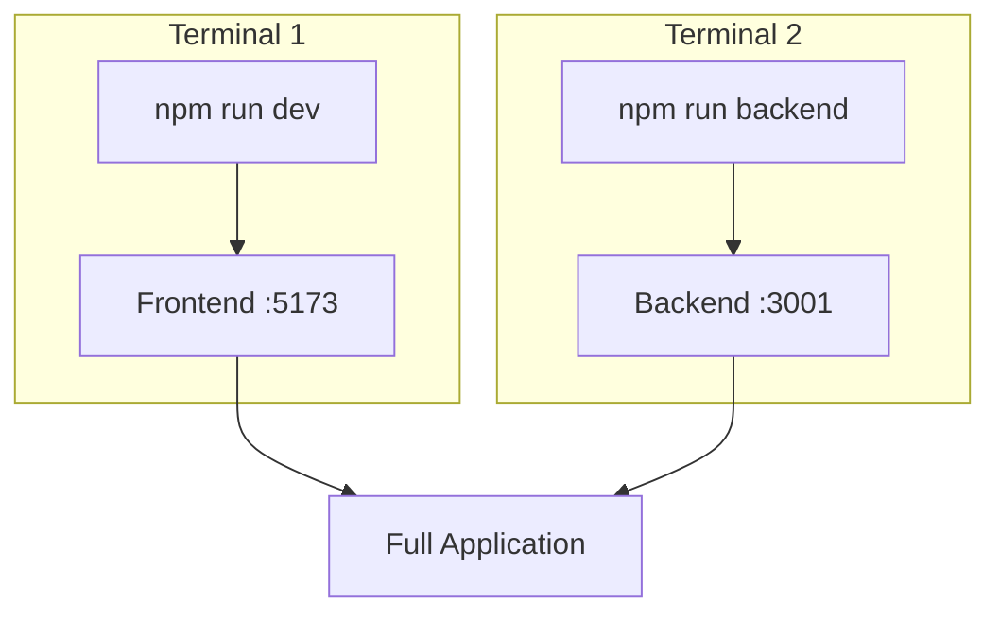
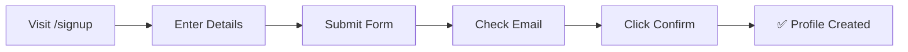

# ✅ Setup Checklist

## Complete Environment Setup Guide

**Difficulty Level**: Beginner to Intermediate\
**Time Required**: 15-20 minutes\
**Last Updated**: December 15, 2025

---

## 📋 Table of Contents

1. [Install Dependencies](#1-install-dependencies)
2. [Environment Variables](#2-environment-variables)
3. [Database Migrations](#3-database-migrations)
4. [Start Development](#4-start-development)
5. [Testing Checklist](#5-testing-checklist)
6. [Troubleshooting](#6-troubleshooting)

---

## Setup Progress Tracker

```
┌─────────────────────────────────────────────────────────────────────┐
│                      SETUP CHECKLIST                                │
├─────────────────────────────────────────────────────────────────────┤
│                                                                     │
│  ☐  Step 1: Install Dependencies                                   │
│  ☐  Step 2: Configure Environment Variables                        │
│  ☐  Step 3: Run Database Migrations                                │
│  ☐  Step 4: Start Development Server                               │
│  ☐  Step 5: Test All Features                                      │
│                                                                     │
└─────────────────────────────────────────────────────────────────────┘
```

---

## 1. Install Dependencies

### Frontend & Root

```bash
# Install root dependencies
npm install

# Frontend dependencies (if needed separately)
cd frontend && npm install
```

### Backend (Local AI Processor)

```bash
cd backend/local-processor
npm install

# Python dependencies
pip install faster-whisper mediapipe opencv-python numpy
```

---

## 2. Environment Variables

### Step 1: Create Environment File

```bash
cp .env.example .env
```

### Step 2: Configure Supabase Credentials



### Step 3: Add to `.env`

```env
# Frontend Environment Variables
VITE_SUPABASE_URL=https://your-project.supabase.co
VITE_SUPABASE_ANON_KEY=eyJhbGciOiJIUzI1NiIsInR5cCI6IkpXVCJ9...
VITE_SUPABASE_PROJECT_ID=your-project-id
```

**Where to find these:**

| Variable                   | Location in Supabase Dashboard     |
| -------------------------- | ---------------------------------- |
| `VITE_SUPABASE_URL`        | Settings → API → Project URL       |
| `VITE_SUPABASE_ANON_KEY`   | Settings → API → anon/public key   |
| `VITE_SUPABASE_PROJECT_ID` | URL: supabase.com/project/**[ID]** |

> [!IMPORTANT]
> All frontend environment variables **must** start with `VITE_` to be
> accessible in the browser.

---

## 3. Database Migrations

### Migration Execution Flow



### Migration 1: Initial Schema

**File:** `supabase/migrations/001_initial_schema.sql`

**Navigate to:**

```
https://supabase.com/dashboard/project/YOUR_PROJECT/sql
```

**What it creates:**

| Component          | Purpose                     |
| ------------------ | --------------------------- |
| `profiles` table   | User profiles with metadata |
| `recordings` table | Video recordings metadata   |
| `feedback` table   | AI analysis results         |
| `progress` table   | User progress tracking      |
| RLS Policies       | Row-level security          |
| Triggers           | Automatic profile creation  |

### Migration 2: Storage Setup

**File:** `supabase/migrations/002_storage_setup.sql`

**What it creates:**

| Component           | Purpose                     |
| ------------------- | --------------------------- |
| `recordings` bucket | Video file storage          |
| `thumbnails` bucket | Thumbnail images            |
| Storage Policies    | Upload/download permissions |

---

## 4. Start Development

### Development Servers



### Start Commands

| Terminal       | Command           | URL                   |
| -------------- | ----------------- | --------------------- |
| **Terminal 1** | `npm run dev`     | http://localhost:5173 |
| **Terminal 2** | `npm run backend` | http://localhost:3001 |

```bash
# Terminal 1: Frontend
npm run dev

# Terminal 2: Backend (if using local processor)
npm run backend
```

---

## 5. Testing Checklist

### 5.1 Test Signup



| Step | Action                      | Expected Result             |
| ---- | --------------------------- | --------------------------- |
| 1    | Go to `/signup`             | Signup form appears         |
| 2    | Enter name, email, password | Form accepts input          |
| 3    | Click Submit                | Confirmation sent           |
| 4    | Check email                 | Confirmation link received  |
| 5    | Click confirmation          | Account activated           |
| 6    | Check Supabase              | Profile in `profiles` table |

### 5.2 Test Recording

| Step | Action                  | Expected Result        |
| ---- | ----------------------- | ---------------------- |
| 1    | Go to `/record`         | Recording page loads   |
| 2    | Allow camera access     | Camera preview shows   |
| 3    | Click "Start Recording" | Recording begins       |
| 4    | Record 30+ seconds      | Timer counts up        |
| 5    | Click "Stop Recording"  | Recording stops        |
| 6    | Wait for upload         | Progress bar completes |
| 7    | Check Supabase Storage  | File visible in bucket |

### 5.3 Test Gallery

| Step | Action           | Expected Result        |
| ---- | ---------------- | ---------------------- |
| 1    | Go to `/gallery` | Gallery page loads     |
| 2    | View recordings  | Your recordings appear |
| 3    | Click play       | Video plays            |

### 5.4 Test Dashboard

| Step | Action             | Expected Result       |
| ---- | ------------------ | --------------------- |
| 1    | Go to `/dashboard` | Dashboard loads       |
| 2    | View stats         | Real statistics shown |
| 3    | Check charts       | Data visualized       |

---

## 6. Troubleshooting

### Quick Fixes

```
┌─────────────────────────────────────────────────────────────────────┐
│                    COMMON ISSUES & FIXES                            │
├─────────────────────────────────────────────────────────────────────┤
│                                                                     │
│  🎥 Camera not working?                                             │
│     ├── Grant browser camera permissions                            │
│     ├── Try Chrome (recommended)                                    │
│     └── Close other apps using camera                               │
│                                                                     │
│  📤 Upload failing?                                                 │
│     ├── Check Storage bucket exists                                 │
│     ├── Verify RLS policies                                         │
│     ├── Check console for errors                                    │
│     └── Ensure file size < 50MB                                     │
│                                                                     │
│  📊 No data showing?                                                │
│     ├── Verify migrations ran successfully                          │
│     ├── Check RLS policies                                          │
│     ├── Open browser console                                        │
│     └── Check Supabase project status                               │
│                                                                     │
│  🔑 Environment variables not working?                              │
│     ├── Ensure .env exists (not .env.example)                       │
│     ├── Restart dev server                                          │
│     └── Variables must start with VITE_                             │
│                                                                     │
└─────────────────────────────────────────────────────────────────────┘
```

> [!WARNING]
> Always restart your development server after changing environment variables!

---

## 📚 Additional Resources

| Document                                                 | Purpose              |
| -------------------------------------------------------- | -------------------- |
| [README.md](../README.md)                                | Project overview     |
| [QUICK_START.md](QUICK_START.md)                         | 5-minute setup       |
| [TECHNICAL_DOCUMENTATION.md](TECHNICAL_DOCUMENTATION.md) | Architecture details |
| [Backend README](../backend/README.md)                   | AI processor setup   |

---

## 🎉 Setup Complete!

Your application should now be fully functional:

| Feature                | Status                     |
| ---------------------- | -------------------------- |
| ✅ User authentication | Supabase Auth              |
| ✅ Video recording     | MediaRecorder API          |
| ✅ Cloud storage       | Supabase Storage           |
| ✅ Real-time analytics | Recharts + TanStack Query  |
| ✅ AI analysis         | faster-whisper + MediaPipe |

---

<div align="center">

**Next Step**: Integrate AI backend for video analysis and feedback!

See [Backend README](../backend/README.md) for local processor setup.

</div>
